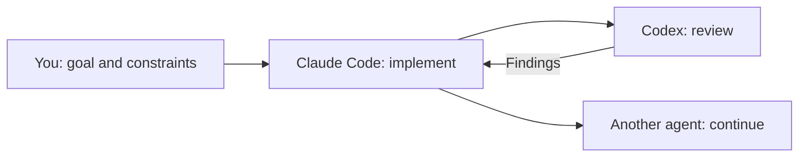
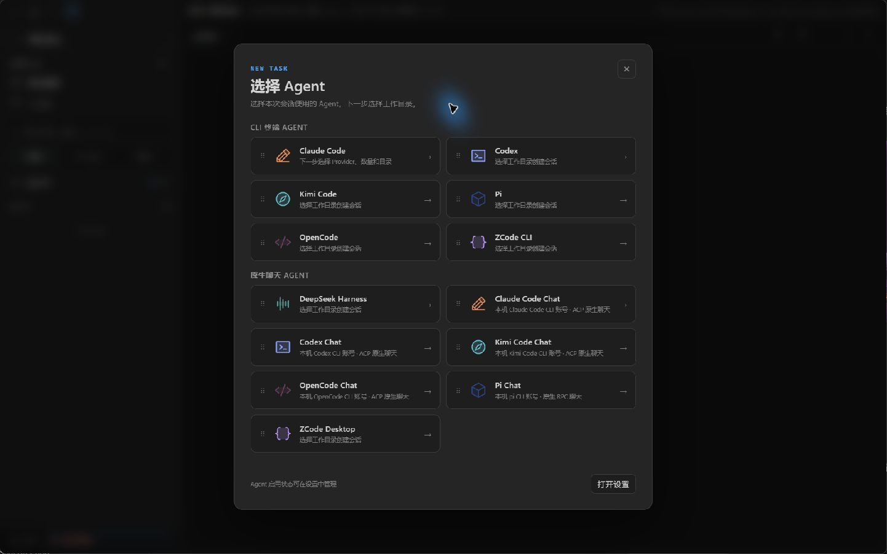

<div align="center">

# CrewVela

### Multiple agents. One workspace.

Let Claude Code implement, Codex review, and another agent pick up the next step.

[](CHANGELOG.md)
[](src-tauri/Cargo.toml)
[](package.json)
[](LICENSE)

[Get started](#get-started) · [See the workspace](#see-the-workspace) · [Workflow guide](docs/workflows.md) · [User guide](docs/user-guide.md) · [Join the community](#join-the-community) · [简体中文](README.md)

**Want your coding agents to work together? Star the project and come back to see what they can do next.**

</div>

CrewVela is a desktop workspace built with **Tauri 2, React, and Rust**. It brings separate agent sessions, messaging, project collaboration, and work handoffs into one window, while retaining each agent's local installation, accounts, and permission mechanisms.

> **Current version: v0.1.0.** The Windows installer is available on [GitHub Releases](https://github.com/token-hunter/CrewVela/releases/tag/v0.1.0). macOS can be built from source; its replacement package awaits native verification. See the [installation guide](docs/downloads.md).

## Give your agents a shared workspace

You may already use different agents for different jobs: building a feature, finding edge cases, or exploring another approach. CrewVela provides a place to organize those roles, pass messages, and hand work over.

| Your workflow | How to organize it |
| --- | --- |
| Implement and review with different agents | Open their sessions side by side and exchange changes and findings |
| Try another approach when an agent gets stuck | Preview a handoff, switch agents, and retain the source session's visible history |
| Move several tasks forward | Use a split workspace and optional Git worktrees for separate working directories |
| Organize a project by role | Track members, tasks, dependencies, collaboration messages, and diagnostics |
| Continue in a later session | Use session recovery and optional local shared-memory integration |

## From one request to a collaboration

One possible division of work; you choose the roles:



**Implement → review → send findings back → hand off.** Keep work in each agent's own session, use explicit recipients, and preview the handoff material before switching.

This diagram illustrates a workflow, not an execution record. Messaging requires supported sessions with the communication tools loaded. **Queued does not mean delivered, read, or answered.** See the [workflow guide](docs/workflows.md) for examples.

## See the workspace

### Choose an agent



Choose a CLI or native chat entry and organize different agents in one workspace. Switch tabs, arrange split views, and use session communication to choose message recipients.

<details>
<summary>See the session communication tutorial</summary>

Choose the sender and recipient, copy the example, and check the target session for the message and reply.

</details>

The picker was captured in an isolated native Windows test window without personal session content. It does not establish acceptance of every model or message delivery. See [media provenance](docs/media/README.md).

## What is in the workspace

| Capability | Purpose |
| --- | --- |
| **CLI and native chat** | Use different session types in one desktop workspace |
| **Session messaging** | Select recipients and use session discovery, message origins, and reply instructions |
| **Project collaboration** | Organize members, tasks, dependencies, messages, and diagnostics |
| **Work handoffs** | Prepare and preview context; stop the source session while retaining visible history |
| **Session and workspace management** | Split views, tabs, execution status, and optional Git worktrees |
| **Optional shared memory** | Connect a local memory service for later retrieval of project context |
| **Work tools** | Access files, terminals, a browser, and source-control entry points |

## Bring the agents you already use

These are the integration entry points implemented in the project. Availability depends on the installed CLI, adapter, account, and model configuration; this is not a full platform/model acceptance matrix.

| Agent | CLI terminal entry | Native chat entry |
| --- | --- | --- |
| Claude Code | Claude Code | Claude Code Chat |
| Codex | Codex CLI | Codex Chat |
| Kimi Code | Kimi Code | Kimi Code Chat |
| OpenCode | OpenCode | OpenCode Chat |
| Pi | Pi Agent | Pi Chat |
| ZCode | ZCode CLI | ZCode Desktop |
| DeepSeek Harness | — | DeepSeek Harness |

CrewVela does not include model subscriptions or agent accounts. The shared-memory quick setup currently targets Claude Code and Codex on Windows x64. See the [user guide](docs/user-guide.md) for other integration paths and requirements.

## Get started

### Pick your starting point

| Goal | Start here |
| --- | --- |
| Download the desktop app | [Installation and attachment status](docs/downloads.md) |
| Connect two agents | [Workflow guide](docs/workflows.md) |
| Configure sessions, models, and tools | [User guide](docs/user-guide.md) |
| Build and validate on Mac | [Mac handoff guide](MACOS-CODEX-HANDOFF.md) |
| Contribute | [Contributing guide](CONTRIBUTING.md) |

### Run from source

Prepare **Node.js 24, Rust stable**, and platform build tools. Windows needs MSVC C++ and WebView2; macOS needs Xcode Command Line Tools. Install and sign in to your chosen agent CLI first.

Run from the project root:

```sh
npm ci
npm run tauri -- dev
```

<details>
<summary>Windows and macOS build commands</summary>

**Windows:**

```sh
npm run tauri -- build --no-bundle
```

Output: `src-tauri/target/release/CrewVela.exe`, the application executable. The NSIS installer is a separate artifact; see [installation details](docs/downloads.md).

**macOS: run on an Apple Silicon Mac.**

```sh
rustup target add aarch64-apple-darwin
APPLE_SIGNING_IDENTITY=- npm run build:macos
```

Output directories:

- `.app`: `src-tauri/target/aarch64-apple-darwin/release/bundle/macos/`
- `.dmg`: `src-tauri/target/aarch64-apple-darwin/release/bundle/dmg/`

This uses an ad-hoc test signature, without Developer ID signing or notarization. See the [Mac guide](MACOS-CODEX-HANDOFF.md) for Intel commands and native acceptance. The [isolated first-run mode](docs/macos-isolated-test.md) disables real agents, accounts, and shared-memory operations.

</details>

### Connect two sessions in three steps

1. Open two supported agent sessions with working directories and distinct names.
2. Open **会话通信** (session communication), choose sender and recipient, and copy the generated instruction.
3. Paste it into the sender and check the recipient for the message and reply. Open communication diagnostics if needed.

Project members use the same entry point. Copying an example only writes to the clipboard. Fully quit the old instance before upgrading so two main processes do not share a data directory.

## Platform and release status

| Platform | Current validation |
| --- | --- |
| Windows x64 | Local source builds and regression passed; clean-machine installation and complete workflow acceptance pending |
| macOS Apple Silicon | Build, isolation, and normal-startup observations reported; installed-app normal exit and real agent/model acceptance remain open |
| macOS Intel / Linux | Native acceptance incomplete; no verified downloads offered |

The packages correspond to the `v0.1.0` tag; `main` includes subsequent updates. See the [release checklist](docs/release-checklist.md), [security policy](SECURITY.md), and [asset record](docs/asset-provenance.md) for platform validation, privacy cleanup, dependency findings, and asset provenance records.

## Common questions

**How do CLI and native chat differ?** Terminal entries preserve the CLI interaction. Native chat presents supported protocol sessions in a shared chat UI. Capabilities vary by agent and adapter.

**Does a handoff keep the original history?** The current flow stops the source session and retains its visible history while the receiving agent continues with the handoff material.

**Where do model requests run?** They go to the model service configured for that agent. A local desktop workspace does not imply offline inference.

**Where are keys and memory stored?** CrewVela-managed provider keys use the system credential store. External agents manage their own login state; shared memory is local by default. Third-party tools have their own configured data access. Keep credentials and private information out of public issues, screenshots, and logs.

## Help shape the workflow

The near-term priorities are clean-machine installation, bidirectional messaging, session recovery and handoff, native Mac regression, and signing/release work. Follow the [changelog](CHANGELOG.md).

| Your contribution | How it helps |
| --- | --- |
| **Star the project** | Bookmark it for future updates and help other developers discover it |
| **Describe a collaboration scenario** | Show which agents you want to work together and how |
| **Report a reproducible issue** | Identify a concrete CLI, platform, or model compatibility problem |
| **Contribute code or docs** | Improve integrations, guides, accessibility, and platform experience |

Read [CONTRIBUTING.md](CONTRIBUTING.md). Sanitize public reports and follow [SECURITY.md](SECURITY.md) for security issues.

## Join the community

Join our Chinese-language WeChat group to discuss agents, Vibe Coding, and multi-agent workflows, share projects, and exchange CrewVela tips.

<div align="center">


Scan with WeChat to join “Agent 交流群” · [Open full-size image](docs/media/wechat-agent-group.jpg)

</div>

The current group code is marked valid **before November 16, 2026**. If it has expired, open an issue to request an update. Remove credentials, account details, and personal information before sharing questions or screenshots.

## A drumstick for the author 🍗

<div align="center">


The agents are working. The author is waiting for dinner.

A star, a helpful report, or a contribution all count as a treat.

</div>

## License

CrewVela project code uses the [MIT License](LICENSE). See the [third-party notices](THIRD_PARTY_NOTICES.md) for dependency and asset information.
