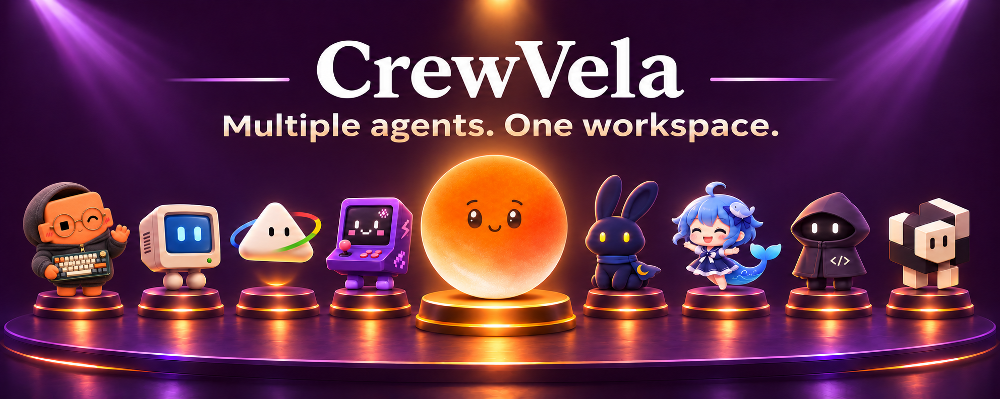
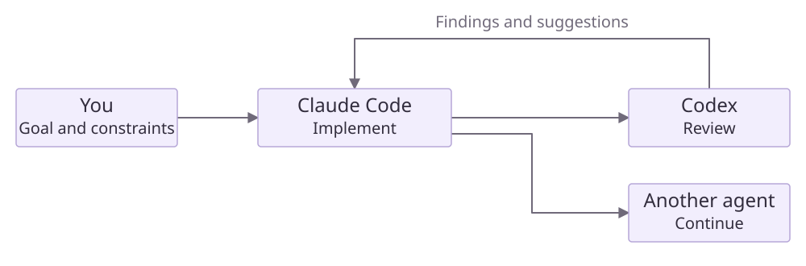

<div align="center">

# CrewVela

### Multiple agents. One workspace.

Let Claude Code implement, Codex review, and another agent pick up the next step.

[](CHANGELOG.md)
[](src-tauri/Cargo.toml)
[](package.json)
[](LICENSE)

[](docs/downloads.en.md)

[Watch the film](#see-crewvela-in-one-minute) · [Get started](#get-started) · [Workflow guide](docs/workflows.md) · [User guide](docs/user-guide.md) · [简体中文](README.md)

**Want your coding agents to work together? Star the project and come back to see what they can do next.**

</div>

CrewVela is a desktop workspace built with **Tauri 2, React, and Rust**. It brings separate agent sessions, messaging, project collaboration, and work handoffs into one window, while retaining each agent's local installation, accounts, and permission mechanisms.

> **The latest Windows x64 build is v0.1.2 Beta.** v0.1.0 Beta is available for macOS Apple Silicon. See [Download and install](docs/downloads.en.md) for links, checksums, and setup.

## See CrewVela in one minute

Play the film below to see multiple coding agents working in one workspace.

https://github.com/user-attachments/assets/a3eb08ee-a30e-4619-92aa-b2854f8d690f

Duration: 1 minute.

## Give your agents a shared workspace

You may already use different agents for different jobs: building a feature, finding edge cases, or exploring another approach. CrewVela provides a place to organize those roles, pass messages, and hand work over.

| Your workflow | How to organize it |
| --- | --- |
| Implement and review with different agents | Open their sessions side by side and exchange changes and findings |
| Try another approach when an agent gets stuck | Preview a handoff, switch agents, and retain the source session's visible history |
| Move several tasks forward | Use a split workspace and optional Git worktrees for separate working directories |
| Organize a project by role | Track members, tasks, dependencies, collaboration messages, and diagnostics |
| Deliver against acceptance criteria | Use automated project delivery to assign implementation, review, and integration, then run the configured checks and open a demo when available |
| Continue in a later session | Use session recovery and optional local shared-memory integration |

## How multiple agents work together

One possible division of work; you choose the roles:



**Implement → review → send findings back → hand off.** Keep work in each agent's own session, use explicit recipients, and preview the handoff material before switching.

This diagram illustrates a workflow, not an execution record. Messaging requires supported sessions with the communication tools loaded. **Queued does not mean delivered, read, or answered.** See the [workflow guide](docs/workflows.md) for examples.

For message flow and agent integration details, see the [technical architecture (Chinese)](docs/architecture.md).

## What is in the workspace

| Capability | Purpose |
| --- | --- |
| **CLI and native chat** | Use different session types in one desktop workspace |
| **Session messaging** | Select recipients and use session discovery, message origins, and reply instructions |
| **Project collaboration and delivery** | Open the project chat in Bot Mode. Run automated delivery with one agent or assign implementation, review, and integration across a team |
| **Work handoffs** | Prepare and preview context; stop the source session while retaining visible history |
| **Session and workspace management** | Split views, workspace search, session filters, and Git worktree management |
| **Optional shared memory** | Set up built-in local memory or use the legacy integrations to retrieve project context in later sessions |
| **Work tools** | Access files, terminals, the browser, source control, and multi-agent collaboration from the work panel |

## Bring the agents you already use

CrewVela connects to eight agent families. Availability depends on the installed CLI, adapter, account, and model configuration.

| Agent | CLI terminal entry | Native chat entry |
| --- | --- | --- |
| Claude Code | Claude Code | Claude Code Chat |
| Codex | Codex CLI | Codex Chat |
| Antigravity | Antigravity CLI | — |
| ZCode | ZCode CLI | ZCode Desktop |
| Kimi | Kimi Code CLI | Kimi Code Chat |
| DeepSeek Harness | — | DeepSeek Harness |
| OpenCode | OpenCode | OpenCode Chat |
| Pi | Pi Agent | Pi Chat |

CrewVela uses your existing agent accounts, subscriptions, and model settings. The runtime manager can install supported official CLIs such as Antigravity CLI, and detect or select an existing ZCode CLI installation. See [CLI installation and version management (Chinese)](docs/runtime-installation.md) and the [user guide (Chinese)](docs/user-guide.md).

## Get started

### Pick your starting point

| Goal | Start here |
| --- | --- |
| Download the desktop app | [Download and install](docs/downloads.en.md) |
| Connect two agents | [Workflow guide (Chinese)](docs/workflows.md) |
| Configure sessions, models, and tools | [User guide (Chinese)](docs/user-guide.md) |
| Build and validate on Mac | [Mac handoff guide](MACOS-CODEX-HANDOFF.md) |
| Contribute | [Contributing guide](CONTRIBUTING.md) |

### Run from source

Prepare **Node.js 24, Rust stable**, and platform build tools. Windows needs MSVC C++ and WebView2; macOS needs Xcode Command Line Tools. Install and sign in to your chosen agent CLI first.

Run from the project root:

```sh
npm ci
npm run tauri -- dev
```

<details>
<summary>Windows and macOS build commands</summary>

**Windows:**

```sh
npm run tauri -- build --no-bundle
```

Output: `src-tauri/target/release/CrewVela.exe`, the application executable. See [Download and install](docs/downloads.en.md) for the separate NSIS installer.

**macOS: run on an Apple Silicon Mac.**

```sh
rustup target add aarch64-apple-darwin
APPLE_SIGNING_IDENTITY=- npm run build:macos
```

Output directories:

- `.app`: `src-tauri/target/aarch64-apple-darwin/release/bundle/macos/`
- `.dmg`: `src-tauri/target/aarch64-apple-darwin/release/bundle/dmg/`

This uses an ad-hoc test signature, without Developer ID signing or notarization. See the [Mac guide](MACOS-CODEX-HANDOFF.md) for Intel commands and native acceptance. The [isolated first-run mode](docs/macos-isolated-test.md) disables real agents, accounts, and shared-memory operations.

</details>

### Connect two sessions in three steps

1. Open two supported agent sessions with working directories and distinct names.
2. Open **会话通信** (session communication), choose sender and recipient, and copy the generated instruction.
3. Paste it into the sender and check the recipient for the message and reply. Open communication diagnostics if needed.

Project members use the same entry point. Copying an example only writes to the clipboard. Fully quit the old instance before upgrading so two main processes do not share a data directory.

## Platform and release status

| Platform | Current validation |
| --- | --- |
| Windows x64 | An unsigned NSIS installer is available. See the release notes for verification details |
| macOS Apple Silicon | An ARM64 DMG is available. It is ad-hoc signed and has not been notarized by Apple |
| macOS Intel / Linux | Native acceptance incomplete; no verified downloads offered |

Source commits and SHA-256 files for each installer are listed on the [download page](docs/downloads.en.md) and the corresponding GitHub Release. See the [release checklist (Chinese)](docs/release-checklist.md), [security policy](SECURITY.md), and [asset record (Chinese)](docs/asset-provenance.md) for validation details.

## Common questions

**How do CLI and native chat differ?** Terminal entries preserve the CLI interaction. Native chat presents supported protocol sessions in a shared chat UI. Capabilities vary by agent and adapter.

**Does a handoff keep the original history?** The current flow stops the source session and retains its visible history while the receiving agent continues with the handoff material.

**Where do model requests run?** They go to the model service configured for that agent. A local desktop workspace does not imply offline inference.

**Where are keys and memory stored?** CrewVela-managed provider keys use the system credential store. External agents manage their own login state; shared memory is local by default. Third-party tools have their own configured data access. Keep credentials and private information out of public issues, screenshots, and logs.

## Help shape the workflow

| Your contribution | How it helps |
| --- | --- |
| **Star the project** | Bookmark it for future updates and help other developers discover it |
| **Describe a collaboration scenario** | Show which agents you want to work together and how |
| **Report a reproducible issue** | Identify a concrete CLI, platform, or model compatibility problem |
| **Contribute code or docs** | Improve integrations, guides, accessibility, and platform experience |

Read [CONTRIBUTING.md](CONTRIBUTING.md). Sanitize public reports and follow [SECURITY.md](SECURITY.md) for security issues.

### Join the Agent WeChat group

Scan with WeChat to join the Chinese-language discussion on agents and CrewVela. This QR code is valid until December 4, 2026.


[Open the full-size QR code](docs/media/wechat-agent-group.jpg)

### Contact the maintainer

For feedback, feature ideas, or collaboration, add me on WeChat at `weilegexinaaa`. Please include “CrewVela” in your contact request.

## A drumstick for the author 🍗

<div align="center">


The agents are working. The author is waiting for dinner.

A star, a helpful report, or a contribution all count as a treat.

</div>

## Star History

<a href="https://www.star-history.com/?repos=token-hunter%2FCrewVela&amp;type=date">
  <picture>
    <source media="(prefers-color-scheme: dark)" srcset="https://api.star-history.com/svg?repos=token-hunter/CrewVela&amp;type=Date&amp;theme=dark" />
    
  </picture>
</a>

## License

CrewVela project code uses the [MIT License](LICENSE). See the [third-party notices](THIRD_PARTY_NOTICES.md) for dependency and asset information.
