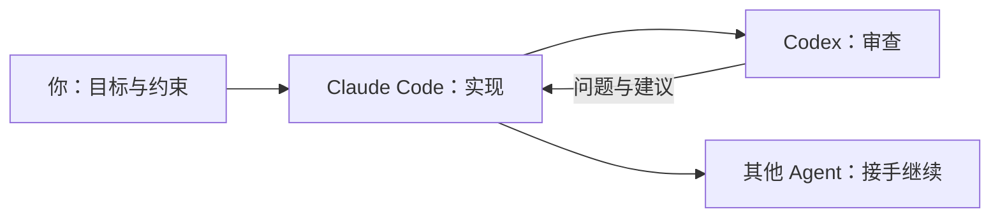
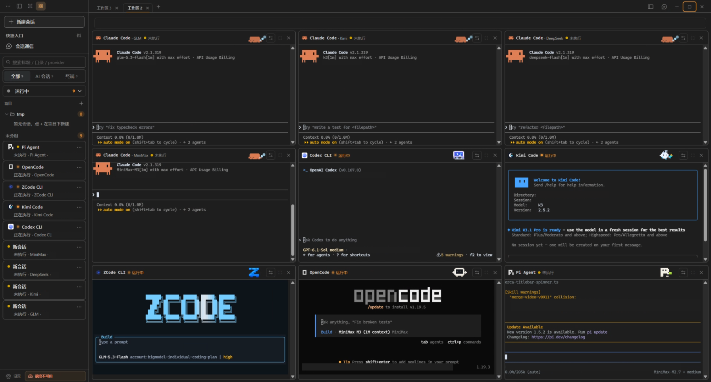
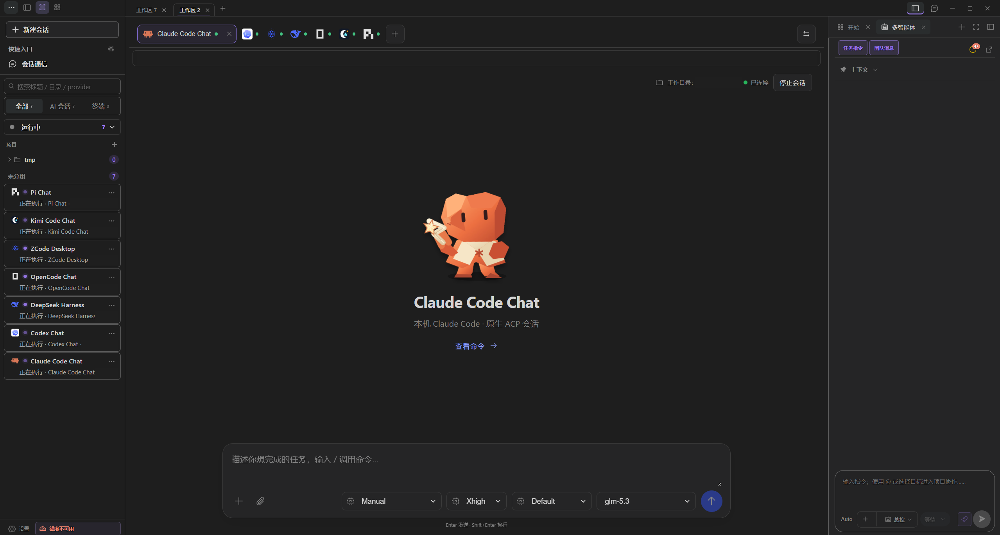
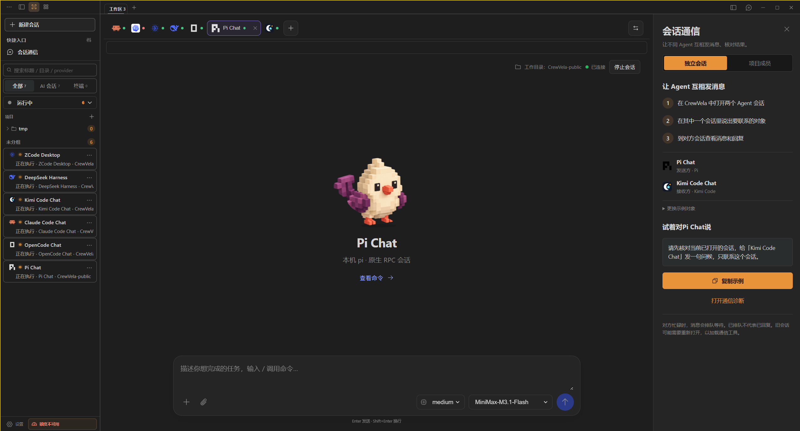
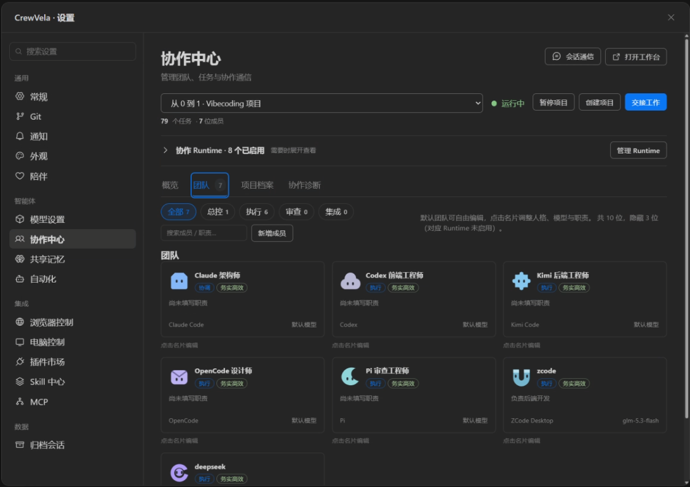

<div align="center">

# CrewVela

### 多个 Agent，一个工作台。

让 Claude Code 写代码，让 Codex 做审查，让其他 Agent 接着干。

[](CHANGELOG.md)
[](src-tauri/Cargo.toml)
[](package.json)
[](LICENSE)

[宣传片](#一分钟看-crewvela) · [开始使用](#开始使用) · [界面预览](#界面预览) · [协作玩法](docs/workflows.md) · [使用手册](docs/user-guide.md) · [English](README.en.md)

**如果你也想让多个编程 Agent 配合干活，点个 Star，方便回来看看它们又学会了什么。**

</div>

CrewVela 是一个基于 **Tauri 2 + React + Rust** 的桌面多 Agent 工作台，把独立会话、会话通信、项目协作和工作交接放进同一个窗口。沿用各 Agent 的本机安装、账号与权限机制，让你围绕任务组织工具。

> **当前版本 v0.1.0。** Windows 安装包见 [GitHub Releases](https://github.com/token-hunter/CrewVela/releases/tag/v0.1.0)；[下载 macOS Apple Silicon DMG](https://github.com/token-hunter/CrewVela/releases/download/v0.1.0/CrewVela_0.1.0_macos_aarch64.dmg)（ARM64，ad-hoc 签名，未公证）。安装步骤与验证限制见[下载说明](docs/downloads.md)。

## 一分钟看 CrewVela

点击下方播放器，看看多个 Agent 如何在一个工作台里协作。

https://github.com/user-attachments/assets/e0bcb281-1893-4359-b720-05e44055632c

约 1 分钟 · 原片画面与文字保持不变。

## 让你的 Agent 成为一支队伍

你可能已经在用好几个编程 Agent：一个擅长搭功能，一个适合挑问题，另一个更顺手处理某类任务。CrewVela 把它们放进同一个工作空间，让分工、沟通和交接都有对应的入口。

| 你想怎么干 | 在 CrewVela 里怎么组织 |
| --- | --- |
| 一个实现，一个 Review | 并排打开不同 Agent，让实现者说明改动，让审查者反馈问题 |
| 当前 Agent 卡住了，换个思路 | 预览交接资料，再交给另一个 Agent；保留来源会话的可见历史 |
| 同时推进几个任务 | 网格分屏查看会话；按需使用 Git worktree 分隔工作目录 |
| 把一个需求拆成多个角色 | 通过项目成员、任务依赖、协作消息和诊断查看进展 |
| 下次打开还能接着做 | 使用会话恢复，以及可选的本地共享记忆接入 |

## 从一个需求，到一场协作

下面是一种分工方式，具体角色由你决定：



**实现 → 审查 → 回传修复 → 交接继续。** 在各自会话中保留工作上下文，通过明确的目标传递消息；需要换人时，先看交接资料，再决定是否交接。

这是工作方式示意，不是自动执行记录。通信需要受支持且已加载工具的会话；**已排队不等于已送达、已读或回复**。完整示例见[三种协作玩法](docs/workflows.md)。

## 界面预览

### 多 Agent 分屏工作台



把 Claude Code、Codex、OpenCode、ZCode CLI 等会话并排放进同一窗口，快速查看各自的状态与输出。右侧工作面板提供文件、终端、浏览器和多智能体入口。

### 原生聊天与标签切换



在统一聊天界面切换不同 Agent，保留各自的会话标签与历史；右侧协作面板用于组织任务和团队消息。



Pi Chat 原生 RPC 会话与会话通信面板同屏展示：选择发送方和接收方、复制通信示例，再到目标会话核对消息与回复。

<details>
<summary>查看会话通信教程</summary>

从左侧「会话通信」入口选择对象、复制示例，再到目标会话核对消息与回复。

</details>

以上截图均为 Windows 实拍，已遮挡本机路径与历史任务文字；图中外观以拍摄时版本为准。

### 协作中心与团队管理



在同一页面查看项目状态、Agent 成员与角色，按总控、执行、审查等角色筛选团队；通过成员名片调整配置，并从顶部管理 Runtime 或发起工作交接。界面以截图时的版本为准。

## 工作台里有什么

| 能力 | 用来做什么 |
| --- | --- |
| **CLI 与原生聊天** | 在同一个桌面工作区使用不同类型的 Agent 会话 |
| **会话通信** | 选择发送方与接收方，使用会话列表、消息来源和回复指引对齐对象 |
| **项目协作** | 按成员、任务和依赖组织工作，查看协作消息与诊断 |
| **工作交接** | 准备并预览交接资料；来源会话停止运行，历史仍可见 |
| **会话与工作区管理** | 网格分屏、标签切换、状态展示，以及可选的 Git worktree 隔离 |
| **共享记忆（可选）** | 接入本地记忆服务，支持后续会话检索项目上下文 |
| **工作工具** | 在工作面板访问文件、终端、浏览器及源码控制入口 |

## 接入你已经在用的 Agent

下表展示项目提供的接入入口，实际可用性取决于 CLI、适配器、账号与模型配置；不是全平台、全模型的验收承诺。

| Agent | CLI 终端入口 | 原生聊天入口 |
| --- | --- | --- |
| Claude Code | Claude Code | Claude Code Chat |
| Codex | Codex CLI | Codex Chat |
| Kimi Code | Kimi Code | Kimi Code Chat |
| OpenCode | OpenCode | OpenCode Chat |
| Pi | Pi Agent | Pi Chat |
| ZCode | ZCode CLI | ZCode Desktop |
| DeepSeek Harness | — | DeepSeek Harness |

CrewVela 不附送模型、订阅或 Agent 账号。共享记忆快速配置目前面向 Windows x64 的 Claude Code / Codex；其他接入方式与条件见[使用手册](docs/user-guide.md)。

## 开始使用

### 选择你的入口

| 想做什么 | 从这里开始 |
| --- | --- |
| 下载桌面应用 | [安装说明与附件状态](docs/downloads.md) |
| 体验两个 Agent 互相联系 | [协作玩法](docs/workflows.md) |
| 查配置、会话与工具的用法 | [完整使用手册](docs/user-guide.md) |
| 在 Mac 上构建与验收 | [Mac 指南](MACOS-CODEX-HANDOFF.md) |
| 参与开发 | [贡献指南](CONTRIBUTING.md) |

### 从源码运行

准备 **Node.js 24、Rust stable** 和平台构建工具。Windows 需要 MSVC C++ 与 WebView2；Mac 需要 Xcode Command Line Tools。先在系统终端安装并登录要使用的 Agent CLI。

在项目根目录运行：

```sh
npm ci
npm run tauri -- dev
```

<details>
<summary>Windows 与 macOS 打包命令</summary>

**Windows：**

```sh
npm run tauri -- build --no-bundle
```

输出：`src-tauri/target/release/CrewVela.exe`，为应用本体。NSIS 安装向导另见[安装说明](docs/downloads.md)。

**macOS：在 Apple Silicon Mac 上执行。**

```sh
rustup target add aarch64-apple-darwin
APPLE_SIGNING_IDENTITY=- npm run build:macos
```

输出目录：

- `.app`：`src-tauri/target/aarch64-apple-darwin/release/bundle/macos/`
- `.dmg`：`src-tauri/target/aarch64-apple-darwin/release/bundle/dmg/`

该命令使用 ad-hoc 测试签名，未做 Developer ID 签名或公证。Intel 命令及原生验收步骤见 [Mac 指南](MACOS-CODEX-HANDOFF.md)。需要空白首次启动效果时使用[独立测试目录](docs/macos-isolated-test.md)；该模式停用真实 Agent、账号与共享记忆操作。

</details>

### 三步让 Agent 互相联系

1. 新建两个受支持的 Agent 会话，为它们选择工作目录和易辨认的名称。
2. 点击 **会话通信**，选择发送方和目标，复制对应指令。
3. 在发送方粘贴指令，到目标会话核对消息和回复；需要时打开通信诊断。

项目成员也可以使用这一入口。复制教程只写入剪贴板，不会直接发消息。升级前从旧窗口或托盘完整退出旧版，避免多个主程序使用同一数据目录。

## 当前平台与发布状态

| 平台 | 当前验证范围 |
| --- | --- |
| Windows x64 | 本机源码构建与回归通过；干净机器安装与完整业务验收待完成 |
| macOS Apple Silicon | 已提供 ARM64 DMG，ad-hoc 签名、未公证；原生界面完整交互、安装副本正常退出与真实 Agent/模型等仍待验收 |
| macOS Intel / Linux | 未完成原生验收，当前不提供已验证安装包 |

安装包对应 `v0.1.0` 标签，`main` 分支包含后续更新。平台验收、隐私脱敏、依赖风险与素材来源的核对记录见[发布检查清单](docs/release-checklist.md)、[安全说明](SECURITY.md)及[素材记录](docs/asset-provenance.md)。

## 常见问题

**CLI 终端和原生聊天有什么区别？** 终端入口保留对应 CLI 的交互方式；原生聊天将受支持协议的会话放进统一聊天界面。具体能力随 Agent 和适配器而异。

**交接之后，原来的记录还在吗？** 当前交接流程会停止来源会话，并保留其可见历史；接手 Agent 继续处理交接资料。详细行为见使用手册。

**模型请求在哪里运行？** 请求发送到你为对应 Agent 配置的模型服务。CrewVela 是本机桌面工作台，不代表模型离线推理。

**密钥和记忆保存在哪里？** CrewVela 管理的 Provider key 使用系统凭据库，外部 Agent 自行管理登录状态；共享记忆默认保存在本机。第三方工具的数据访问行为取决于其配置。不要在 Issue、截图或日志中上传凭据与私人数据。

## 接下来，一起把工作流打磨好

近期重点是：干净机器安装、双 Agent 双向通信、会话恢复与交接、Mac 原生回归，以及签名与发布流程。版本变化见[更新记录](CHANGELOG.md)。

| 你的参与 | 对项目的帮助 |
| --- | --- |
| **点个 Star** | 收藏项目，方便回来跟进更新，也帮助更多人发现它 |
| **描述一个协作场景** | 告诉我们你希望哪几个 Agent 怎样配合 |
| **提交可复现的问题** | 帮助定位具体 CLI、平台或模型组合的兼容问题 |
| **贡献代码或文档** | 改善接入、教程、无障碍和平台体验 |

从[贡献指南](CONTRIBUTING.md)开始。公开反馈前请先脱敏；安全问题按 [SECURITY.md](SECURITY.md) 处理。

## 给作者加个鸡腿 🍗

<div align="center">


Agent 在干活，作者在等开饭。

一个 Star、一条反馈、一份贡献，都是给作者加餐。

</div>

## 开源许可

CrewVela 项目代码采用 [MIT 许可证](LICENSE)。第三方依赖与素材的相关说明，请参阅[第三方声明](THIRD_PARTY_NOTICES.md)。
