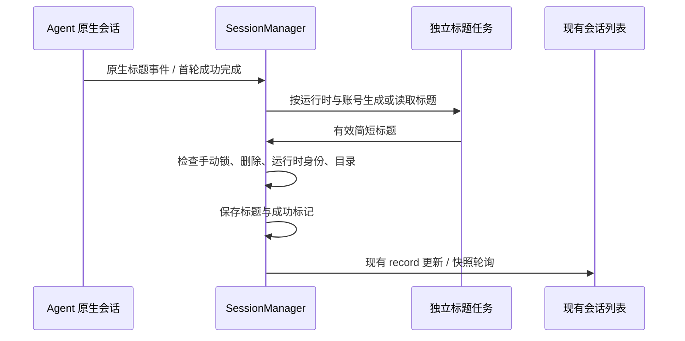

# 其他 Agent 会话的简短标题

本轮扩展原生 Chat 的 Claude Code、Codex、Kimi、OpenCode、Pi 和 DeepSeek Harness。ZCode 已有链路保持不变，CLI 布局、前端及 CSS 不属于本次改动。

## 标题来源

| 会话 | 生成和同步方式 |
| --- | --- |
| Claude Code Chat | 使用本地 Claude 的登录配置和已选模型，独立 `-p` 任务；禁工具、safe mode、不保存会话 |
| Codex Chat | 复用 Codex 自己的临时结构化线程设计；独立 app-server、ephemeral、只读、关闭工具/MCP/hooks/skills/插件；校验会话、轮次和成功终态 |
| Kimi Chat | 当前模型明确绑定 `managed:kimi-code` 时，使用当前 OAuth 账号的官方 `chat_title` 专用接口；不执行 Agent 工具，不写入聊天历史 |
| OpenCode Chat | 接收 ACP 原生标题事件；首轮完成后也按精确上游会话 ID 从原生数据库读取已生成标题 |
| Pi Chat | 使用当前 Pi 登录配置和已选模型，独立 `--print --no-session --no-tools --no-extensions --no-mcp --no-skills --no-context-files` 任务 |
| DeepSeek Harness | 在当前连接的临时 patch 中开启已有 `session-title-llm`；控制桥同步 `sessionTitle` 的 provider 来源，忽略 fallback 名称 |

原生 ACP 会话标题通知可以刷新会话记录。Kimi 的通知还包含 `replaceable` 的首条输入占位标题，不能据此标记摘要成功，否则会阻止首轮完成后的真正标题任务。

普通 Claude CLI 已有 provider 摘要流程继续复用；本地 Claude CLI 使用其自身配置。Pi CLI 通过已有完成事件生成独立摘要。Codex、Kimi、OpenCode CLI 在 **CrewVela 已取得精确原生会话定位** 时，同步相应标题索引或数据库。缺少定位时不按目录或“最新会话”猜测，部分未提供定位事件的普通 CLI 尚不能自动同步；这不等同于所有 CLI 已端到端支持。

Kimi 自定义 API 模型、非默认 OAuth 存储槽、非大陆区官方服务器和未登录账号暂不走托管标题接口；失败保留当前名称，不借用其他 Agent 的账号或密钥。默认槽的过期令牌按 Kimi 官方刷新协议处理，更新前核对原凭据；原生进程更新或用户退出登录优先，不覆盖新账号，也不恢复已删除的登录。

## 状态与持久化

`SessionManager` 是 CrewVela 会话名称的唯一保存者。首个成功完成的用户轮次派发一次请求，成功标题和去重标记一并保存到 `sessions.json`；重启后不重复调用模型。摘要失败保留当前名称，当前运行周期不反复重试；下次启动后可以再次尝试。

手动名称优先；项目协作 Agent 原有锁定身份不改。后台结果检查运行时、目录和原生身份，删除、归档、退休或切换后的会话不会收到旧摘要。保存失败回滚内存标题和成功标记。标题控制字符被拒绝。

原生标题读取只访问精确 ID 的元数据；SQLite 只读打开，不读取其他会话正文，不修改原生数据库。Codex 独立线程收到工具、审批、错误终态或其他会话/轮次通知时立即失败。Claude/Pi 的 stdout/stderr 同时读取并限制输出，超时终止进程树，避免摘要任务阻塞正常聊天。

Windows 的 npm `.cmd` 摘要入口改为直接调用同一安装的 Node 脚本，保留多行提示和用户文本原义，不经过 `cmd /c` 解释；不认识的包装器拒绝生成，保留原名称。

## 验证

针对性回归覆盖：多运行时派发去重、成功标记跨重启恢复、手动名称、删除及过期身份保护；Codex 无工具配置、提前到达的通知、工具项、错会话、错轮次及失败终态；Kimi replaceable 名称不阻止真正摘要；Harness 控制桥标题元数据及原有聊天行为。

安装版 Codex 的无模型验证只建立临时线程，不发送模型消息。Kimi 的独立 smoke test 只发送合成请求给官方标题接口，不写入会话历史。Mock、编译和无模型检查不能代替各 Agent 的真实账号模型和桌面点击验收。

2026-10-14 实测：标题回归 26 项通过；会话相关回归 104 项通过、2 项默认忽略；Pi 原生聊天 5 项通过；Harness 控制桥 Node 回归通过。Codex、Kimi、Pi 各一次合成输入的真实标题生成成功，Codex 和 Harness 安装版无模型检查成功。`cargo check` 无错误，保留 33 个既有警告；前端构建通过。

过程中的内存不足编译中断已通过单并发重跑解决；Kimi 的过期令牌 401 和 Pi 的 Windows 包装器空输出都已修复并由真实请求验证。Claude/OpenCode/DeepSeek 的真实模型生成、所有 Agent 的原生桌面列表显示，以及缺少精确定位的普通 CLI 仍未端到端验收。本轮未打包，此说明记录源码与测试结果。
