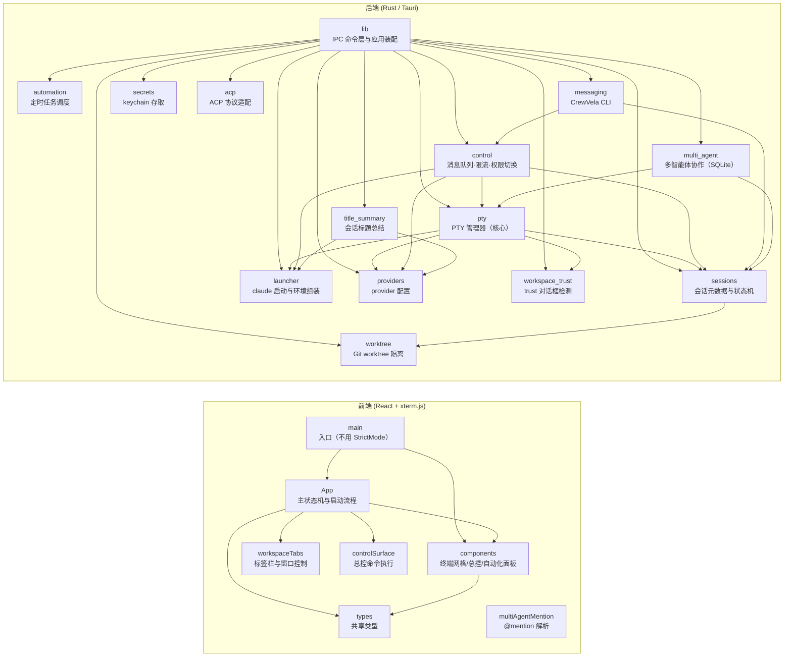

# CrewVela 架构图

> 生成于 2026-08-09 · 32 个模块 · 37 条依赖边 · 交互版：[arch-map.html](./arch-map.html)

## 模块职责

### 后端 `src-tauri/src/`

| 模块 | 文件数 | 职责 |
|------|--------|------|
| `lib` | 1 | Tauri 命令层：launch_multi/pty_poll_all 等 IPC 入口与应用装配 |
| `pty` | 1 | PTY 管理器：portable-pty 拉起 claude 进程，输出缓冲与自动 trust 确认 |
| `control` | 1 | 会话动作队列：消息投递（文本与回车分两次写）、互发限流、权限模式切换 |
| `sessions` | 1 | 会话元数据持久化：状态机、标题生成、hook 事件摄取 |
| `automation` | 1 | 定时任务调度：一次性/间隔/每天/每周/cron 触发，熔断与运行历史 |
| `multi_agent` | 7 | 多智能体协作：项目/任务/运行/评审的 SQLite 持久化与执行器 |
| `messaging` | 1 | CrewVela CLI：sessions 列表与 send 消息投递 |
| `launcher` | 1 | claude 启动：resolve_claude、ANTHROPIC_* 环境变量组装 |
| `providers` | 1 | provider 配置：5 个内置 provider 的加载与自动迁移 |
| `secrets` | 1 | API key 的 keychain 存取（keyring） |
| `acp` | 1 | ACP 协议适配：外部 agent 编辑器协议接入 |
| `worktree` | 1 | Git worktree 隔离：会话独立工作区的创建与清理 |
| `workspace_trust` | 1 | claude workspace trust 对话框的输出检测 |
| `title_summary` | 1 | 会话标题总结：调 claude 生成标题并清洗 |
| `clipboard_image` | 1 | 剪贴板位图编码为 PNG 临时文件 |
| `edge_speech` | 1 | Edge 在线 TTS 语音合成 |
| `native_speech` | 1 | Windows 原生语音识别（WinRT SpeechRecognition） |
| `livekit_voice` | 1 | LiveKit 房间令牌生成（语音通话） |

### 前端 `src/`

| 模块 | 文件数 | 职责 |
|------|--------|------|
| `components` | 21 | React 组件库：终端网格、总控面板、自动化面板等全部 UI |
| `App` | 1 | 前端主状态机：provider 选择到多会话网格的启动流程 |
| `types` | 1 | 前端共享 TypeScript 类型定义 |
| `main` | 2 | 前端入口：React 挂载（故意不用 StrictMode） |
| `controlSurface` | 1 | 总控命令面板的意图解析与执行 |
| `workspaceTabs` | 1 | 工作区标签栏与无边框窗口控制按钮 |
| `multiAgentMention` | 1 | @mention 的解析、补全与替换 |
| `multiAgentDraftState` | 1 | 总控消息草稿状态管理 |
| `multiAgentTaskPresentation` | 1 | 多智能体任务的展示层格式化 |
| `livekitVoice` | 1 | 前端 LiveKit 语音通话逻辑 |
| `pet-preview` | 1 | 宠物预览页面 |

### 其他

| 模块 | 职责 |
|------|------|
| `assets` / `styles` | 样式与静态资源（非代码模块） |
| `tools` | 辅助工具脚本（LiveKit agent） |
| `src-tauri` | Rust 构建脚本（build.rs）与 app 图标 |
| `vite.config` | Vite 构建配置 |

## 架构解读

- **枢纽**：`lib` 是后端唯一的装配点（17 条出边），所有能力模块被它直接引用；前端对应枢纽是 `components`（21 个文件）。
- **分层**：前端 `App → components → types` 单向；后端 `lib → 能力模块 → 基础模块（launcher/providers/sessions）`，能力模块之间少有横向依赖。
- **横向依赖仅 4 处**：`pty → sessions/workspace_trust`、`control → pty/sessions`、`messaging → control`、`multi_agent → pty/sessions`——都是合理的上层调下层。
- **无循环依赖**（模块级）。
- 外部重度依赖（未进图）：`pty` → portable-pty，`multi_agent` → rusqlite，`secrets` → keyring，`automation` → cron/chrono。
