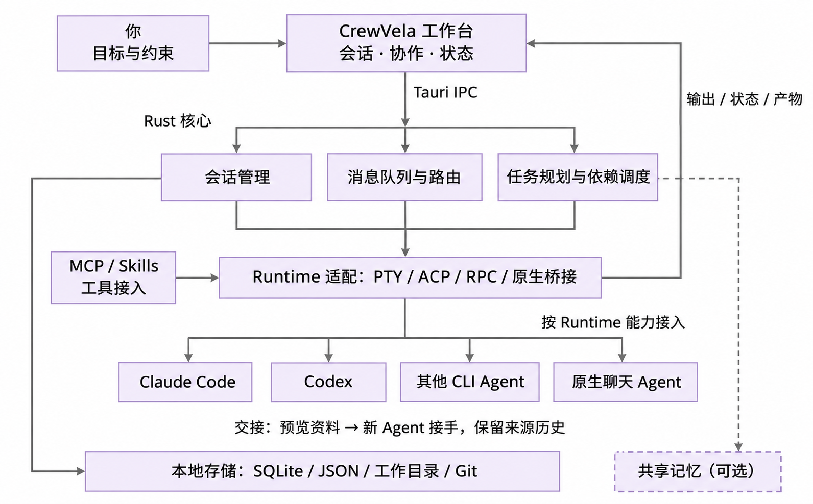

# CrewVela 技术架构

[返回首页](../README.md) · [协作玩法](workflows.md) · [Runtime 会话通信](runtime-cli-communication.md)

CrewVela 的桌面工作台负责组织会话和呈现状态，Rust 核心负责会话管理、消息投递与项目调度，再通过不同的 Runtime 适配方式连接本机 Agent。

图中连线表示模块间的主要关系，并非每次请求都会经过全部模块；不同 Runtime 的协议和能力也有所不同。

## 模块与实现入口

| 模块 | 负责什么 | 代码入口 |
| --- | --- | --- |
| 桌面工作台与 IPC | React 界面调用 Tauri 命令，展示会话、协作与执行状态 | [前端](../src)、[Tauri 命令与事件接入](../src-tauri/src/lib.rs) |
| 会话管理 | 管理会话记录与终端进程，结合各类原生会话实现启动、停止和恢复 | [会话记录](../src-tauri/src/sessions.rs)、[PTY](../src-tauri/src/pty.rs) |
| 消息队列与路由 | 发现目标会话、校验发送方、持久化排队，并按接收方状态投递 | [队列与控制](../src-tauri/src/control.rs)、[CLI 消息](../src-tauri/src/messaging.rs)、[会话 MCP](../src-tauri/src/session_mcp.rs) |
| 任务规划与依赖调度 | 按项目、成员、任务和依赖组织工作，调度对应 Runtime 执行 | [多 Agent 模块](../src-tauri/src/multi_agent) |
| Runtime 适配 | 通过 PTY、ACP、Pi RPC 或原生桥接连接不同 Agent，按其能力处理输入与输出 | [PTY](../src-tauri/src/pty.rs)、[ACP 会话](../src-tauri/src/native_acp_sessions.rs)、[Pi 会话](../src-tauri/src/native_pi_sessions.rs)、[ZCode 会话](../src-tauri/src/native_zcode_sessions.rs) |
| MCP 与 Skills | 为会话接入工具，并管理 Skill 的配置与分发 | [MCP](../src-tauri/src/mcp.rs)、[Skill 中心](../src-tauri/src/skill_center.rs) |
| 工作交接 | 准备和预览资料，在确认后由新 Agent 接手，保留来源会话历史 | [交接实现](../src-tauri/src/session_switch.rs) |
| 本地存储与可选共享记忆 | 使用 SQLite、JSON 和工作目录保存不同类型的记录；可选接入本地记忆服务 | [项目数据库](../src-tauri/src/multi_agent/store.rs)、[共享记忆](../src-tauri/src/ai_memory.rs)、[Git 工作区](../src-tauri/src/worktree.rs) |

## 两条主要工作路径

**定向通信：** 选择接收会话 → 校验身份与目标 → 消息落盘排队 → 按 Runtime 能力与会话状态投递 → 展示结果和状态。直接通信不要求先经过 LLM 任务规划；发送成功表示已接受排队，不表示对方已经处理或回复。

**项目协作：** 需求与成员配置 → 任务规划 → 依赖与执行状态检查 → Runtime 执行 → 记录任务结果和产物。它与定向通信共用部分会话和接入能力，但不是同一条执行链。

交接是单独的确认流程：先预览交接资料，再停止来源会话并由接手 Agent 继续；来源历史仍可查看，不表示完整上下文会无损合并。共享记忆是可选接入，不是所有会话启动的必经步骤。

## 数据与权限边界

应用记录和工作文件主要保存在用户本机；模型请求仍发往对应 Agent 配置的服务，本地存储不等于离线推理。各 Agent 的账号、模型、工具与权限取决于其本地安装和配置。

图示是代码结构说明，不是端到端运行证明。通信机制与限制见 [Runtime 会话通信](runtime-cli-communication.md)，平台和安装包验证范围见[发布检查清单](release-checklist.md)。
