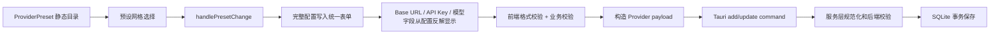

# CC Switch“添加新供应商”源码链路与 CrewVela 重构建议

## 研究基线

- 上游仓库：`farion1231/cc-switch`
- 固定提交：`7e152d758b52d2b9d25cd37bcb8f2f514a3f4038`
- 核对日期：2026-08-11
- 范围：只分析 Claude Code 供应商的预设选择、自动填充、校验、保存和编辑；不把 CC Switch 的 Codex、Gemini、OpenCode、OpenClaw、Hermes、统一供应商和本地代理能力带入 CrewVela。
- 许可证：上游采用 MIT License，允许参考、修改和分发，但如果复制实质性代码，应保留许可证与版权声明。[固定提交下的 LICENSE](https://github.com/farion1231/cc-switch/blob/7e152d758b52d2b9d25cd37bcb8f2f514a3f4038/LICENSE#L1-L21)

## 核心结论

CC Switch 的便利性来自一条明确的数据流：



CrewVela 应借鉴的是“**受限预设目录 + 选择后生成完整草稿 + 新建/编辑共用表单和验证器**”，不是照搬 CC Switch 的多应用供应商框架。CrewVela 目前只有 Kimi、GLM、DeepSeek、MiniMax、自定义五种类型，预设选择区不需要搜索、排序、赞助商标签、统一供应商标签页或 API 格式路由。

## 一、供应商预设的数据结构

CC Switch 的 `ProviderPreset` 不只是显示名称，而是一份可以生成完整配置的模板，包含：

- `name`、`websiteUrl`、`apiKeyUrl`；
- `settingsConfig`，Claude Code 场景中主要是 `env`；
- `category`；
- `apiKeyField`，允许在 `ANTHROPIC_AUTH_TOKEN` 与 `ANTHROPIC_API_KEY` 之间选择；
- `templateValues`、`endpointCandidates`；
- 图标和颜色；
- `apiFormat`、特殊 provider 类型等高级信息。

定义见 [`ProviderPreset`](https://github.com/farion1231/cc-switch/blob/7e152d758b52d2b9d25cd37bcb8f2f514a3f4038/src/config/claudeProviderPresets.ts#L24-L57)。

对 CrewVela 有直接价值的字段只有：

```ts
type SupportedProviderKind = "kimi" | "glm" | "deepseek" | "minimax" | "custom";

interface ProviderPresetDefinition {
  kind: SupportedProviderKind;
  name: string;
  baseUrl: string;
  authTokenRef: string;
  env: Record<string, string>;
  timeoutMs: number | null;
  disableNonessentialTraffic: boolean;
  websiteUrl?: string;
}
```

`authTokenRef` 应继续表示 CrewVela 系统凭据管理器中的引用，不把明文 API Key 放进预设或 `providers.json`。

## 二、五种类型在上游预设中的对应关系

| CrewVela 类型 | CC Switch 固定提交中的对应预设 | 预设自动填充内容 | CrewVela 的处理建议 |
|---|---|---|---|
| Kimi | `Kimi For Coding` | `https://api.kimi.com/coding/`、`ANTHROPIC_AUTH_TOKEN`、四档模型映射、256K 压缩窗口参数 | 使用 Coding 预设；API Key 仍写系统凭据管理器 |
| GLM | `Zhipu GLM` 或 `Zhipu GLM en` | 国内/国际 Endpoint、`ANTHROPIC_AUTH_TOKEN`、四档 GLM 模型映射 | CrewVela 应只保留产品当前选定区域的一套 Endpoint，避免在“仅五类”约束下再增加第六个卡片 |
| DeepSeek | `DeepSeek` | `https://api.deepseek.com/anthropic`、Key 占位、主模型与 Haiku 快速模型映射 | 可直接采用预设生成方式，但模型 ID 应由 CrewVela 自己维护和测试 |
| MiniMax | `MiniMax` / `MiniMax en` | 国内/国际 Endpoint、Key 占位、超时、关闭非必要流量、四档模型映射 | 根据 CrewVela 当前发行区域保留一套，不复制双预设 |
| 自定义 | `custom` 分支 | 清空为默认表单，让用户填写全部字段 | 保留手动配置和高级环境变量编辑能力 |

上游证据：

- Kimi 与 Kimi For Coding 的 Endpoint、Key 字段和模型映射见 [`claudeProviderPresets.ts`](https://github.com/farion1231/cc-switch/blob/7e152d758b52d2b9d25cd37bcb8f2f514a3f4038/src/config/claudeProviderPresets.ts#L59-L116)。
- DeepSeek 预设见 [`claudeProviderPresets.ts`](https://github.com/farion1231/cc-switch/blob/7e152d758b52d2b9d25cd37bcb8f2f514a3f4038/src/config/claudeProviderPresets.ts#L791-L807)。
- Zhipu GLM 国内/国际预设见 [`claudeProviderPresets.ts`](https://github.com/farion1231/cc-switch/blob/7e152d758b52d2b9d25cd37bcb8f2f514a3f4038/src/config/claudeProviderPresets.ts#L831-L865)。
- MiniMax 国内/国际预设见 [`claudeProviderPresets.ts`](https://github.com/farion1231/cc-switch/blob/7e152d758b52d2b9d25cd37bcb8f2f514a3f4038/src/config/claudeProviderPresets.ts#L1015-L1064)。

这些值是固定提交中的上游快照，不应视为永久权威值。CrewVela 在落地前仍应按对应厂商官方文档和真实连接测试确定模型 ID；本次应借鉴“配置集中在预设目录”的方式，而不是无条件同步 CC Switch 的最新模型名称。

## 三、分类与选择 UI 的实际实现

### 3.1 预设目录转换为 UI 条目

`ProviderForm` 根据当前应用选择相应的预设数组；Claude 场景会过滤隐藏项，并生成 `claude-{index}` 的临时选择 ID。[预设条目构造](https://github.com/farion1231/cc-switch/blob/7e152d758b52d2b9d25cd37bcb8f2f514a3f4038/src/components/providers/forms/ProviderForm.tsx#L681-L714)

选择器支持搜索和排序。原始排序模式按“官方 → 顶级合作伙伴 → 其他合作伙伴 → 其余按名称”组织。[排序实现](https://github.com/farion1231/cc-switch/blob/7e152d758b52d2b9d25cd37bcb8f2f514a3f4038/src/components/providers/forms/ProviderPresetSelector.tsx#L85-L136)

UI 首先提供“自定义配置”按钮，再把可见预设渲染为网格按钮；点击后仅上报预设 ID，由表单负责后续填充。[自定义和预设按钮](https://github.com/farion1231/cc-switch/blob/7e152d758b52d2b9d25cd37bcb8f2f514a3f4038/src/components/providers/forms/ProviderPresetSelector.tsx#L394-L450)

### 3.2 CrewVela 的简化方式

CrewVela 只有五项，应使用固定的单行或双行选择卡：

1. Kimi
2. GLM
3. DeepSeek
4. MiniMax
5. 自定义

不需要搜索、排序、类别提示、赞助商角标和“统一供应商”标签页。预设数量少时，这些功能只会增加认知和维护成本。

## 四、选择预设后如何自动填充

### 4.1 上游真实调用链

`ProviderPresetSelector` 调用 `onPresetChange(entry.id)` 后，进入 `ProviderForm.handlePresetChange`：

1. 写入 `selectedPresetId`；
2. 如果选择 `custom`，清除活动预设并恢复默认值；
3. 否则从 `presetEntries` 找到预设；
4. 记录 category、合作伙伴元数据；
5. Claude 场景对模板变量求值；
6. 设置 API 格式、Key 字段类型；
7. 用预设中的名称、官网、完整 `settingsConfig`、图标重置表单。

自定义分支见 [`handlePresetChange` 前半段](https://github.com/farion1231/cc-switch/blob/7e152d758b52d2b9d25cd37bcb8f2f514a3f4038/src/components/providers/forms/ProviderForm.tsx#L1744-L1787)，Claude 预设写入见 [`handlePresetChange` Claude 分支](https://github.com/farion1231/cc-switch/blob/7e152d758b52d2b9d25cd37bcb8f2f514a3f4038/src/components/providers/forms/ProviderForm.tsx#L1902-L1924)。

### 4.2 字段为何能立即显示正确值

CC Switch 没有为每个预设分别写一套表单逻辑，而是把 `settingsConfig` 作为单一草稿源：

- `useBaseUrlState` 监听配置变化，从 `env.ANTHROPIC_BASE_URL` 反解 URL；编辑 URL 时再写回同一份 JSON。[Base URL 同步](https://github.com/farion1231/cc-switch/blob/7e152d758b52d2b9d25cd37bcb8f2f514a3f4038/src/components/providers/forms/hooks/useBaseUrlState.ts#L34-L102)
- `useApiKeyState` 从配置提取 Key，输入变化时按已有字段或 `apiKeyField` 写回配置。[API Key 状态同步](https://github.com/farion1231/cc-switch/blob/7e152d758b52d2b9d25cd37bcb8f2f514a3f4038/src/components/providers/forms/hooks/useApiKeyState.ts#L29-L79)
- Key 工具优先读取 `ANTHROPIC_AUTH_TOKEN`，其次读取 `ANTHROPIC_API_KEY`；写回时也优先更新已有字段。[Key 读取](https://github.com/farion1231/cc-switch/blob/7e152d758b52d2b9d25cd37bcb8f2f514a3f4038/src/utils/providerConfigUtils.ts#L183-L228) 与 [Key 写回](https://github.com/farion1231/cc-switch/blob/7e152d758b52d2b9d25cd37bcb8f2f514a3f4038/src/utils/providerConfigUtils.ts#L307-L371)
- `useModelState` 从 `env` 解析主模型、Haiku、Sonnet、Opus 和子 Agent 模型；预设切换造成配置外部变化时，会同步所有显示字段。[模型解析与同步](https://github.com/farion1231/cc-switch/blob/7e152d758b52d2b9d25cd37bcb8f2f514a3f4038/src/components/providers/forms/hooks/useModelState.ts#L38-L173)

### 4.3 CrewVela 应采用更简单的草稿模型

CrewVela 已有扁平的 `ProviderConfig`：`baseUrl`、`authTokenRef`、`env`、`timeoutMs`、`disableNonessentialTraffic`。无需复制 CC Switch 的“JSON 字符串表单 → 多 Hook 反解 → 再拼 JSON”结构。

建议直接实现纯函数：

```ts
function createProviderDraftFromPreset(
  preset: ProviderPresetDefinition,
): ProviderConfig {
  return {
    id: preset.kind,
    name: preset.name,
    baseUrl: preset.baseUrl,
    authTokenRef: preset.authTokenRef,
    env: { ...preset.env },
    timeoutMs: preset.timeoutMs,
    disableNonessentialTraffic: preset.disableNonessentialTraffic,
    builtin: true,
  };
}
```

选择卡只更新一次完整草稿；表单受控字段直接绑定 `draft.baseUrl` 和 `draft.env`。这样能获得 CC Switch 的自动填充体验，同时保留 CrewVela 当前更简单的类型系统。

## 五、API Key、Endpoint 与模型映射的处理

### API Key

CC Switch 的预设在 `settingsConfig.env` 中放一个空 Key 字段，用户输入后将明文写回配置，最终 `settingsConfig` 整体进入数据库。该模式可从 [预设中的 Key 占位](https://github.com/farion1231/cc-switch/blob/7e152d758b52d2b9d25cd37bcb8f2f514a3f4038/src/config/claudeProviderPresets.ts#L76-L116)、[表单 Key 写回](https://github.com/farion1231/cc-switch/blob/7e152d758b52d2b9d25cd37bcb8f2f514a3f4038/src/utils/providerConfigUtils.ts#L307-L371) 和 [数据库保存完整配置](https://github.com/farion1231/cc-switch/blob/7e152d758b52d2b9d25cd37bcb8f2f514a3f4038/src-tauri/src/database/dao/providers.rs#L180-L278) 串起来确认。

CrewVela 不应照搬：继续使用系统凭据管理器保存 API Key，`ProviderConfig` 只保存 `authTokenRef`。新建时用户只需输入 Key；编辑时 Key 输入框留空表示保持现有凭据。

### Endpoint

CC Switch 的主 Endpoint 来自预设 `settingsConfig`，还允许 `endpointCandidates` 进入 `meta.custom_endpoints`，用于测速和自动选择。[候选 Endpoint 汇总](https://github.com/farion1231/cc-switch/blob/7e152d758b52d2b9d25cd37bcb8f2f514a3f4038/src/components/providers/AddProviderDialog.tsx#L169-L308)

CrewVela 当前只需每种类型一个官方 Endpoint，因此第一版不需要 `endpointCandidates`、测速或自动选路。应保留“高级设置”中的 Endpoint 编辑，以处理厂商变更、代理地址和地区差异。

### 模型映射

CC Switch 把 Claude Code 的模型角色映射直接放进预设 `env`，选择预设后整份写入表单；模型编辑器只是读取和修改相同 `env`。CrewVela 可直接采用这一原则：每个预设拥有完整的 `env` 默认值，用户无需逐条添加环境变量。

不应把“模型名称”和“供应商类型”混成同一个 ID。更稳妥的模型是：

- `provider.kind`：`kimi | glm | deepseek | minimax | custom`，决定使用哪个预设；
- `provider.id`：具体配置实例 ID；
- `provider.env`：可覆盖的模型角色映射。

如果产品确定每种供应商永远只允许一个配置实例，可以暂时让 `id === kind`；如果未来可能同时配置同厂商的不同账号或地区 Endpoint，应现在就把两者分开。

## 六、校验与保存链路

### 6.1 前端校验

CC Switch 的基础 Zod schema 只硬校验官网 URL、配置非空且为合法 JSON。[`providerSchema`](https://github.com/farion1231/cc-switch/blob/7e152d758b52d2b9d25cd37bcb8f2f514a3f4038/src/lib/schemas/provider.ts#L38-L58)

业务层再检查供应商名、模板变量、Endpoint、API Key 等。非官方 Claude 供应商缺 Endpoint 或 Key 时，会加入软问题列表。[业务校验](https://github.com/farion1231/cc-switch/blob/7e152d758b52d2b9d25cd37bcb8f2f514a3f4038/src/components/providers/forms/ProviderForm.tsx#L1016-L1046) 与 [Endpoint/Key 检查](https://github.com/farion1231/cc-switch/blob/7e152d758b52d2b9d25cd37bcb8f2f514a3f4038/src/components/providers/forms/ProviderForm.tsx#L1264-L1328)

这些问题允许用户点击“仍要保存”绕过。[软校验确认框](https://github.com/farion1231/cc-switch/blob/7e152d758b52d2b9d25cd37bcb8f2f514a3f4038/src/components/providers/forms/ProviderForm.tsx#L2635-L2680)

### 6.2 CrewVela 的校验建议

CrewVela 的范围固定，第一版应比 CC Switch 更严格：

- Kimi、GLM、DeepSeek、MiniMax：名称、合法 `http/https` Endpoint、API Key 或已有凭据必须存在；
- 自定义：名称、合法 Endpoint、API Key 或已有凭据必须存在；模型映射可以为空；
- `env` 的 Key 去空格、拒绝空 Key；
- `timeoutMs` 为空或正整数；
- 内置类型的 `id/kind` 不允许在编辑页改变；
- 编辑时空 Key 表示保持，不应清除已有 Key；明确点击“清除凭据”才删除。

不建议第一版复制“缺 Endpoint/Key 仍可保存”。CrewVela 的五种供应商都是可直接连接 Claude Code 的明确配置，保存无效条目只会把错误延迟到启动会话时。

### 6.3 保存管线

CC Switch 的表单先规范化 `settingsConfig` 和元数据，再交给 `AddProviderDialog` 生成 Provider payload。[表单 payload 构造](https://github.com/farion1231/cc-switch/blob/7e152d758b52d2b9d25cd37bcb8f2f514a3f4038/src/components/providers/forms/ProviderForm.tsx#L1356-L1648) 与 [添加对话框二次组装](https://github.com/farion1231/cc-switch/blob/7e152d758b52d2b9d25cd37bcb8f2f514a3f4038/src/components/providers/AddProviderDialog.tsx#L112-L317)

新增 mutation 为普通应用生成 UUID，调用 Tauri `add_provider` 并刷新缓存。[新增 mutation](https://github.com/farion1231/cc-switch/blob/7e152d758b52d2b9d25cd37bcb8f2f514a3f4038/src/lib/query/mutations.ts#L19-L145)；API 包装见 [`providersApi.add/update`](https://github.com/farion1231/cc-switch/blob/7e152d758b52d2b9d25cd37bcb8f2f514a3f4038/src/lib/api/providers.ts#L49-L75)。

后端命令只做类型解析和服务转发。[Tauri add/update command](https://github.com/farion1231/cc-switch/blob/7e152d758b52d2b9d25cd37bcb8f2f514a3f4038/src-tauri/src/commands/provider.rs#L38-L60) 服务层负责规范化、校验、保存和必要时写入 live 配置。[ProviderService.add](https://github.com/farion1231/cc-switch/blob/7e152d758b52d2b9d25cd37bcb8f2f514a3f4038/src-tauri/src/services/provider/mod.rs#L2551-L2598)

CrewVela 可以保留当前 `save_provider` + `set_key` 的总体边界，但应把以下逻辑放到唯一服务函数中，避免 UI 与后端各自维护一份规则：

1. 根据 `presetKind` 取得受支持预设；
2. 合并允许用户覆盖的名称、Endpoint、模型映射、超时；
3. 后端再次验证；
4. 保存 `ProviderConfig`；
5. 若传入新 Key，则写系统凭据管理器；
6. 任一步失败时返回明确错误，并避免出现“配置已保存、Key 未保存”的半成品状态。

## 七、编辑已有供应商

CC Switch 新建和编辑共用 `ProviderForm`，但编辑时不再显示预设选择器，避免编辑一个已有供应商时误切换成另一类型。[仅新建显示预设选择器](https://github.com/farion1231/cc-switch/blob/7e152d758b52d2b9d25cd37bcb8f2f514a3f4038/src/components/providers/forms/ProviderForm.tsx#L1955-L1973)

编辑页会优先尝试读取当前生效的 live 配置；代理接管、OpenCode 等场景则回退数据库 SSOT，避免把代理生成的配置误保存回供应商。[编辑初始配置加载](https://github.com/farion1231/cc-switch/blob/7e152d758b52d2b9d25cd37bcb8f2f514a3f4038/src/components/providers/EditProviderDialog.tsx#L43-L170)

提交时在原 Provider 上覆盖名称、官网、配置、图标和元数据，然后调用统一更新动作。[编辑提交](https://github.com/farion1231/cc-switch/blob/7e152d758b52d2b9d25cd37bcb8f2f514a3f4038/src/components/providers/EditProviderDialog.tsx#L172-L242) 服务层重新规范化和校验，并处理 ID 变化限制。[ProviderService.update](https://github.com/farion1231/cc-switch/blob/7e152d758b52d2b9d25cd37bcb8f2f514a3f4038/src-tauri/src/services/provider/mod.rs#L2601-L2688)

CrewVela 可直接借鉴“新建时选预设、编辑时不切类型”的规则：

- 新建页顶部显示五个类型卡；
- 选择非自定义类型后，默认只展示名称和 API Key，把 Endpoint、模型映射、超时放进“高级设置”；
- 编辑页显示只读的供应商类型标签，不再显示五选一；
- 提供“恢复当前类型默认配置”按钮，但必须二次确认，而且不能清除 Key；
- 预设升级不得在应用启动时静默覆盖用户已编辑的 Endpoint 或模型映射。

## 八、可以直接借鉴的部分

1. **预设作为完整配置模板**：Endpoint、Key 字段类型、模型映射、超时和流量开关集中定义，不在 UI 事件里散落硬编码。
2. **自定义与预设共用一个草稿结构**：自定义只是空模板，不是另一套保存管线。
3. **选择预设后一次性重置完整草稿**：避免逐字段异步更新产生混合配置。
4. **新建和编辑共用表单与后端验证器**：降低两条路径行为不一致的风险。
5. **编辑时隐藏预设选择器**：防止修改配置时意外改变供应商类型。
6. **前后端双重验证**：前端提供即时反馈，后端不信任前端 payload。
7. **后端保存前规范化**：去除首尾空格、清理空 env、统一 URL 尾斜杠和超时表达。

## 九、不应照搬的部分

1. **多应用分支**：CC Switch 同时处理多个 CLI，`ProviderForm` 已超过两千行；CrewVela 只管理 Claude Code 兼容供应商，不应引入 `appId` 分支矩阵。
2. **统一供应商标签页**：CrewVela 当前没有“一份配置同步到多个应用”的需求。
3. **搜索、排序、合作伙伴和推广信息**：五个固定类型无需这些产品机制。
4. **API 格式转换、本地代理和 OAuth 特殊供应商**：当前四个内置供应商都走 Anthropic 兼容 Endpoint，自定义第一版也应明确只支持这一协议。
5. **把明文 Key 放进 Provider 配置**：CrewVela 已有系统凭据管理器，安全边界更好。
6. **缺 Key/Endpoint 仍可保存**：固定五类没有必要保留无效草稿。
7. **完整复制上游预设值**：模型 ID 和 Endpoint 会变化，CrewVela 应在自己的预设目录中独立版本化和验证。
8. **直接按数组下标生成预设 ID**：`claude-{index}` 会随数组排序变化；CrewVela 应使用稳定的语义 ID。

## 十、建议的最小重构边界

### 前端

- 新建 `providerPresets.ts`：只导出五种稳定预设。
- 新建 `ProviderPresetPicker`：五个选择卡，无搜索和分类。
- 重构 `ProviderEditor`：支持 `mode: "create" | "edit"`、`presetKind`、高级设置折叠。
- 新建纯函数 `createProviderDraftFromPreset`、`mergeProviderDraft`、`validateProviderDraft`。
- 编辑模式不允许切换 `presetKind`；Key 留空保持原值。

### Rust

- 把五个默认配置从 `default_providers()` 的大段字面量集中成稳定预设定义或构造函数。
- 新增后端校验：ID、名称、URL、env、timeout、受支持类型。
- 保存 API 明确区分“未提交新 Key”“设置新 Key”“显式删除 Key”。
- 为五种预设生成、用户覆盖合并、编辑保持 Key、非法 URL、空 env key、错误 preset kind 增加测试。

### 数据迁移

- 现有五个内置 ID 保持不变，避免会话记录、启动预设和用量统计失联。
- 新增 `presetKind` 或由稳定 ID 推导；自定义条目显式标为 `custom`。
- 迁移只补元数据，不覆盖现有 `baseUrl/env`。
- 新预设默认值只用于新建或用户主动点击“恢复默认”，不能在 `load()` 时静默覆盖老用户配置。

## 最终判断

CrewVela 可以直接参考 CC Switch 的交互和调用链，但实现应缩减为一个很小的本地预设系统。最合适的结果不是移植 CC Switch 的 `ProviderForm`，而是让 CrewVela 的现有 `ProviderConfig` 成为统一草稿，五个预设负责生成默认值，系统凭据管理器负责 Key，新增和编辑共用一套强校验与保存逻辑。
