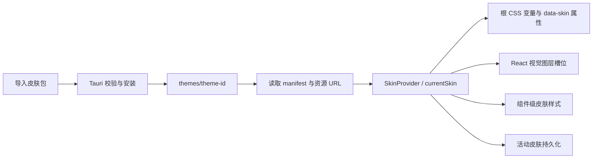

> 历史研究记录：皮肤功能已于 2026-11-15 按用户要求从 CrewVela 移除。本文保留当时源码研究，不代表当前产品能力。

# Codex QQ Skin 换肤机制与 CrewVela 差距研究

> 研究日期：2026-08-12  
> 参考仓库：[`zhulin025/Codex-QQ-Skin`](https://github.com/zhulin025/Codex-QQ-Skin/tree/6ba087781c7e11a9176a4aced607d0e3ff10a5ed)，固定提交 `6ba087781c7e11a9176a4aced607d0e3ff10a5ed`，本地副本 `REFERENCE_ROOT/Codex-QQ-Skin` 与公开仓库提交一致。
> CrewVela 基线：`.` 当前工作树；相关皮肤文件尚未提交，因此本文引用当前文件路径和行号，而不把 `32be6b212f7ba802a69342c9a54aaa8226ff392a` 错当作这些文件的提交版本。
> 证据范围：用户指定官网、公开仓库固定提交、本地两套源码。本文没有使用第三方测评或教程。

## 1. 结论

用户的判断成立：CrewVela 当前把“主题预设”和“皮肤”混在了一起，还没有实现参考项目意义上的完整换肤。

参考项目的“换皮肤”是一条完整链路：

1. 皮肤是一个带 `theme.json` 和多张分层图片的包，不是几组颜色枚举。
2. 引擎先严格校验清单、图片、路径、体积和 ZIP 结构，再安装到本机皮肤库。
3. 应用皮肤时，将背景、右侧人物、侧栏人物、水印、品牌徽章等资源转换为运行时 URL，并把受控布局参数映射成 CSS 变量。
4. 注入的 CSS 覆盖真实应用的外壳、侧栏、主内容、标题区、输入框、对话卡、选中态和响应式布局；注入脚本还会识别实际 DOM、挂载装饰节点、监听路由和尺寸变化并持续修复状态。
5. 皮肤库、当前活动皮肤、运行状态和窗口内模式分别持久化，热应用与重启后的结果要求一致。

这一结论由 V2 皮肤包约定、校验器、注入器、渲染脚本和验收矩阵共同证明，而不是来自官网宣传文案。[V2 包约定](https://github.com/zhulin025/Codex-QQ-Skin/blob/6ba087781c7e11a9176a4aced607d0e3ff10a5ed/skills/codex-deep-skin-builder/references/theme-pack-v2.md#L1-L38)；[验收矩阵](https://github.com/zhulin025/Codex-QQ-Skin/blob/6ba087781c7e11a9176a4aced607d0e3ff10a5ed/skills/codex-deep-skin-builder/references/acceptance-matrix.md#L1-L25)

CrewVela 当前有两种行为，必须区分：

- 对“导入皮肤”，确实只会换颜色和背景质感枚举。导入器只保留 `theme`、`background`、`accent`、`followSystem`，没有任何图片或布局字段；应用时也只调用外观设置。`src/customSkins.ts:8-14,26-56`；`src/components/SkinSettingsPanel.tsx:37-53`
- 对 6 个内置“深度皮肤”，代码会额外给 `.app-shell` 设置一张背景图，但每套仍只有一张背景和一组外观枚举，没有独立前景、人物、品牌、水印、组件覆盖或布局。主要内容层又以 76%–91% 的主题色表面覆盖背景，因此视觉上仍以“换颜色”为主。`src/deepSkins.ts:17-23,25-68`；`src/styles.css:10939-11038`

因此，这 6 个现有项目最多可以称为“场景背景主题”，不能称为已完成的“皮肤”。

## 2. “主题”和“皮肤”的工程边界

| 能力 | 主题 | 完整皮肤 |
|---|---|---|
| 颜色令牌 | 必需 | 必需 |
| 单张背景图 | 可选 | 通常有，但不充分 |
| 独立视觉图层 | 无 | 背景、前景人物、侧栏装饰、水印、品牌等 |
| 组件外观 | 只随全局色值变化 | 侧栏、页签、面板、输入框、卡片、标题区、选中态分别覆盖 |
| 布局参数 | 通常不变 | 可改变图层位置、栏宽、留白、内容安全区和响应式退化 |
| DOM/组件适配 | 无 | 将资源和状态映射到真实界面结构 |
| 包格式与校验 | 几个 JSON 字段即可 | 清单、资源、路径、尺寸、类型、体积、原子安装 |
| 切换清理 | 重映射令牌 | 还要卸载旧图层、旧类名、旧布局和旧资源 URL |

最低验收线应是：一套皮肤至少同时改变“场景图层”“组件外观”和“布局/构图”三个维度，并且切换后作用于真实工作界面，而非只改变预览卡或颜色变量。参考项目也把“作用于真实 renderer，而非静态预览”列为明确验收项。[验收矩阵](https://github.com/zhulin025/Codex-QQ-Skin/blob/6ba087781c7e11a9176a4aced607d0e3ff10a5ed/skills/codex-deep-skin-builder/references/acceptance-matrix.md#L20-L25)

## 3. 参考项目的真实机制

### 3.1 官网定义的是“生成 + 皮肤库 + 切换”，源码负责具体机制

[官网](https://codex.liuwa.xyz/skin/)当前公开描述了两种入口：选择图片后自动提取配色与视觉焦点；用一句描述交给深度皮肤助手生成整套设计。官网还明确把“原生、QQ、自定义皮肤快速切换”和“皮肤库管理”作为产品能力。官网本身是展示页，皮肤包格式、校验和注入细节应以固定提交源码为准。

仓库 README 进一步说明：Windows 端不修改官方安装目录或 `app.asar`，而是通过仅监听 `127.0.0.1` 的 Chromium DevTools Protocol 注入样式；侧栏、对话、输入框、输出和来源仍是原生 DOM。[README：安装与 CDP](https://github.com/zhulin025/Codex-QQ-Skin/blob/6ba087781c7e11a9176a4aced607d0e3ff10a5ed/README.md#L238-L251)；[README：工作原理](https://github.com/zhulin025/Codex-QQ-Skin/blob/6ba087781c7e11a9176a4aced607d0e3ff10a5ed/README.md#L415-L423)

### 3.2 V2 皮肤包：清单与资源分离

参考项目支持 V1 单图主题和 V2 深度皮肤。真正值得 CrewVela 借鉴的是 `schemaVersion: 2`、`kind: "deep-custom"` 的 V2 包。

推荐目录结构：

```text
theme-root/
├── theme.json
├── background.png
├── foreground-right.png
├── sidebar-character.png
├── watermark.png
├── brand-emblem.png
└── avatar.png              # 可选
```

V2 清单包含以下领域：

| 领域 | 字段 | 作用 |
|---|---|---|
| 身份 | `schemaVersion`、`kind`、`id`、`name`、`tagline` | 版本、类型、稳定 ID 和展示文案 |
| 基础外观 | `appearance` | `light`、`dark` 或 `auto` |
| 资源 | `assets.*` | 背景、右侧前景、侧栏人物、水印、品牌徽章、可选头像 |
| 品牌 | `brand.title/subtitle` | 以原生文字显示，避免生成图片里的乱码文字 |
| 颜色 | `colors.*` | 背景、面板、强调色、文字、分隔线等语义色 |
| 布局 | `layout.foregroundRight` | 宽度、右偏移、底偏移、透明度 |
| 布局 | `layout.sidebarCharacter` | 尺寸、纵向位置、透明度 |
| 布局 | `layout.watermark` | 宽度、横纵位置、透明度 |
| 构图 | `art.safeArea/taskMode` | 内容安全区以及任务页背景模式 |

字段结构与示例见[V2 包约定](https://github.com/zhulin025/Codex-QQ-Skin/blob/6ba087781c7e11a9176a4aced607d0e3ff10a5ed/skills/codex-deep-skin-builder/references/theme-pack-v2.md#L3-L38)和[大黄蜂预设](https://github.com/zhulin025/Codex-QQ-Skin/blob/6ba087781c7e11a9176a4aced607d0e3ff10a5ed/presets/preset-bumblebee/theme.json#L1-L54)。

需要注意一个源码与写作约定的差异：构建助手文档要求 `background`、`foregroundRight`、`sidebarCharacter`、`watermark`、`brandEmblem` 五个资源键，`avatar` 可选；实际运行时校验器只把 `background` 设为硬性必需，其余已声明资源按需加载。这表示“五层”是官方生成质量规范，“背景必需”是运行时兼容下限。[文档约定](https://github.com/zhulin025/Codex-QQ-Skin/blob/6ba087781c7e11a9176a4aced607d0e3ff10a5ed/skills/codex-deep-skin-builder/references/theme-pack-v2.md#L3-L5)；[运行时校验](https://github.com/zhulin025/Codex-QQ-Skin/blob/6ba087781c7e11a9176a4aced607d0e3ff10a5ed/scripts/deep-theme-core.mjs#L91-L112)

### 3.3 资源不是预览图，而是分别进入真实界面的图层

引擎把每个深度资源编码进注入 payload，浏览器端再转换成 Blob URL。背景单独作为主画布图片，其他资源组成 `deepThemeUrls`。[payload 构建](https://github.com/zhulin025/Codex-QQ-Skin/blob/6ba087781c7e11a9176a4aced607d0e3ff10a5ed/scripts/injector.mjs#L846-L892)；[Blob URL 转换](https://github.com/zhulin025/Codex-QQ-Skin/blob/6ba087781c7e11a9176a4aced607d0e3ff10a5ed/assets/renderer-inject.js#L154-L171)

渲染脚本把这些资源和布局参数写到根节点 CSS 变量：

- `--dream-skin-art`：全局背景。
- `--dream-deep-right`：右侧前景主体。
- `--dream-deep-sidebar`：侧栏氛围人物。
- `--dream-deep-watermark`：主内容水印。
- `--dream-deep-brand`：侧栏品牌徽章。
- `--dream-deep-avatar`：头像或品牌回退。
- `--dream-deep-*-width/right/bottom/opacity/...`：受校验约束的布局值。

对应实现见[根节点状态映射](https://github.com/zhulin025/Codex-QQ-Skin/blob/6ba087781c7e11a9176a4aced607d0e3ff10a5ed/assets/renderer-inject.js#L2991-L3047)。

CSS 再把变量映射到真实视觉层：

- `body::before` 绘制全窗口背景。
- `body::after` 绘制右侧前景人物。
- `main.main-surface::after` 绘制水印。
- `aside.app-shell-left-panel::after` 绘制侧栏人物。
- `aside.app-shell-left-panel::before` 组合品牌文字、徽章、边框和面板。
- 侧栏选中项、composer、对话 turn、article 和 header 分别获得皮肤化背景、边框、阴影和透明度。
- 小窗口下会缩小前景并降低透明度。

这些并非推断，均由深度皮肤 CSS 直接实现。[深度皮肤图层与组件覆盖](https://github.com/zhulin025/Codex-QQ-Skin/blob/6ba087781c7e11a9176a4aced607d0e3ff10a5ed/assets/custom-skin.css#L1242-L1351)

### 3.4 CSS/DOM 注入：既重绘，也适配真实结构

引擎通过本机回环 CDP 获取 `app://` 页面 target，并对 WebSocket URL 的协议、主机、端口和路径进行限制；只接受带 Codex 外壳标记的页面。[CDP 目标校验](https://github.com/zhulin025/Codex-QQ-Skin/blob/6ba087781c7e11a9176a4aced607d0e3ff10a5ed/scripts/injector.mjs#L82-L105)；[renderer 探测](https://github.com/zhulin025/Codex-QQ-Skin/blob/6ba087781c7e11a9176a4aced607d0e3ff10a5ed/scripts/injector.mjs#L239-L253)

注入不是简单追加一个全局颜色表：

1. 根据当前模式把 `qq-skin.css` 或 `qq-skin.css + custom-skin.css` 放入一个有固定 ID 的 `<style>`，避免模式切换后残留另一套 CSS。[样式节点管理](https://github.com/zhulin025/Codex-QQ-Skin/blob/6ba087781c7e11a9176a4aced607d0e3ff10a5ed/assets/renderer-inject.js#L2968-L2989)
2. 给 `<html>` 写入 `codex-dream-skin`、`data-dream-deep-theme`、shell 类型、构图模式和路由状态，再写入受控 CSS 变量。[根状态应用](https://github.com/zhulin025/Codex-QQ-Skin/blob/6ba087781c7e11a9176a4aced607d0e3ff10a5ed/assets/renderer-inject.js#L2991-L3066)
3. 查询侧栏、主页、主内容、composer、摘要面板等真实 DOM，添加模式类名并根据 DOM 能力调整布局；QQ 模式还会自动打开侧栏和原生摘要面板，形成三栏结构。[路由与三栏布局](https://github.com/zhulin025/Codex-QQ-Skin/blob/6ba087781c7e11a9176a4aced607d0e3ff10a5ed/assets/renderer-inject.js#L3090-L3259)
4. 对需要的新装饰和附加功能创建独立 DOM 节点，并在切换或清理时移除。品牌 chrome 的创建是其中一个直接例子。[品牌节点挂载](https://github.com/zhulin025/Codex-QQ-Skin/blob/6ba087781c7e11a9176a4aced607d0e3ff10a5ed/assets/renderer-inject.js#L3301-L3346)；[清理入口](https://github.com/zhulin025/Codex-QQ-Skin/blob/6ba087781c7e11a9176a4aced607d0e3ff10a5ed/scripts/injector.mjs#L938-L966)
5. 用 `MutationObserver`、`ResizeObserver`、窗口 resize、路由点击回调和定时兜底持续重跑适配，避免 SPA 路由切换、DOM 重建和窗口变化使皮肤失效。[观察与调度](https://github.com/zhulin025/Codex-QQ-Skin/blob/6ba087781c7e11a9176a4aced607d0e3ff10a5ed/assets/renderer-inject.js#L3661-L3704)；[观察器安装](https://github.com/zhulin025/Codex-QQ-Skin/blob/6ba087781c7e11a9176a4aced607d0e3ff10a5ed/assets/renderer-inject.js#L3769-L3789)

参考项目需要这些注入逻辑，是因为它不拥有 Codex 官方应用的 React 源码。CrewVela 自己拥有 DOM，不应照搬 CDP；应借鉴它的“资源层 + 组件映射 + 状态清理 + 响应式退化”模型，并在 React/CSS 内原生实现。

### 3.5 导入校验：`.codexskin` 是受限 ZIP，不是改后缀的 JSON

参考项目的 `.codexskin` 是引擎生成的安全 ZIP 容器。导入时会校验：

- ZIP 中央目录、条目数量和边界。
- 只接受 stored 条目，不接受任意压缩方法。
- 展开总量不超过 64 MB。
- 不允许符号链接、目录、路径穿越、反斜杠、控制字符或重复文件名。
- 校验本地条目与中央目录文件名一致以及 CRC32。
- 必须包含 `theme.json`。
- 解包进临时目录后，再运行完整的深度主题目录校验。

证据见[ZIP 导入校验](https://github.com/zhulin025/Codex-QQ-Skin/blob/6ba087781c7e11a9176a4aced607d0e3ff10a5ed/scripts/deep-theme.mjs#L162-L236)。

深度主题目录校验还会执行：

- `theme.json` 最大 1 MB，单资源最大 16 MB，总资源最大 64 MB。
- 拒绝未知清单字段。
- ID 只允许字母、数字、下划线和连字符。
- 颜色只允许六位十六进制或 `rgb/rgba`。
- 布局数值各有明确上下界。
- 资源名必须是扁平本地文件名，只允许 PNG/JPEG/WebP。
- 拒绝符号链接、非普通文件、目录逃逸、未声明条目和加载期间被替换的文件。
- 验证图片二进制元数据和尺寸，不只相信扩展名。

证据见[清单归一化](https://github.com/zhulin025/Codex-QQ-Skin/blob/6ba087781c7e11a9176a4aced607d0e3ff10a5ed/scripts/deep-theme-core.mjs#L6-L170)和[目录与资源校验](https://github.com/zhulin025/Codex-QQ-Skin/blob/6ba087781c7e11a9176a4aced607d0e3ff10a5ed/scripts/deep-theme-core.mjs#L175-L247)。皮肤包禁止携带任意 CSS、JavaScript、外部路径或可执行文件也是明确的验收边界。[验收矩阵](https://github.com/zhulin025/Codex-QQ-Skin/blob/6ba087781c7e11a9176a4aced607d0e3ff10a5ed/skills/codex-deep-skin-builder/references/acceptance-matrix.md#L5-L10)

### 3.6 安装、应用和持久化

参考项目将“皮肤库”和“当前生效副本”分开：

```text
Windows: %APPDATA%\CodexQQSkin\
macOS:   ~/Library/Application Support/CodexQQSkin/

CodexQQSkin/
├── themes/<theme-id>/       # 已安装皮肤库
├── theme/                   # 当前 live 皮肤副本
├── active-skin.json         # 当前模式和活动主题 ID
├── state.json               # injector 端口、PID、路径等运行状态
└── theme-backup.json        # 官方外观配置备份
```

导入/安装先写临时目录，再用 rename 发布；替换失败会回滚旧目录。[原子安装](https://github.com/zhulin025/Codex-QQ-Skin/blob/6ba087781c7e11a9176a4aced607d0e3ff10a5ed/scripts/deep-theme.mjs#L45-L83)；[安装到皮肤库](https://github.com/zhulin025/Codex-QQ-Skin/blob/6ba087781c7e11a9176a4aced607d0e3ff10a5ed/scripts/deep-theme.mjs#L293-L313)

Windows 切换时先校验库中主题，再 stage、备份和原子替换 live `theme/`，最后重启或热应用 custom 模式。[Windows 切换脚本](https://github.com/zhulin025/Codex-QQ-Skin/blob/6ba087781c7e11a9176a4aced607d0e3ff10a5ed/scripts/windows/switch-theme-windows.ps1#L1-L35)

运行时还有两层状态：

- renderer `localStorage` 保存 `native / qq / custom` 模式，保证当前窗口即时切换和刷新恢复。[模式恢复](https://github.com/zhulin025/Codex-QQ-Skin/blob/6ba087781c7e11a9176a4aced607d0e3ff10a5ed/assets/renderer-inject.js#L18-L50)
- injector 把当前模式与自定义主题 ID 原子写入 `active-skin.json`，守护进程记录在 `state.json`。[活动模式落盘](https://github.com/zhulin025/Codex-QQ-Skin/blob/6ba087781c7e11a9176a4aced607d0e3ff10a5ed/scripts/injector.mjs#L24-L40)；[运行状态目录](https://github.com/zhulin025/Codex-QQ-Skin/blob/6ba087781c7e11a9176a4aced607d0e3ff10a5ed/scripts/windows/common-windows.ps1#L7-L18)

watcher 同时监控 live 主题和静态 CSS/JS/资源，内容变化后重建 payload 并重新注入所有 renderer；新页面还会通过 `Page.addScriptToEvaluateOnNewDocument` 获得早期注入。[文件监控](https://github.com/zhulin025/Codex-QQ-Skin/blob/6ba087781c7e11a9176a4aced607d0e3ff10a5ed/scripts/injector.mjs#L1197-L1228)；[热刷新](https://github.com/zhulin025/Codex-QQ-Skin/blob/6ba087781c7e11a9176a4aced607d0e3ff10a5ed/scripts/injector.mjs#L1327-L1364)；[新 renderer 注入](https://github.com/zhulin025/Codex-QQ-Skin/blob/6ba087781c7e11a9176a4aced607d0e3ff10a5ed/scripts/injector.mjs#L1453-L1503)

## 4. CrewVela 当前实现为什么看起来只换颜色

### 4.1 内置皮肤的数据模型只有“单背景 + 外观枚举”

`DeepSkinDefinition` 只有 `id/name/description/background/appearance`。6 套内置资源目录也只有 6 张 `.webp`，每套一张，没有前景、侧栏、品牌、水印、头像或 manifest。`src/deepSkins.ts:17-23,25-68`；`src/assets/skins/`

每套 `appearance` 仍然只是既有外观系统的 4 个字段：主题、背景质感、强调色、跟随系统。切换时，`SkinSettingsPanel.applySkin` 同时写 `customSkinId` 并调用 `onAppearanceChange(skin.appearance)`，所以色彩令牌会立刻成为最显眼的变化。`src/components/SkinSettingsPanel.tsx:37-40`

### 4.2 导入皮肤完全没有资源能力

当前 `CustomSkin` 只保存名称、描述、`appearance` 和导入时间。导入解析器只验证有限的主题、背景和强调色枚举，然后生成随机 ID；任何资源、布局、组件或品牌字段都不会进入模型。`src/customSkins.ts:8-20,26-56`

导入 UI 虽接受 `.json` 和 `.ccskin`，但调用 `file.text()` 后执行 `JSON.parse`，最大仅 128 KB。它既不接受参考项目使用的 `.codexskin` 扩展名，也不可能读取其 ZIP 二进制内容。因此当前 `.ccskin` 只是“JSON 换了后缀”，与参考项目皮肤包不兼容。`src/components/SkinSettingsPanel.tsx:43-53,71-84`

更关键的是，App 只通过 `findDeepSkin(customSkinId)` 查询 6 个内置 ID。导入皮肤使用随机 `skin-*` ID，必然查询失败，然后会删除 `data-deep-skin` 并清除 `--deep-skin-background`。也就是说，用户导入的自定义皮肤从代码路径上就只能应用 `appearance`，连单张背景都不会生效。`src/App.tsx:711-728`；`src/deepSkins.ts:70-72`

### 4.3 内置背景被高不透明内容层压住

内置深度皮肤确实在 `.app-shell` 设置了背景图，而不是完全没有背景；但当前 CSS 只做了以下事情：

- 背景图叠加一层 wash 和全局暗角/边框。
- `.workspace-shell` 使用 76%–84% 的 `--bg` 覆盖背景。
- 侧栏使用 84%–91% 的 `--bg-elev` 覆盖背景。
- 其余内容层只被改成透明，没有为皮肤重新设计边框、卡片、页签、输入区或终端框架。

证据见 `src/styles.css:10939-11038`。在真实界面中，面积最大的 workspace 和 sidebar 大部分仍是主题色，因此背景细节很弱，视觉结果自然更像“颜色换了”。

### 4.4 现有全局外观系统本质上就是令牌重映射

主题通过 `data-appearance-theme` 重映射 `--bg`、`--bg-elev`、文字、边框和终端颜色；强调色通过 `data-appearance-accent` 重映射 `--accent`；背景质感只增加 inset glow 或 repeating gradient。`src/styles.css:155-216,218-284,10924-10936`

App 应用外观时写入 `data-theme`、`data-appearance-theme`、`data-appearance-background` 和 `data-appearance-accent`。这是一套合格的主题系统，但不是皮肤渲染器。`src/App.tsx:711-716`

### 4.5 持久化保存的是“外观”和“选择”，不是完整皮肤

当前持久化分散在浏览器 `localStorage`：

- `CrewVela-appearance` 保存 4 个外观字段。`src/appearance.ts:9-17,47-72,87-99`
- `crewvela-custom-skins-v1` 保存导入皮肤的名称、描述和外观。`src/customSkins.ts:16,59-84`
- `crewvela-companion-settings-v1` 保存 `customSkinId`。`src/companionSettings.ts:26-43,85-110`

这里没有本机资源库、安装目录、manifest 快照、活动包版本、原子发布或重启校验。资源一旦真正进入皮肤包，仅用 localStorage 也不适合承载大图和多个二进制图层。

### 4.6 缺少皮肤专项测试

当前 `tests/` 中未检索到 `parseCustomSkin`、`DEEP_SKINS`、`customSkinId`、`data-deep-skin` 或 `SkinSettingsPanel` 的测试。参考项目则分别对深度包、stage 安全、renderer 注入和模式残留做了专项回归；例如它明确测试 custom CSS 不得残留到 QQ 模式以及模式切换必须重新读取布局。[renderer 测试](https://github.com/zhulin025/Codex-QQ-Skin/blob/6ba087781c7e11a9176a4aced607d0e3ff10a5ed/tests/renderer-inject.test.mjs#L386-L422)

## 5. 逐项差距表

| 维度 | Codex QQ Skin | CrewVela 当前 | 结论 |
|---|---|---|---|
| 配置格式 | V2 manifest，资源、品牌、颜色、布局、构图分域 | `appearance` 四字段；内置定义多一个背景 URL | CrewVela 是主题预设模型 |
| 包格式 | `.codexskin` 受限 ZIP | `.json/.ccskin` 文本 JSON | 名称和真实格式都不兼容 |
| 资源结构 | 背景 + 右前景 + 侧栏人物 + 水印 + 徽章 + 可选头像 | 内置每套仅一张背景；导入无资源 | 缺少分层视觉资产 |
| 渲染 | CSS 变量 + 根状态 + 伪元素 + DOM 类名 + 新节点 | 根 dataset + 单一背景变量 | 缺少皮肤渲染层 |
| 背景 | 全窗口，带构图、安全区、任务模式 | `.app-shell` 背景，内容层高不透明遮盖 | 场景存在但不沉浸 |
| 边框/面板 | 侧栏、header、composer、turn、article 分别覆盖 | 沿用主题令牌 | 组件识别度不足 |
| 布局 | 三栏、栏宽、前景位置、响应式退化 | 布局不随皮肤变化 | 不是结构化换肤 |
| 导入校验 | 路径、ZIP、CRC、图片元数据、类型、大小、未知字段、原子安装 | 扩展名、128 KB、JSON 和枚举 | 安全性与真实性均不足 |
| 持久化 | 皮肤库、live 副本、active state、renderer mode | localStorage 外观 + 选中 ID | 无资产生命周期 |
| 热应用 | watcher 重建 payload，所有 renderer 重注入 | React 状态即时重渲染 | CrewVela 无需 CDP，但需完整资源状态更新 |
| 清理 | 移除 CSS、类名、属性、节点、URL 和布局残留 | 清除一个 dataset 和一个背景变量 | 未来多图层后必须补齐 |
| 验证 | 包验证、真实 renderer、热应用/重启一致、模式往返无残留 | 无皮肤专项测试 | 当前不能证明“已换肤” |

## 6. 适合 CrewVela 的借鉴方案

### 6.1 不复制 CDP，复制皮肤领域模型

CrewVela 拥有自身 React、CSS 和 Tauri 后端，最合适的实现是原生皮肤引擎：



不需要注入外部 DOM，也不需要 `MutationObserver` 去猜结构。参考项目的 DOM 查询应替换为稳定的内部组件接口；参考项目的多图层、布局边界、清理、导入安全和真实界面验收应完整保留。

### 6.2 建议的 CrewVela manifest

可以兼容参考项目的核心字段，并用 CrewVela 自己的组件令牌扩展：

```json
{
  "schemaVersion": 2,
  "kind": "crewvela-deep-skin",
  "id": "custom-cyber-office",
  "name": "赛博事务所",
  "description": "雨夜办公室与暖色工作台",
  "appearance": "dark",
  "assets": {
    "background": "background.webp",
    "foregroundRight": "foreground-right.png",
    "sidebarCharacter": "sidebar-character.png",
    "watermark": "watermark.png",
    "brandEmblem": "brand-emblem.png",
    "avatar": "avatar.png",
    "preview": "preview.webp"
  },
  "brand": {
    "title": "CREWVELA",
    "subtitle": "CYBER OFFICE"
  },
  "colors": {
    "background": "#0b1117",
    "panel": "rgba(15, 23, 31, 0.82)",
    "panelAlt": "rgba(23, 34, 44, 0.88)",
    "accent": "#58c7e8",
    "text": "#e8f2f6",
    "muted": "#91a6af",
    "line": "rgba(88, 199, 232, 0.28)"
  },
  "layout": {
    "foregroundRight": { "width": 520, "right": -24, "bottom": -120, "opacity": 1 },
    "sidebarCharacter": { "size": 138, "positionY": 22, "opacity": 0.08 },
    "watermark": { "width": 170, "positionX": 56, "positionY": 8, "opacity": 0.1 }
  },
  "components": {
    "sidebarOpacity": 0.78,
    "workspaceOpacity": 0.62,
    "panelBlur": 12,
    "borderRadius": 10,
    "terminalFrame": "glass"
  }
}
```

`components` 仍必须是白名单参数，不能允许皮肤包携带任意 CSS 或 JavaScript。这样既能让皮肤真正改变组件质感，又不会把任意代码执行能力交给导入文件。

### 6.3 在现有 DOM 中提供明确图层槽位

现有 App 已有稳定外壳：`.app-shell`、`.workspace-shell`、`.sidebar.unified-sidebar`、`.main-workspace` 和 `.terminal-wrap`。`src/App.tsx:1211-1277`；`src/components/AppSidebar.tsx:85-87,176,295`

建议映射：

| 资源/令牌 | CrewVela 原生落点 |
|---|---|
| `background` | `.app-shell` 的最低背景层，铺满窗口 |
| `foregroundRight` | 新增 `.skin-layer--foreground-right`，位于 workspace 内容之下、外壳背景之上，`pointer-events:none` |
| `sidebarCharacter` | `.unified-sidebar` 内独立氛围层，不覆盖导航点击区域 |
| `watermark` | `.workspace-shell` 或当前空白工作区的独立水印层 |
| `brandEmblem/title/subtitle` | 侧栏 header 的品牌槽位，文字由 DOM 渲染 |
| 颜色与透明度 | 皮肤作用域 CSS 变量，不复用外观页的有限枚举 |
| component tokens | sidebar、tabs、terminal frame、control panel、dialog 分别消费 |

终端字符画布本身应继续使用高可读纯色主题；皮肤应主要改变终端外框、标题栏、分隔线、空白区和周围工作台，而不是把复杂背景直接放到 xterm 文本下面。

### 6.4 组件覆盖至少应达到的范围

第一版完整皮肤至少覆盖：

1. 应用背景与前景人物两层。
2. 侧栏背景、品牌区、导航选中态和侧栏人物层。
3. Workspace Tabs 的表面、边框、激活态和分隔线。
4. Terminal pane 的框架、header、工具按钮和空白占位；终端内容保持可读。
5. 控制面板/多 Agent 工作区的卡片、边框和状态强调色。
6. Settings/Dialog 默认维持安全、高可读表面，必要时像参考项目一样在设置页暂停复杂场景层。
7. 窄窗口和低高度时降低或隐藏人物、水印等装饰层，不允许遮住输入、关闭按钮和任务状态。

参考项目的布局规则同样强调：人物放右侧以保护内容列；窄窗口减少或隐藏装饰前景；不要把关键角色烘焙进背景；只调整受控 manifest 参数。[布局规则](https://github.com/zhulin025/Codex-QQ-Skin/blob/6ba087781c7e11a9176a4aced607d0e3ff10a5ed/skills/codex-deep-skin-builder/references/layout-rules.md#L3-L13)

### 6.5 导入与持久化应进入 Tauri 后端

建议采用本机皮肤库而不是把图片塞进 localStorage：

```text
<app-data>/CrewVela/skins/
├── themes/<theme-id>/
│   ├── theme.json
│   └── ...assets
└── active-skin.json
```

导入流程应是：

1. Tauri 打开 `.ccskin` 或兼容 `.codexskin`。
2. 在临时目录安全解包。
3. 严格 schema 校验，拒绝未知字段和任意 CSS/JS。
4. 校验扁平资源名、路径穿越、符号链接、类型、体积、图片元数据和总量。
5. 生成或校验 preview。
6. 原子安装到 `themes/<id>`；失败不污染旧版本。
7. 应用时只持久化稳定 ID；启动时重新从磁盘加载并再次做轻量完整性检查。

如希望直接兼容参考项目生成的 `.codexskin`，CrewVela 可接受 `kind: "deep-custom"` 并映射其五个标准资源层；CrewVela 自有 `components` 扩展应使用新 `kind` 或更高 schemaVersion，避免假装完全兼容。

### 6.6 切换与清理

原生实现仍需显式清理：

- 撤销所有 skin data 属性和 CSS 变量。
- 释放通过 `URL.createObjectURL` 创建的资源 URL。
- 卸载 React 装饰层。
- 恢复组件默认 class/variant。
- 重新计算外观主题与终端主题。
- 确保从 A 皮肤切到 B，再切原生，不残留 A 的背景、边框、人物、透明度或布局。

参考项目对模式残留有专门清理与测试，CrewVela 在多图层实现后也必须建立同等回归。[renderer 清理](https://github.com/zhulin025/Codex-QQ-Skin/blob/6ba087781c7e11a9176a4aced607d0e3ff10a5ed/assets/renderer-inject.js#L3366-L3407)；[验收矩阵](https://github.com/zhulin025/Codex-QQ-Skin/blob/6ba087781c7e11a9176a4aced607d0e3ff10a5ed/skills/codex-deep-skin-builder/references/acceptance-matrix.md#L20-L25)

## 7. 建议的实施优先级与验收标准

### P0：先把“皮肤”从外观枚举中独立出来

- 新建 `SkinManifestV2`、`SkinAssetMap`、`SkinLayout`、`SkinComponentTokens`。
- 内置 6 套皮肤改为真正的包，每套至少背景、前景/人物、品牌/水印三类独立资源。
- `applySkin` 不再等于 `onAppearanceChange`；它应切换完整 `currentSkin`，appearance 只是其派生结果之一。
- 导入格式改为真实 ZIP 包，或者在完成前将现有入口明确改名为“导入配色主题”。

### P1：建立原生皮肤渲染层

- 在 App Shell、Sidebar、Workspace、Terminal Frame 中增加稳定槽位。
- 按 skin scope 覆盖组件，不依赖脆弱的全局选择器猜测。
- 建立窄屏/低高度退化规则和设置页安全模式。

### P1：后端安全导入与资产持久化

- Tauri 命令负责解析、校验、安装、删除、列出和读取皮肤。
- 采用临时目录 + 原子替换，禁止任意 CSS/JS。
- 迁移现有 `customSkinId` 和 6 套内置 ID；旧 JSON 外观主题继续可读，但显示为“配色主题”。

### P1：自动化验收

每套皮肤必须通过：

1. 包校验和重导入。
2. 应用后真实 `.app-shell` 存在背景、至少一个独立装饰层和组件级 token。
3. 侧栏、页签、终端框架、控制面板和对话框文字对比度合格。
4. 宽屏、窄屏、低高度下不遮挡导航、输入、关闭、设置和任务状态。
5. A → B → 原生 → A 往返无残留。
6. 热切换和重启恢复同一稳定 ID，渲染结果一致。
7. 删除活动皮肤后安全回退原生，不留下失效资源 URL。

## 8. 最终判断

CrewVela 当前外观系统本身没有错，问题是它被包装成了“皮肤”。现有导入路径只能导入配色；现有 6 个内置项目只是“单背景场景 + 配色主题”。要达到用户所说的真正换肤，关键不是再增加几组颜色，而是新增“多资源皮肤包 → 严格校验与安装 → 原生视觉图层 → 组件级覆盖 → 布局参数 → 持久化与清理 → 真实界面验收”的完整闭环。
