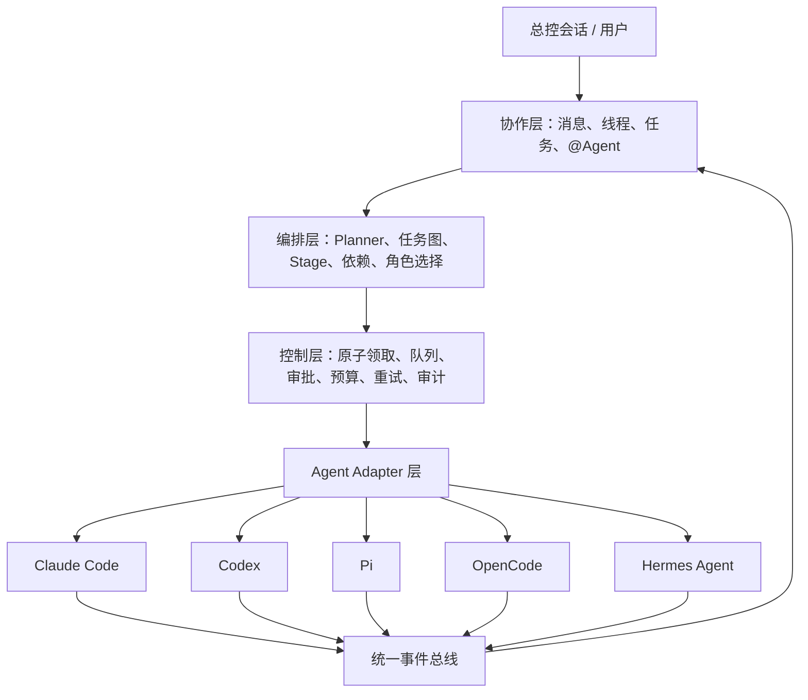
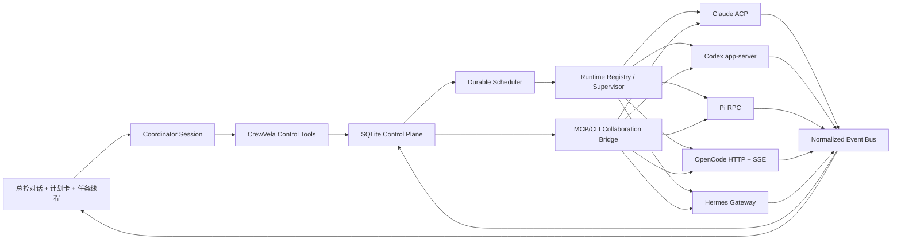

# 多 Agent 协作参考项目源码调研

> 调研日期：2026-07-31
> 范围：Multica、Paperclip、Raft 公开源码与官方文档
> 目的：为 CrewVela 的“通过总控会话指挥多个 Agent 协作完成项目”提供可验证的架构参考
> 说明：本文件只做调研与方案抽取，不修改 CrewVela 现有实现。

## 1. 结论先行

三个项目不是同一种多 Agent 产品，最值得借鉴的是它们的互补组合：

- **Raft 是协作通信层**：频道、不可变消息、线程、任务、@提及、Agent 身份与持久工作区，让 Agent 像团队成员一样在共享对话里协调。
- **Multica 是任务执行层**：Issue 是工作载体，Squad Leader 负责分解与路由，子 Issue 和 Stage Barrier 表达并行/串行关系；本地 Daemon 统一驱动不同 CLI Agent。
- **Paperclip 是控制与治理层**：组织树、目标链路、原子领取、心跳唤醒、预算、审批、审计、隔离工作区和自动恢复，适合长期无人值守运行。

对 CrewVela 最合适的方向，不是照搬某一个项目，而是组合为：

1. 用 **Raft 式总控协作线程**承载自然语言总控、Agent 间消息、进度和交付物；
2. 用 **Multica 式任务图 + Leader/Reviewer 角色**完成分解、并行派发、阶段屏障和汇总；
3. 用 **Paperclip 式持久控制平面**保证原子领取、审批、超时、重试、审计和崩溃恢复；
4. 用统一 `AgentAdapter` 接入 Claude Code、Codex、Pi、OpenCode、Hermes Agent，协议优先、PTY 兜底。

关键原则：**总控会话不是把同一 Prompt 广播给五个终端，而是创建一个可持久化的协作运行（Run），由调度器生成任务图，让不同 Agent 通过结构化事件、任务线程和产物引用协作。**

---

## 2. 调研方法与证据边界

### 2.1 固定源码版本

| 项目 | 官方仓库 | 本次固定提交 |
|---|---|---|
| Multica | [multica-ai/multica](https://github.com/multica-ai/multica) | [`2e0c599`](https://github.com/multica-ai/multica/tree/2e0c599edd58af51877181d3b19d79934ab3317b) |
| Paperclip | [paperclipai/paperclip](https://github.com/paperclipai/paperclip) | [`fcf66f3`](https://github.com/paperclipai/paperclip/tree/fcf66f3a91e6d1e5b81200f5ebf945b0d6ecad9d) |
| Raft 官方文档 | [botiverse/raft-docs](https://github.com/botiverse/raft-docs) | [`3607111`](https://github.com/botiverse/raft-docs/tree/36071119ae95a7f48f71981224b67c7fb8ece975) |
| Raft 外部 Agent 插件 | [botiverse/raft-external-agents](https://github.com/botiverse/raft-external-agents) | [`72c3189`](https://github.com/botiverse/raft-external-agents/tree/72c31894f933b9aa9243195d038d66ee79589593) |

源码只读副本位于 `tmp/research/`，不应纳入项目提交。

### 2.2 Raft 的证据限制

Raft 主产品、服务端和 `Raft Computer` 的完整源码未在 `botiverse` 组织公开仓库列表中出现；公开的主要证据是：

- 官方产品文档仓库 `raft-docs`；
- 官方 Claude Code 外部 Agent 插件 `raft-external-agents`；
- 官方站点 [raft.build](https://raft.build/) 与 [docs.raft.build](https://docs.raft.build/)。

因此本文对 Raft 的消息、任务、Agent 生命周期、工作区和外部 Agent 接入可陈述为**官方公开事实**；对其服务端数据库、调度队列、消息投递一致性、任务 Claim 的事务实现只能标为**推断或未知**，不能当作源码事实。

### 2.3 许可证边界

- **Paperclip**：仓库根目录是标准 [MIT License](https://github.com/paperclipai/paperclip/blob/fcf66f3a91e6d1e5b81200f5ebf945b0d6ecad9d/LICENSE)，在保留版权与许可声明的前提下，可复用代码。
- **Multica**：不是标准 Apache-2.0，而是带额外商业限制和品牌条件的 [modified Apache License 2.0](https://github.com/multica-ai/multica/blob/2e0c599edd58af51877181d3b19d79934ab3317b/LICENSE)。把其源码嵌入商业分发产品或向第三方提供托管服务可能需要商业许可。本文只建议借鉴架构思想；若复制具体实现，必须先做许可证审查。
- **Raft**：本次核验的 `raft-docs` 与 `raft-external-agents` 根目录均未发现 LICENSE，不能因仓库公开就推定拥有复制、修改或分发授权。可根据公开文档独立实现相同产品思想；不要直接搬运插件代码，除非权利方另行明确授权。

---

## 3. 三个项目的整体模型对照

| 维度 | Multica | Paperclip | Raft |
|---|---|---|---|
| 核心抽象 | Workspace → Issue → Task Run；Squad → Leader → Members | Company → Goal/Project → Issue；Org Tree → Agent；Heartbeat Run | Server → Channel/DM → Message/Thread/Task；Member/Agent |
| 工作入口 | 分配 Issue、@Agent、Autopilot、Chat | 分配 Issue、@Mention、Timer、Manual、Approval resolution | 消息、@Mention、Task、Reminder |
| 多 Agent 组织 | Squad，固定 Leader；Leader 自主分解并分配成员 | 严格汇报树；Manager/CEO 分解、委派和升级 | 扁平团队身份 + 角色描述；通过频道、任务、@提及协作 |
| 并行机制 | 多个子 Issue `todo` 同时入队；Stage 控制屏障 | 父子 Issue、依赖、不同 Agent 心跳并行 | Agent 创建子任务，成员 Claim 不同任务并行 |
| 防重复执行 | 队列 Claim、并发上限、任务租约 | Issue `checkoutRunId` 原子锁，冲突返回 409 | 文档声明单 Owner/Claim 防重复；服务端原子性未公开 |
| 通信 | Issue 评论、触发评论、Chat、实时事件 | Issue 评论、活动流、Run Events、REST API | Channel、DM、Thread、不可变 Message、@Mention |
| 上下文 | Issue/评论/工作目录/Session ID/Workspace Context/Skill | 目标祖先、Issue、评论、Session、Workspace、Skill | Channel/Thread 历史 + Agent 私有持久 Workspace/Memory |
| 状态模型 | Issue 状态 + Task 状态 + Runtime/Agent 状态 | Issue 状态 + Agent 状态 + Heartbeat Run 状态 + Approval 状态 | Task 状态 + Agent online/busy/error/offline |
| 治理 | Workspace 角色、可见性、任务 Token；运行时多采用自动权限处理 | 公司隔离、Agent 权限、审批、预算硬停、审计 | Server 成员权限、私有频道、Owner/Admin 生命周期控制 |
| 隔离 | Workspace 隔离；每任务工作目录；Runtime 绑定 | Company 隔离；Execution Workspace/Worktree/Provider | 每 Agent 独立工作区；机器本地运行；跨服务器 Joint Channel 权限隔离 |
| 失败恢复 | Lease/attempt/max_attempts、Runtime Sweeper、会话恢复失败后新会话重建 | Orphan reap、Zombie guard、bounded retry、watchdog、lock sweep、continuation | Restart/session reset/full reset；公开服务端恢复细节有限 |
| 可观测性 | 统一事件流、Task usage、Timeline、Runtime heartbeat | Run events/logs、usage/cost、activity audit、OpenTelemetry | 实时状态点、Activity；外部插件上报有限工具/生命周期遥测 |
| 接入方式 | Go `Backend.Execute` 统一接口；CLI JSON/JSON-RPC/ACP | Adapter package：Server/UI/CLI；REST API；本地/HTTP/插件 | Managed runtime；外部 Agent 通过 CLI 身份、消息拉取和 wake bridge |

---

## 4. Multica：Issue/Squad 驱动的多 Agent 执行平台

### 4.1 组织模型：Agent 是一等参与者，Squad 是稳定路由层

Multica 将 Agent 放入与人相同的 Issue/评论/指派流程。官方 README 明确说明 Agent 有 profile、可被分配 Issue、发评论、创建 Issue；Squad 将 Agent 和人归组，并指定 Leader，用户可以把工作分配给 Squad，而不必指定具体成员：[README.md#L32-L64](https://github.com/multica-ai/multica/blob/2e0c599edd58af51877181d3b19d79934ab3317b/README.md#L32-L64)。

但 Squad **不是广播组**。源码内置 Squad 运行契约明确规定：

- Squad Issue 和 `@Squad` 只唤醒 `squad.leader_id`；
- 不会自动 fan-out 给所有成员；
- Leader 的 briefing 包含成员、角色和技能，Leader 决定如何拆分；
- Leader 创建子 Issue 并分配给成员，成员完成后再唤醒 Leader；
- 父 Issue 由 Leader 维护为 `in_progress`，确认整体目标满足后才进入 `in_review`。

证据：[multica-squads/SKILL.md](https://github.com/multica-ai/multica/blob/2e0c599edd58af51877181d3b19d79934ab3317b/server/internal/service/builtin_skills/multica-squads/SKILL.md)，以及 Squad Leader 专用入队入口 [`EnqueueTaskForSquadLeader`](https://github.com/multica-ai/multica/blob/2e0c599edd58af51877181d3b19d79934ab3317b/server/internal/service/task.go#L1102-L1114)。

**可借鉴点**：总控不要直接把五个 Agent 当广播目标；应先选一个 Orchestrator/Leader，让其读取 Agent 能力目录，生成任务图后再指派。

### 4.2 任务分解和调度：子 Issue + Stage Barrier

Multica 的工作单元分两层：

- `Issue` 是用户可见的持久工作对象；
- `agent_task_queue` 中的 Task 是 Agent 对某个 Issue 的一次执行/对话。

Issue 可由分配、评论 @Mention、Squad 路由、Chat 或 Autopilot 触发不同入队路径。源码入口集中在 [`server/internal/service/task.go`](https://github.com/multica-ai/multica/blob/2e0c599edd58af51877181d3b19d79934ab3317b/server/internal/service/task.go)，例如普通 Issue、Mention、Squad Leader 和 Quick Create 分别有独立函数，避免把触发语义混在一个 Prompt 解析器里。

多 Agent 依赖由子 Issue 和 Stage 表达：

- 同一 Stage 的多个 `todo` 子 Issue 可并行启动；
- 后续 Stage 以 `backlog` 停放；
- 当前最低未完成 Stage 的全部子 Issue 到达 `done/cancelled` 后，服务端只唤醒父 Issue 的负责人一次；
- 是否推进下一 Stage 仍由 Leader 判断，服务端不凭状态自动猜业务决策。

证据：[multica-working-on-issues/SKILL.md 的 Sub-issues / Stages 章节](https://github.com/multica-ai/multica/blob/2e0c599edd58af51877181d3b19d79934ab3317b/server/internal/service/builtin_skills/multica-working-on-issues/SKILL.md)。

**可借鉴点**：CrewVela 的任务图至少需要 `parent_task_id`、`stage`、`depends_on[]`；Stage Barrier 比单纯依赖 DAG 更容易让用户理解“研究并行完成后再编码”。

### 4.3 统一运行时抽象：五种目标 Agent 已有直接参考

Multica 用很薄的 Go 接口统一 Agent：`Backend.Execute(ctx, prompt, ExecOptions) -> Session`，Session 提供结构化消息流和最终 Result。统一事件类型包括 text、thinking、tool-use、tool-result、status、error、log；Result 保存状态、输出、错误、时长、Session ID 和按模型统计的 Token Usage。证据：[server/pkg/agent/agent.go#L14-L172](https://github.com/multica-ai/multica/blob/2e0c599edd58af51877181d3b19d79934ab3317b/server/pkg/agent/agent.go#L14-L172)。

用户要求的五种 Agent 在 Multica 中均为正式支持类型，见 [`SupportedTypes`](https://github.com/multica-ai/multica/blob/2e0c599edd58af51877181d3b19d79934ab3317b/server/pkg/agent/agent.go#L215-L248)：

| Agent | Multica 的接入方式 | 对 CrewVela 的启示 |
|---|---|---|
| Claude Code | 非交互 `stream-json` 输入/输出，保存/恢复 Session ID，受控 MCP 配置；见 [`claude.go#L33-L184`](https://github.com/multica-ai/multica/blob/2e0c599edd58af51877181d3b19d79934ab3317b/server/pkg/agent/claude.go#L33-L184)、[`claude.go#L655-L707`](https://github.com/multica-ai/multica/blob/2e0c599edd58af51877181d3b19d79934ab3317b/server/pkg/agent/claude.go#L655-L707) | 总控协作运行应使用结构化 headless channel；PTY 留给用户交互视图 |
| Codex | 启动 app-server，通过 stdin/stdout JSON-RPC 2.0；支持 thread resume 和权限请求；见 [`codex.go#L178-L179`](https://github.com/multica-ai/multica/blob/2e0c599edd58af51877181d3b19d79934ab3317b/server/pkg/agent/codex.go#L178-L179)、[`codex.go#L740-L909`](https://github.com/multica-ai/multica/blob/2e0c599edd58af51877181d3b19d79934ab3317b/server/pkg/agent/codex.go#L740-L909) | 优先使用 app-server/结构化协议，不要依赖终端文本识别状态 |
| OpenCode | `opencode run --format json`，`--session` 恢复，结构化事件解析；见 [`opencode.go#L45-L150`](https://github.com/multica-ai/multica/blob/2e0c599edd58af51877181d3b19d79934ab3317b/server/pkg/agent/opencode.go#L45-L150) | 用 JSON event adapter，映射到统一事件模型 |
| Hermes Agent | 通过 ACP JSON-RPC 2.0，显式 `session/new` / `session/resume` / `session/prompt`，协商 MCP 能力和权限；见 [`hermes.go#L157-L182`](https://github.com/multica-ai/multica/blob/2e0c599edd58af51877181d3b19d79934ab3317b/server/pkg/agent/hermes.go#L157-L182)、[`hermes.go#L330-L531`](https://github.com/multica-ai/multica/blob/2e0c599edd58af51877181d3b19d79934ab3317b/server/pkg/agent/hermes.go#L330-L531) | ACP 可作为 CrewVela 的首选通用 Agent 协议之一 |
| Pi | `pi -p --mode json --session <path>`，Session 是持久日志文件；见 [`pi.go#L18-L20`](https://github.com/multica-ai/multica/blob/2e0c599edd58af51877181d3b19d79934ab3317b/server/pkg/agent/pi.go#L18-L20)、[`pi.go#L176-L208`](https://github.com/multica-ai/multica/blob/2e0c599edd58af51877181d3b19d79934ab3317b/server/pkg/agent/pi.go#L176-L208) | Adapter 需允许不同的 Session locator，不要假定全是字符串会话 ID |

### 4.4 共享上下文与会话连续性

Multica 同时保留业务上下文和 Provider 上下文：

- Issue、触发评论、线程、Workspace Context 和 Skills 组成可重建的业务上下文；
- `session_id` 和 `work_dir` 保留 Provider 对话与文件状态；
- 同一 `(agent, issue)` 的后续 Task 自动恢复会话；
- 若 Provider 明确拒绝恢复，则只进行一次 fresh-session fallback，并在 Prompt 中明确告知之前的内存上下文已丢失，要求重新读取 Issue 和线程。

数据库迁移直接说明 Session ID 用于同一 Agent/Issue 的跨 Task 恢复：[020_task_session.up.sql](https://github.com/multica-ai/multica/blob/2e0c599edd58af51877181d3b19d79934ab3317b/server/migrations/020_task_session.up.sql)。恢复失败提示构造见 [`server/internal/daemon/prompt.go#L11-L20`](https://github.com/multica-ai/multica/blob/2e0c599edd58af51877181d3b19d79934ab3317b/server/internal/daemon/prompt.go#L11-L20)。

**可借鉴点**：Agent 协作上下文不能只依赖 Provider 会话。必须能从数据库中的 Run、Task、Message、Artifact 重建；Provider Session 只是加速连续性的缓存。

### 4.5 状态机、失败恢复与可观测性

Multica 为 Task 增加 `attempt`、`max_attempts`、租约和 retry reason，允许 Runtime Sweeper 对失联任务重新入队或终止。证据：[055_task_lease_and_retry.up.sql](https://github.com/multica-ai/multica/blob/2e0c599edd58af51877181d3b19d79934ab3317b/server/migrations/055_task_lease_and_retry.up.sql)。

Daemon 以 WebSocket 优先接收 pending-work hint，失败时保留轮询作为正确性路径；WebSocket 提示丢失只增加一个 heartbeat 延迟，不导致任务丢失。证据：[server/internal/daemon/wakeup.go](https://github.com/multica-ai/multica/blob/2e0c599edd58af51877181d3b19d79934ab3317b/server/internal/daemon/wakeup.go)、[server/internal/daemon/wsrpc.go#L307-L367](https://github.com/multica-ai/multica/blob/2e0c599edd58af51877181d3b19d79934ab3317b/server/internal/daemon/wsrpc.go#L307-L367)。

统一 Message/Result 事件使 UI 不必解析五套终端文本；Task Usage、Activity Timeline、Runtime heartbeat 又提供运行级和业务级观测。

### 4.6 权限和隔离的局限

Multica 有 Workspace 作用域、owner/admin/member 角色、Agent/Runtime 可见性和绑定 Workspace 的 Task Token。Workspace 中间件会拒绝跨 Workspace Task Token，并检查角色：[server/internal/middleware/workspace.go#L203-L261](https://github.com/multica-ai/multica/blob/2e0c599edd58af51877181d3b19d79934ab3317b/server/internal/middleware/workspace.go#L203-L261)。

但其 headless Agent 运行常采用自动权限处理，例如 Claude `bypassPermissions`、OpenCode `--dangerously-skip-permissions`，Hermes ACP 会自动选择安全的 session-scoped allow option。证据：[claude.go#L655-L707](https://github.com/multica-ai/multica/blob/2e0c599edd58af51877181d3b19d79934ab3317b/server/pkg/agent/claude.go#L655-L707)、[opencode.go#L40-L103](https://github.com/multica-ai/multica/blob/2e0c599edd58af51877181d3b19d79934ab3317b/server/pkg/agent/opencode.go#L40-L103)、[hermes.go#L868-L1050](https://github.com/multica-ai/multica/blob/2e0c599edd58af51877181d3b19d79934ab3317b/server/pkg/agent/hermes.go#L868-L1050)。

**对 CrewVela 的约束**：不要把“Agent 自己确认权限”当作总控安全模型。总控应独立提供路径边界、命令策略和人工审批；YOLO 只能是用户显式选择的执行策略。

---

## 5. Paperclip：长期自治的控制平面与治理系统

### 5.1 组织模型：严格汇报树和目标链

Paperclip 把多 Agent 组织建模成 Company：Agent 有 role、capabilities、adapter、permissions 和 `reportsTo`；除 CEO 外每个 Agent 有一个上级。Schema 证据：[packages/db/src/schema/agents.ts#L18-L35](https://github.com/paperclipai/paperclip/blob/fcf66f3a91e6d1e5b81200f5ebf945b0d6ecad9d/packages/db/src/schema/agents.ts#L18-L35)。

Issue 关联 Project、Goal、Parent 和单一 Assignee，因此每项工作能沿父任务和 Goal 回溯到公司目标：[packages/db/src/schema/issues.ts#L28-L40](https://github.com/paperclipai/paperclip/blob/fcf66f3a91e6d1e5b81200f5ebf945b0d6ecad9d/packages/db/src/schema/issues.ts#L28-L40)。官方概念文档说明 CEO/Manager 负责策略、分解、指派和必要时招聘 Agent：[docs/start/core-concepts.md](https://github.com/paperclipai/paperclip/blob/fcf66f3a91e6d1e5b81200f5ebf945b0d6ecad9d/docs/start/core-concepts.md)。

**可借鉴点**：CrewVela 不必复制“公司/CEO”叙事，但应保留 `orchestrator`、`worker`、`reviewer` 三种责任，以及 Agent 能力描述和可被调度的范围。

### 5.2 调度模型：Heartbeat + Wakeup Queue

Paperclip 的 Agent 不是长时间占用一个对话轮询任务，而是在短执行窗口 Heartbeat 中醒来：

1. Timer、Assignment、Mention、Manual 或 Approval resolution 创建 wakeup；
2. 服务端根据 Adapter 配置启动运行；
3. Agent 通过 REST API 查看/领取任务、工作并更新状态；
4. Adapter 收集日志、Token、Cost 和 Session；
5. Run 和 Session 持久化，供下一次 heartbeat 恢复。

官方架构与运行文档：[docs/start/architecture.md](https://github.com/paperclipai/paperclip/blob/fcf66f3a91e6d1e5b81200f5ebf945b0d6ecad9d/docs/start/architecture.md)、[docs/agents-runtime.md](https://github.com/paperclipai/paperclip/blob/fcf66f3a91e6d1e5b81200f5ebf945b0d6ecad9d/docs/agents-runtime.md)。

Wakeup 持久记录 reason、payload、status、coalesced count 和请求者，见 [agent_wakeup_requests.ts#L13-L18](https://github.com/paperclipai/paperclip/blob/fcf66f3a91e6d1e5b81200f5ebf945b0d6ecad9d/packages/db/src/schema/agent_wakeup_requests.ts#L13-L18)。同一 Agent 已在运行时，新 wakeup 会合并，避免重复启动昂贵会话；相关逻辑在 [`heartbeat.ts` 的 coalesced 分支](https://github.com/paperclipai/paperclip/blob/fcf66f3a91e6d1e5b81200f5ebf945b0d6ecad9d/server/src/services/heartbeat.ts#L16761-L16830)。

### 5.3 原子领取和执行锁

Paperclip 的 Issue 只有一个 `assigneeAgentId`，同时保存 `checkoutRunId` 作为执行锁：[issues.ts#L34-L40](https://github.com/paperclipai/paperclip/blob/fcf66f3a91e6d1e5b81200f5ebf945b0d6ecad9d/packages/db/src/schema/issues.ts#L34-L40)。官方文档定义 `in_progress` 必须经过原子 checkout；两个 Agent 同时领取时只有一个成功，另一个收到 409：[docs/start/core-concepts.md](https://github.com/paperclipai/paperclip/blob/fcf66f3a91e6d1e5b81200f5ebf945b0d6ecad9d/docs/start/core-concepts.md)。

调度器还处理“排队任务持锁后 Assignee 已改变”的竞态：取消旧 Run、释放锁，再让新 Assignee 执行，见 [`heartbeat.ts#L16453-L16500`](https://github.com/paperclipai/paperclip/blob/fcf66f3a91e6d1e5b81200f5ebf945b0d6ecad9d/server/src/services/heartbeat.ts#L16453-L16500)。

**可借鉴点**：CrewVela 必须把“任务正在被哪个 Agent/Run 执行”放进数据库并用事务更新，不能仅靠前端状态或终端是否忙碌推断。

### 5.4 Session、上下文和持久化

Paperclip 的 `heartbeat_runs` 保存前后 Session ID、上下文快照、状态、错误码和 usage：[heartbeat_runs.ts#L14-L33](https://github.com/paperclipai/paperclip/blob/fcf66f3a91e6d1e5b81200f5ebf945b0d6ecad9d/packages/db/src/schema/heartbeat_runs.ts#L14-L33)。`agent_task_sessions` 以 `(company, agent, adapterType, taskKey)` 唯一定位 Provider Session，并可保存 adapter-specific params：[agent_task_sessions.ts#L10-L35](https://github.com/paperclipai/paperclip/blob/fcf66f3a91e6d1e5b81200f5ebf945b0d6ecad9d/packages/db/src/schema/agent_task_sessions.ts#L10-L35)。

这比“会话 ID 直接挂 Agent”更可靠：一个 Agent 可同时服务多个任务，每个任务有独立 Session；更换 Adapter 时也不会错误复用不兼容 Session。

### 5.5 Adapter 模型和五 Agent 支持

Paperclip 的 Adapter 分为三部分：Server `execute()`、UI stdout parser/config fields、CLI formatter；这使新 Agent 接入同时覆盖执行、显示和命令行观察面。证据：[docs/start/architecture.md 的 Adapter Model](https://github.com/paperclipai/paperclip/blob/fcf66f3a91e6d1e5b81200f5ebf945b0d6ecad9d/docs/start/architecture.md)。

当前运行指南列出 `claude_local`、`codex_local`、`opencode_local`、`pi_local`、`hermes_local` 和 `hermes_gateway`，正好覆盖用户要求的五种 Agent：[docs/agents-runtime.md](https://github.com/paperclipai/paperclip/blob/fcf66f3a91e6d1e5b81200f5ebf945b0d6ecad9d/docs/agents-runtime.md)。服务端注册表为 Claude/Codex/OpenCode/Pi 提供 Session codec/management，并加载 Hermes Adapter：[server/src/adapters/registry.ts#L19-L124](https://github.com/paperclipai/paperclip/blob/fcf66f3a91e6d1e5b81200f5ebf945b0d6ecad9d/server/src/adapters/registry.ts#L19-L124)。

Paperclip 已把 Claude 与 Codex 的旧通用 ACPX 路径收敛为各自 Adapter 内的 `engine="acp"`，说明协议相同不代表生命周期、Session 和 UI 语义完全相同：[registry.ts#L170-L181](https://github.com/paperclipai/paperclip/blob/fcf66f3a91e6d1e5b81200f5ebf945b0d6ecad9d/server/src/adapters/registry.ts#L170-L181)。

**可借鉴点**：CrewVela 需要统一 Adapter 接口，但仍应让每个 Provider 自己实现 Session codec、模型发现、权限映射、取消和日志解析，不能强行共用一个 ACP Adapter 类。

### 5.6 执行隔离

Paperclip 区分 Project Workspace 和 Execution Workspace。执行工作区持久记录 provider、branch、来源 workspace/issue 和状态：[execution_workspaces.ts#L15-L65](https://github.com/paperclipai/paperclip/blob/fcf66f3a91e6d1e5b81200f5ebf945b0d6ecad9d/packages/db/src/schema/execution_workspaces.ts#L15-L65)。其目标是让并行 Agent 使用不同 Git worktree/operator branch，避免同时写同一目录。

本地 CLI Adapter 默认在宿主机非沙箱运行，官方文档明确要求最小权限并谨慎处理 cwd/env/secrets：[docs/agents-runtime.md 的 Security and risk notes](https://github.com/paperclipai/paperclip/blob/fcf66f3a91e6d1e5b81200f5ebf945b0d6ecad9d/docs/agents-runtime.md)。

**可借鉴点**：同一项目多个 coding Agent 并行时，默认一 Task 一个 worktree；只读研究任务可共享主目录，写任务不应共享。

### 5.7 审批、预算和权限

Paperclip Approval 有 type、请求 Agent/User、pending 状态、payload 和决定人：[approvals.ts#L5-L25](https://github.com/paperclipai/paperclip/blob/fcf66f3a91e6d1e5b81200f5ebf945b0d6ecad9d/packages/db/src/schema/approvals.ts#L5-L25)。批准后服务端会唤醒请求 Agent 继续执行；拒绝、要求修订、重提也都有独立状态路径和 Activity 记录：[server/src/routes/approvals.ts#L188-L368](https://github.com/paperclipai/paperclip/blob/fcf66f3a91e6d1e5b81200f5ebf945b0d6ecad9d/server/src/routes/approvals.ts#L188-L368)。

预算策略不是 UI 警告：达到硬限制可 pause Agent、取消 pending wakeup 和活动 Run。入口可见 [`server/src/services/budgets.ts`](https://github.com/paperclipai/paperclip/blob/fcf66f3a91e6d1e5b81200f5ebf945b0d6ecad9d/server/src/services/budgets.ts) 与 [`heartbeat.ts#L17319-L17519`](https://github.com/paperclipai/paperclip/blob/fcf66f3a91e6d1e5b81200f5ebf945b0d6ecad9d/server/src/services/heartbeat.ts#L17319-L17519)。

### 5.8 故障恢复和可观测性

Paperclip 对长期运行的恢复覆盖更完整：

- Run 卡在 `running` 时检测 orphaned process group，结束旧 Run并有限重试；
- 启动时恢复 queued runs；
- sweep stale issue locks；
- watchdog 扫描无输出的 active run；
- continuation retry 有次数上限、幂等键和 schedule；
- 在重试前重新检查 Issue 是否终态、Assignee/Lock 是否改变，避免恢复出“幽灵任务”。

代码集中在 [`server/src/services/heartbeat.ts#L12129-L12361`](https://github.com/paperclipai/paperclip/blob/fcf66f3a91e6d1e5b81200f5ebf945b0d6ecad9d/server/src/services/heartbeat.ts#L12129-L12361) 和 [`server/src/services/recovery/`](https://github.com/paperclipai/paperclip/tree/fcf66f3a91e6d1e5b81200f5ebf945b0d6ecad9d/server/src/services/recovery)。

可观测性分为：Heartbeat Run、顺序 Run Events、外置完整日志、Agent runtime state、Token/Cost、Activity audit；浏览器通过实时更新刷新状态。官方说明：[docs/agents-runtime.md 的 Logs / Live updates](https://github.com/paperclipai/paperclip/blob/fcf66f3a91e6d1e5b81200f5ebf945b0d6ecad9d/docs/agents-runtime.md)。

---

## 6. Raft：对话原生的人与 Agent 协作层

### 6.1 组织模型：持久身份，而不是一次性 Run

Raft 的 Agent 是 Server Member：有名字、描述、身份、频道成员关系、任务、提醒和独立 Workspace。Agent 可使用不同 Runtime，但日常对话不暴露底层 Runtime 差异。官方 Runtime 文档列出 Claude Code、Codex CLI、OpenCode 和 Pi 等混合运行时：[features/agents/runtime/index.md](https://github.com/botiverse/raft-docs/blob/36071119ae95a7f48f71981224b67c7fb8ece975/content/features/agents/runtime/index.md)。

Raft 的角色组织比 Paperclip 更松：没有公开的严格汇报树，而是通过 Agent 描述、频道成员关系、@提及、任务 Owner 和协作约定形成团队。官方教程展示“负责人/研究/审查”这样的职责分工，但它更像对话协议而非数据库强制层：[investing-research-team](https://github.com/botiverse/raft-docs/blob/36071119ae95a7f48f71981224b67c7fb8ece975/content/tutorials/investing-research-team/index.md)。

### 6.2 消息、线程和任务是同一个协作上下文

Raft 的核心设计不是独立“总控 Prompt”，而是：

- Channel/DM 里发布顶层 Message；
- Message 可直接转为 Task，原内容不丢失；
- Task 增加编号、状态和单 Owner；
- Task 的讨论、进度与结果都放在其 Thread；
- Agent 可创建子任务并让多个成员 Claim，从而并行；
- Agent 完成后把 Task 置为 `in review`，由人确认后进入 `done`。

证据：[tasks/index.md](https://github.com/botiverse/raft-docs/blob/36071119ae95a7f48f71981224b67c7fb8ece975/content/features/collaboration/tasks/index.md)、[threads/index.md](https://github.com/botiverse/raft-docs/blob/36071119ae95a7f48f71981224b67c7fb8ece975/content/features/messaging/threads/index.md)。

消息不可编辑、不可删除，修正通过 Thread 回复完成，因此消息本身构成可靠协作记录：[messages/index.md](https://github.com/botiverse/raft-docs/blob/36071119ae95a7f48f71981224b67c7fb8ece975/content/features/messaging/messages/index.md)。

**可借鉴点**：CrewVela 总控输入的一条项目目标，应成为 Run 的根消息；分解出的任务、Agent 回复、Review 和纠错都应保留 source message/thread ID，避免上下文变成无法追踪的拼接 Prompt。

### 6.3 唤醒模型：推送提示与正文拉取分离

Raft 外部 Agent 的公开源码给出了非常有价值的通信边界：

- Bridge 接收 wake hint，但 hint **不含消息正文、频道名和发送者身份**；
- Runtime 插件只向 Agent 上下文注入“有新消息，请执行 `raft message check`”的固定通知；
- Agent 使用自己的 CLI 身份直接从服务端拉取正文和权限范围内的上下文；
- wake 可 debounce/coalesce，但成功只代表通知进入 Runtime，不代表模型已经处理；
- wake 失败不会删除提示，保留重试；
- localhost endpoint 使用每 Session token，Runtime 插件不持有 Raft 服务凭据。

证据：[raft-external-agents README](https://github.com/botiverse/raft-external-agents/blob/72c31894f933b9aa9243195d038d66ee79589593/README.md)、[wake-endpoint-contract.md#L14-L103](https://github.com/botiverse/raft-external-agents/blob/72c31894f933b9aa9243195d038d66ee79589593/docs/wake-endpoint-contract.md#L14-L103)、[plugins/raft-channel/src/wake.ts](https://github.com/botiverse/raft-external-agents/blob/72c31894f933b9aa9243195d038d66ee79589593/plugins/raft-channel/src/wake.ts)。

**可借鉴点**：CrewVela 的调度通知只传 `event_id/task_id/run_id`，Agent 通过受控工具读取任务正文。这样可以防止把其他会话中的内容误注入、降低 Prompt Injection 扩散，并支持权限过滤和已读游标。

### 6.4 持久 Workspace 与 Memory

Raft 为每个 Agent 建独立持久目录，存放 memory、草稿、脚本、仓库和领域知识；Workspace 跨 idle/active 和 session reset 存活，只有 full reset 清除。其他 Agent 在同一机器上也有自己的隔离目录：[workspace/index.md](https://github.com/botiverse/raft-docs/blob/36071119ae95a7f48f71981224b67c7fb8ece975/content/features/agents/workspace/index.md)。

这形成两层记忆：

- 共享：频道/线程/任务历史；
- 私有：Agent Workspace 内的长期笔记与文件。

**风险**：文档说明 Workspace 绑定机器且不可迁移。对 CrewVela 更合理的是将关键 Memory 摘要、Artifact 索引和决策持久化到控制平面，文件缓存仍可留在本机。

### 6.5 生命周期和失败处理

Raft 的公开生命周期：online、busy、error、offline；消息、@Mention、Reminder 可让 idle Agent 自动 active。三种恢复动作具有不同清理范围：Restart 保留 Session；Session Reset 清 Provider 对话但保留 Workspace；Full Reset 同时清两者。证据：[lifecycle/index.md](https://github.com/botiverse/raft-docs/blob/36071119ae95a7f48f71981224b67c7fb8ece975/content/features/agents/lifecycle/index.md)。

Owner/Admin 才能执行 reset/delete；Agent 不能自删或自停。这一边界值得保留：Agent 可请求恢复动作，但控制平面决定是否执行。

### 6.6 权限和外部 Agent

Public Channel 可由 Agent 自行加入并读取；Private Channel 必须由 Owner/Admin 添加。证据：[channels/index.md](https://github.com/botiverse/raft-docs/blob/36071119ae95a7f48f71981224b67c7fb8ece975/content/features/messaging/channels/index.md)。

外部 Agent 通过 device authorization 登录，获得特定 Agent 身份；设置 `RAFT_PROFILE` 后使用 CLI 收发消息、Claim Task、搜索、上传附件和设置 Reminder。Hermes 通过本地 wake-channel bridge，Claude Code 通过 channel plugin，其他能运行 shell 的 Agent 可使用 Raft CLI：[external/index.md](https://github.com/botiverse/raft-docs/blob/36071119ae95a7f48f71981224b67c7fb8ece975/content/features/agents/external/index.md)。

Raft 官方明确承认外部 Agent 的 activity indicator 可能不准确：[external/index.md 的 Activity status](https://github.com/botiverse/raft-docs/blob/36071119ae95a7f48f71981224b67c7fb8ece975/content/features/agents/external/index.md)。官方插件也只上报工具事件和 Session/Turn 生命周期，不读 transcript，不上报模型 thinking/text；这些 telemetry 被视为 self-reported、不可作为权限依据：[raft-external-agents README 的 Activity Reporting](https://github.com/botiverse/raft-external-agents/blob/72c31894f933b9aa9243195d038d66ee79589593/README.md#L59-L81)。

**可借鉴点**：Agent “正在工作”状态应来自多个信号并注明置信度：结构化协议事件 > 进程/PTY 活动 > 心跳推断；任何 UI 状态都不能承担授权判断。

### 6.7 对 Raft 未知的部分

以下实现没有公开主产品源码支撑，不能直接声称其具体算法：

- Task Claim 是否数据库事务/乐观锁；
- 消息和 wake hint 的持久队列、投递语义、去重键；
- 服务端数据模型与数据库选型；
- Managed Agent 的进程隔离、重试次数和崩溃恢复算法；
- Server/Computer 之间的完整协议。

可以借鉴公开产品语义，但 CrewVela 应自行实现可验证的事务、队列和恢复机制。

---

## 7. 最值得 CrewVela 借鉴的组合方案

### 7.1 四层架构



### 7.2 应采用的模式

1. **Conversation-as-control-surface（来自 Raft）**
   用户在总控会话提出目标；系统创建根 Run 和根 Thread。用户仍用自然语言，但实际动作转成结构化命令并显示确认卡片。

2. **Leader routing，不做默认 fan-out（来自 Multica）**
   每次 Run 指定一个 Orchestrator。Orchestrator 读取 Agent Registry，根据能力、负载、目录权限和可用协议选择 Worker。

3. **任务图与 Stage Barrier（来自 Multica）**
   Task 支持 parent、stage、depends_on、assignee、reviewer。一个 Stage 内并行，跨 Stage 等屏障；允许用户在执行前编辑计划。

4. **Atomic claim + durable wakeup（来自 Paperclip）**
   Task 只能由一个 active Run 持有；Agent 通知持久入队并可 coalesce；进程启动成功不等于 Task 成功领取。

5. **Pull context，push wake（来自 Raft）**
   唤醒只发送 task/event ID；Agent 通过本地工具/IPC 读取任务、消息、依赖结果和 Artifact，避免广播全部历史。

6. **Provider Session 只是缓存（来自 Multica/Paperclip）**
   核心上下文必须可从 DB 重建。Session 丢失时创建新会话，并注入结构化恢复摘要。

7. **一任务一写工作区（来自 Paperclip）**
   coding Task 默认创建 worktree；Reviewer 可只读打开 Worker worktree/diff；最终由 Integrator 合并。

8. **Human gate（来自 Paperclip/Raft）**
   删除、覆盖、外部发布、合并、密钥访问、扩大文件路径或网络权限必须形成 Approval；Agent 不能自己批准。

9. **统一事件，不解析终端画面（来自 Multica/Paperclip）**
   Adapter 输出 `started/thinking/tool_started/tool_finished/message/artifact/blocked/completed/failed`；PTY 文本仅展示与兜底。

### 7.3 不应直接照搬的模式

- 不应把 Paperclip 的完整“公司/CEO/预算中心”一次性搬入桌面工具，复杂度过高；先保留角色与审批核心。
- 不应把 Multica 的权限绕过策略当成总控默认；多 Agent 会放大误操作范围。
- 不应只实现 Raft 式频道而没有原子领取和恢复；协作 UI 好看但无法保证执行正确性。
- 不应依赖 Agent 在自然语言里自报“已完成”；完成必须由结构化状态、产物和验证结果共同证明。
- 不应让五个 Agent 共享同一个可写目录；并行修改会产生不可解释的文件竞争。

---

## 8. 研究结论对应的设计检查表

### 组织与角色

- [ ] Agent Registry 保存 type、capabilities、runtime、model、permission profile、workspace scope、max concurrency。
- [ ] Run 有一个 Orchestrator，可选 Reviewer/Integrator。
- [ ] 角色是责任，不与 Provider 强绑定；Claude/Codex/Pi/OpenCode/Hermes 都可担任任一角色。

### 任务与调度

- [ ] Task 有 `parent_id`、`stage`、`depends_on`、`assignee_agent_id`、`reviewer_agent_id`。
- [ ] Claim 在数据库事务中完成；同一 Task 同时只有一个 lease owner。
- [ ] Wakeup 持久化、幂等、可合并；运行中收到新输入进入 pending inbox，而不是开第二个冲突 Run。

### 消息与共享上下文

- [ ] 每个 Task 有独立 Thread；消息不可静默改写，纠正追加新消息。
- [ ] Agent 间消息使用 target Agent/Thread/Task ID，而不是把字符串写入别的 PTY。
- [ ] 唤醒消息不携带正文；Agent 读取权限范围内的上下文。
- [ ] Artifact 用 ID/路径/哈希引用，避免在 Prompt 中复制大文件。

### 状态与恢复

- [ ] 分离 Agent、Process、Task、Run、Session 五类状态。
- [ ] 保存 Adapter-specific session locator 和可重建的 context snapshot。
- [ ] App 重启后扫描 running/claimed Run，校验进程是否存活、lease 是否过期，再恢复或失败。
- [ ] 重试有原因分类、最大次数、退避和幂等键；写操作发生后不盲目整轮重放。

### 权限与隔离

- [ ] 每个 Run 有 cwd allowlist、网络策略、命令策略和环境变量白名单。
- [ ] 多写任务默认独立 worktree。
- [ ] Approval 由控制平面强制执行，不由 Prompt 约定。
- [ ] YOLO/Auto 是显式运行策略，并在总控计划确认卡中逐 Task 显示。

### 可观测性

- [ ] 统一事件流包含 seq、timestamp、run/task/agent/session ID。
- [ ] UI 同时显示状态、当前动作、耗时、Token/Cost、重试、审批和产物。
- [ ] 状态来源有 provenance；自报状态不用于权限和锁判断。
- [ ] 所有状态变更、指派、审批、重试和人工接管写入 Activity Audit。

---

## 9. 参考源码入口索引

### Multica

- 产品与支持 Runtime：[README.md](https://github.com/multica-ai/multica/blob/2e0c599edd58af51877181d3b19d79934ab3317b/README.md)
- Agent 统一接口与事件：[server/pkg/agent/agent.go](https://github.com/multica-ai/multica/blob/2e0c599edd58af51877181d3b19d79934ab3317b/server/pkg/agent/agent.go)
- Task 入队/会话/Claim 服务：[server/internal/service/task.go](https://github.com/multica-ai/multica/blob/2e0c599edd58af51877181d3b19d79934ab3317b/server/internal/service/task.go)
- Daemon 唤醒：[server/internal/daemon/wakeup.go](https://github.com/multica-ai/multica/blob/2e0c599edd58af51877181d3b19d79934ab3317b/server/internal/daemon/wakeup.go)
- Squad 契约：[multica-squads/SKILL.md](https://github.com/multica-ai/multica/blob/2e0c599edd58af51877181d3b19d79934ab3317b/server/internal/service/builtin_skills/multica-squads/SKILL.md)
- Stage/子 Issue 契约：[multica-working-on-issues/SKILL.md](https://github.com/multica-ai/multica/blob/2e0c599edd58af51877181d3b19d79934ab3317b/server/internal/service/builtin_skills/multica-working-on-issues/SKILL.md)

### Paperclip

- 总体架构：[docs/start/architecture.md](https://github.com/paperclipai/paperclip/blob/fcf66f3a91e6d1e5b81200f5ebf945b0d6ecad9d/docs/start/architecture.md)
- 核心概念：[docs/start/core-concepts.md](https://github.com/paperclipai/paperclip/blob/fcf66f3a91e6d1e5b81200f5ebf945b0d6ecad9d/docs/start/core-concepts.md)
- Agent Runtime：[docs/agents-runtime.md](https://github.com/paperclipai/paperclip/blob/fcf66f3a91e6d1e5b81200f5ebf945b0d6ecad9d/docs/agents-runtime.md)
- Heartbeat 调度核心：[server/src/services/heartbeat.ts](https://github.com/paperclipai/paperclip/blob/fcf66f3a91e6d1e5b81200f5ebf945b0d6ecad9d/server/src/services/heartbeat.ts)
- Adapter 注册：[server/src/adapters/registry.ts](https://github.com/paperclipai/paperclip/blob/fcf66f3a91e6d1e5b81200f5ebf945b0d6ecad9d/server/src/adapters/registry.ts)
- 恢复服务：[server/src/services/recovery](https://github.com/paperclipai/paperclip/tree/fcf66f3a91e6d1e5b81200f5ebf945b0d6ecad9d/server/src/services/recovery)

### Raft

- 官方产品页：[raft.build](https://raft.build/)
- Task 模型：[content/features/collaboration/tasks/index.md](https://github.com/botiverse/raft-docs/blob/36071119ae95a7f48f71981224b67c7fb8ece975/content/features/collaboration/tasks/index.md)
- Thread 模型：[content/features/messaging/threads/index.md](https://github.com/botiverse/raft-docs/blob/36071119ae95a7f48f71981224b67c7fb8ece975/content/features/messaging/threads/index.md)
- Agent Workspace：[content/features/agents/workspace/index.md](https://github.com/botiverse/raft-docs/blob/36071119ae95a7f48f71981224b67c7fb8ece975/content/features/agents/workspace/index.md)
- Agent 生命周期：[content/features/agents/lifecycle/index.md](https://github.com/botiverse/raft-docs/blob/36071119ae95a7f48f71981224b67c7fb8ece975/content/features/agents/lifecycle/index.md)
- 外部 Agent：[content/features/agents/external/index.md](https://github.com/botiverse/raft-docs/blob/36071119ae95a7f48f71981224b67c7fb8ece975/content/features/agents/external/index.md)
- Claude Code channel 插件：[botiverse/raft-external-agents](https://github.com/botiverse/raft-external-agents/tree/72c31894f933b9aa9243195d038d66ee79589593)
- Wake endpoint 协议：[docs/wake-endpoint-contract.md](https://github.com/botiverse/raft-external-agents/blob/72c31894f933b9aa9243195d038d66ee79589593/docs/wake-endpoint-contract.md)

---

## 10. CrewVela 当前实现与目标能力之间的差距

### 10.1 可以直接复用的基础

CrewVela 已经具备一部分重要底座，无须推倒重写：

- `src-tauri/src/pty.rs` 和 `MultiTerminal` 已能管理、展示多个本地进程；
- `src-tauri/src/sessions.rs` 已能持久化会话、恢复 Claude Session，并借助 Claude Hooks 获取运行、等待、完成和 Permission Mode；
- `src-tauri/src/control.rs` 已有批量启动、广播、停止、删除和统一 Mode 的总控入口；
- `src-tauri/src/acp.rs` 已经实现一个 Claude ACP JSON-RPC 客户端，包括初始化、新建/恢复 Session、发送 Prompt、Mode 和 Slash Command 目录；
- 总控可以停靠或分离为独立窗口，适合作为后续协作控制面 UI。

这些能力应继续服务“手动多会话工作台”。Multi-Agent 功能在其上增加新的受管运行模式，现有终端、广播和统一 Mode 不应被删除。

### 10.2 目前不能承担项目级编排的部分

1. `SessionKind` 只有 `claude | terminal`；“GLM、Kimi、DeepSeek Provider”实际仍是 Claude Code 的模型后端，不是 Claude/Codex/Pi/OpenCode/Hermes 这种 Agent Runtime。
2. `ControlIntent` 只有 launch、broadcast、stop/delete-all、help、unknown。一次 Claude 结构化输出只能生成固定计划，不是可持续观察结果、再次调用工具的编排循环。
3. `SessionActionQueue` 是内存队列；App 退出后广播、Mode 切换和待处理动作会消失。
4. `sessions.json` 只有会话记录，没有 Project、Task、Dependency、Run、Message、Artifact、Approval 和 Workspace Lease。
5. Claude 状态主要依赖 Hook，其他 Agent 没有统一事件接口；不能继续用终端字符或小图标动画推断五种 Runtime 的真实状态。
6. `AcpManager` 当前只有一个 `Mutex<Option<AcpConnection>>`，适合右侧单个本地 Claude 会话，不适合并发管理多个 Agent 实例。
7. 当前所有 Claude 会话可直接在同一目录运行。项目级并行写代码会发生文件覆盖和 Git 冲突。

因此，多 Agent 功能应建立独立领域模型，不能继续向 `SessionRecord` 和 `ControlPlan` 追加越来越多的可选字段。

---

## 11. 五类 Agent 的推荐接入协议

### 11.1 统一接口，不统一最低能力

定义 `AgentRuntimeAdapter`，但每个 Adapter 在启动时返回能力清单。调度器只能调用已声明能力，不能假定五个 Agent 都支持相同的 fork、steer、approval、diff 或 slash command。

```text
probe -> capabilities -> start/resume -> submit/steer -> event stream
      -> respond_approval -> interrupt -> snapshot -> close
```

推荐能力位：`streaming`、`resume`、`steer`、`interrupt`、`approvals`、`commands`、`usage`、`diff`、`fork`、`subagents`、`structured_output`、`mcp`。

### 11.2 具体协议矩阵

| Runtime | CrewVela 推荐主协议 | 选择原因 | 进程模型 |
|---|---|---|---|
| Claude Code | MVP 泛化现有 `claude-agent-acp`；需要更完整 Hook/子 Agent 事件时增加官方 Claude Agent SDK/stream-json Bridge | 当前已有 ACP 实现，可最快形成多连接池；官方 SDK 支持双向会话、Hooks 和自定义工具 | 每个受管 Session 一个 ACP/Bridge 子进程 |
| Codex | `codex app-server --stdio` JSON-RPC | 官方富客户端接口；原生 Thread/Turn/Item、流事件、Diff、Approval、Interrupt、Resume/Fork | 每个 Codex Profile 一个 app-server，可承载多个 Thread |
| Pi | `pi --mode rpc` LF 分隔 JSONL | 官方跨语言进程协议；有 prompt/steer/follow_up/abort/state/messages 和细粒度事件 | 每个活跃 Session 一个 RPC 子进程 |
| OpenCode | `opencode serve` + HTTP/SDK + SSE | 原生 Session API、异步 Prompt、Abort、Diff、Permission 回复和全局事件流比 PTY/ACP 更完整 | 每个 Workspace/配置一个 Server，多 Session 复用 |
| Hermes Agent | TUI Gateway JSON-RPC；ACP 作为简化回退 | Gateway 官方定位就是自定义桌面宿主，包含 Session、Slash Command、Approval、Clarify、Steer、Branch、Delegation 和 Spawn Tree | 每个 Hermes Profile 一个 Gateway，多 Session 复用 |

一手资料：

- Claude Agent SDK：[anthropics/claude-agent-sdk-python](https://github.com/anthropics/claude-agent-sdk-python)
- Codex app-server：[openai/codex app-server README](https://github.com/openai/codex/blob/main/codex-rs/app-server/README.md)
- Pi RPC：[pi RPC protocol](https://github.com/earendil-works/pi/blob/main/packages/coding-agent/docs/rpc.md)
- OpenCode Server：[OpenCode Server](https://opencode.ai/docs/server/)
- Hermes Programmatic Integration：[Hermes programmatic integration](https://github.com/NousResearch/hermes-agent/blob/main/website/docs/developer-guide/programmatic-integration.md)

PTY 只用于“用户手动接管”和协议不可用时的降级。受管协作运行不能以向 PTY 写字符串、解析终端画面作为主链路。

---

## 12. CrewVela 目标架构



建议新增后端模块：

```text
src-tauri/src/multi_agent/
  domain.rs          Project/Team/Agent/Task/Run/Message/Artifact
  store.rs           SQLite migration 与事务
  scheduler.rs       DAG、Stage、Claim、Wakeup、Retry
  supervisor.rs      子进程与共享 Server 生命周期
  events.rs          统一事件、顺序号、Tauri 推送
  approvals.rs       人工审批与权限策略
  workspaces.rs      worktree、lease、merge handoff
  coordinator.rs     总控工具循环
  bridge.rs          Agent 读取任务/发消息/交付产物
  adapters/
    claude.rs
    codex.rs
    pi.rs
    opencode.rs
    hermes.rs
```

前端不要让现有 `SessionRecord` 同时承担 Agent、进程、任务和运行状态。至少分开：

- `AgentProfile`：持久身份、Runtime、角色、能力、权限和并发限制；
- `RuntimeSession`：Provider/CLI 的 Session locator 与连接状态；
- `Task`：业务工作及依赖；
- `Run`：一次执行尝试；
- `ProcessState`：本地子进程或共享 Server 状态。

---

## 13. 总控会话如何真正指挥多个 Agent

### 13.1 从固定意图解析器升级为持久 Coordinator

保留现有“快捷调度”处理开会话、广播和统一 Mode；新增“项目协作”模式。项目协作由一个持久 Coordinator Session 驱动，默认可使用 Claude Code，后续允许用户改成任意具有 Tool Calling 的 Runtime。

Coordinator 不获得直接操作数据库和终端的自由文本权限，而是调用 CrewVela 提供的受控工具：

```text
project.create / project.inspect
team.create / agent.list / agent.assign_role
task.plan / task.create / task.depend / task.assign / task.reassign
run.start / run.pause / run.cancel / run.retry
message.send / thread.read
artifact.list / artifact.inspect
review.request / approval.request
workspace.diff / merge.request
```

每个 Tool 必须：校验参数、带 actor/run/idempotency key、在 SQLite 事务中更新、写 Activity Event。模型不能通过伪造一句“已完成”跳过状态机。

推荐把这些工具同时暴露为：

1. 给 Coordinator 使用的本地 MCP Server；
2. 给 Worker 使用的受限 MCP Server；
3. 给不能稳定接 MCP 的 Runtime 使用的 `crewvela-agent` 本地 CLI。

每个 Worker 只拿到短期 Agent/Run Token，工具按 Agent、Project、Task 和 cwd 授权。

### 13.2 用户交互流程

用户输入：

> 用 Claude 做架构，Codex 和 OpenCode 并行实现，Pi 写测试，Hermes 做最终集成；完成登录模块重构。

系统先生成可编辑计划卡，而不是立即向五个终端广播：

```text
Stage 1  Claude：架构与接口设计
Stage 2  Codex：后端实现 ┐
         OpenCode：前端实现 ├─ 并行，依赖 Stage 1
         Pi：测试基线     ┘
Stage 3  Hermes：集成、运行验证，依赖 Stage 2
Stage 4  Claude/Reviewer：审查；用户批准后合并
```

用户确认后才创建 Task、Worktree 和 Wakeup。执行期间用户仍可自然语言控制：

- “把前端任务改给 Pi”；
- “让 Codex 先暂停，等 Claude 回答接口问题”；
- “把 OpenCode 的结果发给 Hermes”；
- “失败的测试最多重试一次”；
- “只看需要我审批的事项”。

Coordinator 将这些话转换为受控 Tool 调用；UI 同时显示实际变更，避免“模型说执行了，但控制面没有执行”。

### 13.3 Agent 间通信

每个 Project 有根 Thread，每个 Task 有子 Thread。Agent 间消息写入持久 Message 表，包含：发送者、目标 Agent、Task/Thread、正文或 Artifact 引用、投递状态和已读游标。

使用 Raft 式 `push wake / pull context`：

1. Agent A 调用 `message.send`，消息持久化；
2. Scheduler 给 Agent B 写入只含 `event_id/task_id` 的 Wakeup；
3. Agent B 醒来后调用 `thread.read` 拉取权限范围内的正文；
4. 处理成功后提交游标；失败保留 Wakeup 重试。

这比直接把文字塞进另一个 PTY 更可靠，也能审计、去重、控制权限和避免跨会话 Prompt Injection 扩散。

---

## 14. 持久化数据与状态机

推荐使用 SQLite WAL；CrewVela 是本地桌面应用，不需要先引入 PostgreSQL 或独立服务。

核心表：

| 表 | 关键字段 |
|---|---|
| `projects` | root_path、goal、default_branch、policy |
| `agent_profiles` | runtime_kind、role、capabilities、permission_profile、max_concurrency |
| `teams/team_members` | coordinator、reviewer、成员与职责 |
| `tasks` | parent_id、stage、status、assignee、reviewer、acceptance、workspace_id |
| `task_dependencies` | task_id、depends_on_task_id |
| `runs` | task_id、agent_id、attempt、status、session_id、usage、error、lease_expiry |
| `runtime_sessions` | adapter_kind、locator_json、cwd、resume snapshot |
| `wakeup_requests` | target_agent、task/run、reason、idempotency_key、status、coalesced_count |
| `messages` | thread、sender、target、body/artifact、delivery/read cursor |
| `artifacts` | type、path/URI、hash、producer_run、metadata |
| `approvals` | type、payload、requester、status、decision actor |
| `workspace_leases` | project、task、worktree、branch、owner_run、expiry |
| `events` | monotonic seq、entity、event_type、payload、timestamp |

Task 状态：

```text
draft -> ready -> claimed -> running -> in_review -> done
          |          |          |          |
        blocked    cancelled   failed   changes_requested -> ready
```

Run 状态必须独立：`queued -> starting -> running -> waiting_input/approval -> succeeded/failed/timed_out/cancelled/interrupted`。一个 Task 可有多个顺序 Run，但同时只能有一个有效 Lease。

Task 进入 `done` 至少要求：结构化 `succeeded`、必要 Artifact 已登记、Acceptance Check 通过、Reviewer/Human Gate 满足；不能只根据最后一条自然语言回复判断。

---

## 15. 工作区、权限和恢复

### 15.1 Git 隔离

- 只读研究任务可共享项目根目录；
- 写代码任务默认 `git worktree` + 独立 `crewvela/task/<task-id>` 分支；
- Reviewer 只读查看 Worker diff；
- Integrator 按任务依赖顺序合并；冲突生成新的 Integration Task，不让多个 Agent 同时修主目录；
- 非 Git 目录使用文件路径 Lease，默认禁止并发写。

### 15.2 权限

- `ProviderConfig` 继续只管理 Claude 模型后端；新增独立 Runtime Settings 检测五个 CLI、版本、登录状态和协议能力；
- 每个 Run 明确 cwd allowlist、网络、命令、环境变量和密钥范围；
- Auto/YOLO 是逐 Task 策略，必须在计划确认卡中展示；
- 删除、覆盖、扩大路径/网络权限、外部发布和合并默认进入 Approval；
- 日志、Event 和 Artifact 元数据统一做 Secret Redaction。

### 15.3 崩溃恢复

App 启动时执行恢复扫描：

1. 读取 `starting/running/claimed` Run；
2. 校验子进程、共享 Server、Session locator、Workspace Lease；
3. 能重新连接则恢复事件订阅；
4. 不能连接则标记 `interrupted`，按错误分类决定同 Session 恢复、Fresh Session、重试或人工接管；
5. 重试前重新检查 Task 是否终态、Assignee 是否改变、依赖是否仍满足；
6. 写过文件但结果未知时不自动整轮重放，先生成恢复/审查任务。

---

## 16. 建议开发顺序与工期

这属于高复杂度功能。五种 Runtime 同时做到可靠恢复、审批和协作，不能视为给总控多加几个 Prompt 规则。

### Phase 1：控制平面骨架（约 1–2 周）

- SQLite schema/migration、Task DAG、原子 Claim、Wakeup Queue、Event Log；
- `AgentRuntimeAdapter` 合约与 Fake Adapter 测试；
- 总控增加“快捷调度 / 项目协作”切换和计划卡；
- 保持现有终端功能不变。

### Phase 2：可运行 MVP（约 2–3 周）

- 泛化 Claude ACP 为多连接池；
- 接入 Codex app-server；
- Coordinator Tool Loop、Task Thread、用户暂停/取消/重新指派；
- 每写任务一 Worktree；
- 先用 Claude + Codex 跑通“规划—并行—审查—合并”闭环。

### Phase 3：补齐三种 Runtime（约 2–3 周）

- Pi RPC、OpenCode Server/SSE、Hermes Gateway Adapter；
- 能力协商、版本检测、Session 恢复、Slash Command/Approval 映射；
- Adapter 契约测试和录制事件回放测试。

### Phase 4：可靠协作与治理（约 2–3 周）

- MCP/CLI Collaboration Bridge、push-wake/pull-context；
- Approval、超时、有限重试、孤儿 Run 恢复；
- Token/Cost/并发预算、Activity Audit、Artifact 和 Diff UI；
- Reviewer/Integrator 与 Merge Gate。

合理预期：可演示 MVP 约 4–6 周；五种 Agent 都达到可日常使用约 8–12 周；若要求无人值守、异常恢复和权限治理达到生产级，约 10–16 周。以上按一名熟悉 Rust/Tauri 和各 CLI 协议的开发者估算。

### MVP 验收标准

1. 用户能在总控对话创建一个 Project Run，查看并修改 Agent/Task/Stage 计划后启动；
2. Claude 与 Codex 能在独立 Worktree 并行工作，结构化状态实时显示；
3. 依赖未完成的 Task 不会提前运行，同一 Task 不会被两个 Run 同时领取；
4. 用户能在对话中暂停、取消、重新指派、追加要求和批准；
5. App 重启后能恢复或明确标记中断 Run，不丢 Task、消息和 Artifact；
6. Worker 完成后进入 Review，不会自行合并或越过用户设定的 Gate；
7. 五种 Adapter 最终通过同一合约测试：启动、发送、流事件、取消、恢复、错误和能力降级。
