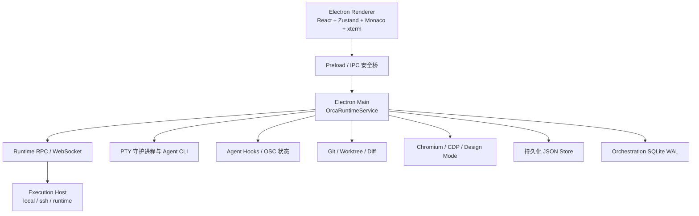

# Orca 深度研究：功能、架构、真实边界与 CrewVela 融合建议

> 研究日期：2026-08-11  
> 源码基线：`stablyai/orca` 提交 [`2e5f067c2e33183093f2e48513e4362470d23fdd`](https://github.com/stablyai/orca/tree/2e5f067c2e33183093f2e48513e4362470d23fdd)，提交时间 2026-08-10，仓库版本 `1.4.178-rc.2`。  
> 证据范围：Orca 官方仓库、固定提交源码、官方文档和官网。没有使用第三方测评、教程或媒体文章。  
> 证据分级：**源码确认** > **官方文档确认** > **官方文档声明但源码未确认**。文档明确标注的 `Experimental`、`Beta` 均原样保留。

## 1. 结论

Orca 的核心不是“让多个 Agent 自己组成团队并自动讨论”，而是一个围绕 **真实 Git worktree、真实 CLI Agent 进程和真实 PTY** 建立的多 Agent 开发 IDE。它把 Claude Code、Codex、Cursor CLI、OpenCode 等现有命令行 Agent 放进统一桌面工作台，并补齐以下工程能力：

1. 每项工作使用独立 worktree、分支、终端和浏览器，避免并行任务相互污染。
2. 用 Hook、OSC 标题和会话解析器识别 Agent 的 working、waiting、done 状态，而不是只把它们当普通终端。
3. 在同一个 IDE 中完成代码查看、Diff 审核、逐行批注、浏览器验证、提交、PR 和任务平台联动。
4. 通过本地、SSH、Remote Orca Server 三类执行宿主，把 UI 与实际运行 Agent 的机器解耦。
5. 通过会话历史、后台 PTY 守护进程、实验性休眠恢复，降低大量并行会话的恢复成本。

官方自己也明确限定：Orca 不是模型，不替代 Git，不提供托管 VPS；它运行用户已经安装和付费的 Agent CLI。[官方定位](https://www.onorca.dev/docs#what-is-orca)与[仓库描述](https://github.com/stablyai/orca/blob/2e5f067c2e33183093f2e48513e4362470d23fdd/package.json#L2-L11)一致。

对 CrewVela 最值得借鉴的不是 Orca 已有的 worktree、多终端、多 Agent 启动、任务 DAG 或自动化——这些与 CrewVela 已有能力高度重叠；而是以下五个补充层：

| 优先级 | 候选功能 | 对 CrewVela 的新增价值 | Orca 成熟度 | 建议 |
|---:|---|---|---|---|
| P0 | Diff 行级批注 → 批量发送给指定 Agent 修改 | 补齐人工 Review 与 Agent 修改之间的闭环，不替代现有自动审查 | 文档与源码均确认 | 先做 |
| P0 | GitHub/CI 闭环：PR、Checks、失败日志、Agent 修复、重跑 | 让“代码完成”延伸到“CI 通过、PR 可合并”，减少在浏览器和终端之间搬运信息 | 文档与源码均确认 | 先做 |
| P0 | 项目浏览器 + Design Mode：点选页面元素并发送 DOM、样式、截图、源码位置 | 把“看图猜 UI 问题”变成可复现的结构化上下文 | 文档与源码均确认 | 先做 |
| P1 | Provider 用量、限额、重置时间与账号容量面板 | 调度前知道哪个账号/Provider 即将触顶，减少任务中途停摆 | 文档与源码均确认，但采集方式有边界 | 做 Claude/Codex MVP |
| P2 | SSH Execution Host：远端 worktree、PTY、文件、Git 与重连 | 把耗时任务迁到远端主机，同时保留 CrewVela 的本地统一 UI | 文档与源码均确认；Remote Server 另为 Beta | 单独立项 |

全局活动收件箱与 Session History 也有价值，但与 CrewVela 现有会话/项目列表更接近，优先级低于上表五项。Remote Server、移动端则复杂度与安全边界更高，不宜与 P0 功能同时推进。

### 1.1 为什么这五项不属于“重复造轮子”

本次不是只按界面名称比较，而是核对了 CrewVela 的真实模块与领域对象：

| CrewVela 已有能力 | 代码证据 | 本报告如何处理 |
|---|---|---|
| 多 Agent 任务图、角色分工、Reviewer、Integrator、人工审批 | `README.md:96-103`；`src-tauri/src/multi_agent/domain.rs:31-32,672,699` | 明确排除 Orca Orchestration，不建议重写 |
| 独立 Git worktree、会话启动、Agent 消息与共享记录 | `README.md:19-20,103`；`src-tauri/src/multi_agent/domain.rs:672,866` | 明确排除 worktree、普通会话和消息功能 |
| 定时/事件自动化、通知、广播 | `CLAUDE.md:45-52`；`src-tauri/src/automation.rs:115` | 明确排除 Orca Automations 与普通通知 |
| 实时语音 | `src-tauri/src/livekit_voice.rs` | 明确排除语音能力 |
| 会话 Token 用量统计 | `CLAUDE.md:43`；`src-tauri/src/usage.rs:43` | 只建议当前没有的“额度窗口、重置时间、账号归属与调度预检”，不是再做 Token 计数 |

五项候选的缺口也能从当前源码直接确认：`projects.rs` 明确写着项目模型裁掉了 GitHub、多 host 和项目级 worktree 管理；当前仓库没有 `DiffComment`、`BrowserPane`、`SshTarget`、`RateLimit` 或 `AccountProfile` 领域对象。执行器虽会调用 `git diff --name-only` 计算工作区内容哈希，但这不等于面向人的 Diff 查看、逐行批注和反馈闭环。

## 2. Orca 的真实架构

### 2.1 总体分层



源码证据：

- 项目是 Electron 应用，入口为 `out/main/index.js`；开发、桌面、Web 客户端和多平台构建脚本均在同一仓库。[package.json](https://github.com/stablyai/orca/blob/2e5f067c2e33183093f2e48513e4362470d23fdd/package.json#L2-L11)、[构建脚本](https://github.com/stablyai/orca/blob/2e5f067c2e33183093f2e48513e4362470d23fdd/package.json#L50-L85)
- 核心依赖包括 `node-pty`、Electron、Monaco、React、xterm、Zustand。[运行依赖](https://github.com/stablyai/orca/blob/2e5f067c2e33183093f2e48513e4362470d23fdd/package.json#L130-L145)、[前端依赖](https://github.com/stablyai/orca/blob/2e5f067c2e33183093f2e48513e4362470d23fdd/package.json#L191-L229)、[Zustand](https://github.com/stablyai/orca/blob/2e5f067c2e33183093f2e48513e4362470d23fdd/package.json#L254)
- Main 进程创建 `OrcaRuntimeService`，并按当前代际动态解析本地与 SSH PTY Provider。[main 初始化](https://github.com/stablyai/orca/blob/2e5f067c2e33183093f2e48513e4362470d23fdd/src/main/index.ts#L2460-L2469)
- RPC 清单覆盖状态、AI Vault、自动化、仓库、worktree、Agent 会话、终端、浏览器、编排、通知、账号、文件、Git、GitHub、GitLab、Linear、Jira、SSH、语音、插件、Skills、配对与更新等边界，不是只为移动端临时添加的一组接口。[RPC 方法总表](https://github.com/stablyai/orca/blob/2e5f067c2e33183093f2e48513e4362470d23fdd/src/main/runtime/rpc/methods/index.ts#L2-L43)、[注册清单](https://github.com/stablyai/orca/blob/2e5f067c2e33183093f2e48513e4362470d23fdd/src/main/runtime/rpc/methods/index.ts#L47-L88)
- Execution Host 是显式领域对象，分为 `local`、`ssh`、`runtime`，Repo 和 Worktree 都会解析到唯一宿主。[类型与 ID](https://github.com/stablyai/orca/blob/2e5f067c2e33183093f2e48513e4362470d23fdd/src/shared/execution-host.ts#L3-L14)、[Repo/Worktree 归属解析](https://github.com/stablyai/orca/blob/2e5f067c2e33183093f2e48513e4362470d23fdd/src/shared/execution-host.ts#L142-L163)

### 2.2 状态与持久化

Orca 不是“所有状态都在一个 SQLite 数据库”里：

- 工作区、布局、设置、会话 UI 等主要状态由大型 `Store` 管理并写入数据文件。[Store](https://github.com/stablyai/orca/blob/2e5f067c2e33183093f2e48513e4362470d23fdd/src/main/persistence.ts#L2782-L2814)
- 写盘使用临时文件、文件 `fsync`、原子替换，并避免旧 generation 覆盖新状态。[耐久写入](https://github.com/stablyai/orca/blob/2e5f067c2e33183093f2e48513e4362470d23fdd/src/main/persistence.ts#L4045-L4072)
- 结构化多 Agent 编排另有 SQLite 数据库，启用 WAL、`synchronous=NORMAL` 与 busy timeout；当前 schema 版本为 26，存放 Run、Message、Task、Dispatch、Decision Gate 等。[OrchestrationDb](https://github.com/stablyai/orca/blob/2e5f067c2e33183093f2e48513e4362470d23fdd/src/main/runtime/orchestration/db.ts#L285-L319)、[消息表](https://github.com/stablyai/orca/blob/2e5f067c2e33183093f2e48513e4362470d23fdd/src/main/runtime/orchestration/db.ts#L321-L350)

这个拆分值得 CrewVela 借鉴：高频 UI 快照与强事务协作记录不是同一种数据，不应强行共用一套持久化模型。

### 2.3 Agent 状态不是模型 API，而是 CLI 观测层

Orca 对任意 CLI Agent 的最低适配只是“在终端启动一个进程”；更深的状态、Hooks、用量和账号切换只对部分 Agent 可用。官方当前列出 30 多个预配置 CLI，但能力深度不同。[支持列表与能力差异](https://www.onorca.dev/docs/agents/supported#supported-agents)

状态主要来自：

- Orca 管理的 Agent Hook；
- CLI 发出的终端 OSC 标题或结构化状态；
- 会话 transcript 与 Provider 特定解析器；
- 对不认识的 CLI，只能退化为普通终端。

Hooks 会把 endpoint 写到磁盘，每次调用重新加载，所以 Orca 重启后长寿命 Agent 仍能连到新端口。[Hook 管理与重启恢复](https://www.onorca.dev/docs/agents/hooks-memory#agent-status-hooks)

这意味着 Orca 的“实时 Agent 状态”不是无条件准确：适配深度取决于各 CLI 是否提供稳定 Hook、OSC 或 transcript。CrewVela 若扩展 Provider，必须把 `process_alive`、`agent_turn_state`、`provider_session_state` 分开建模，不能用一个绿色圆点代替全部事实。

## 3. 功能全景与成熟度

### 3.1 已落地、未被官方标为实验性的主功能

| 领域 | 功能 | 证据 |
|---|---|---|
| 并行开发 | 每个任务独立真实 Git worktree、分支、终端、浏览器；支持创建、休眠、归档、提交与推送 | [Worktrees](https://www.onorca.dev/docs/model/worktrees) |
| 工作区 UI | Tabs、嵌套分屏、跨 worktree 快速跳转、布局恢复 | [Session restore](https://www.onorca.dev/docs/model/session-restore) |
| Agent 启动 | 多种 CLI 一键启动；自定义命令；Agent 状态、账号和用量的 Provider 深度适配 | [Supported agents](https://www.onorca.dev/docs/agents/supported)、[Custom CLI](https://www.onorca.dev/docs/agents/custom-cli) |
| 会话连续性 | 扫描多个 Agent 的原生 transcript，统一搜索、过滤、查看和一键 Resume | [Agent session history](https://www.onorca.dev/docs/agents/session-history) |
| 代码审核 | 合并查看 staged/unstaged/untracked；图片 Diff；三方冲突；按行/块 stage；行级批注并发送 Agent | [Diff viewer](https://www.onorca.dev/docs/review/diff-viewer)、[Annotate AI Diff](https://www.onorca.dev/docs/review/annotate-ai-diff) |
| 编辑与预览 | Monaco、Markdown、Mermaid、PDF、图片、文件树、外部拖放 | [官方文档目录](https://www.onorca.dev/docs#editing-in-orca) |
| 浏览器 | 每个 worktree 独立 Chromium tabs、浏览历史、DevTools、viewport 模拟、CLI 自动化 | [Per-worktree browser](https://www.onorca.dev/docs/browser/overview) |
| Design Mode | 点选页面元素，将截图、DOM、样式、可访问性、选择器和可选源码位置发给 Agent | [Design Mode](https://www.onorca.dev/docs/browser/design-mode) |
| 终端 | xterm、分屏、搜索、上下文复制、主题、Ghostty/Warp 导入、WSL、多 shell | [Terminal](https://www.onorca.dev/docs/terminal) |
| 通知与注意力 | 系统通知、声音、未读 Bell、Agent Feed、点击跳转到具体 pane | [Notifications](https://www.onorca.dev/docs/notifications)、[Agents feed](https://www.onorca.dev/docs/activity) |
| CLI 与自动化 | CLI 控制 worktree、终端、浏览器、Git；定时 prompt、cron/RRULE、时区、precheck、运行历史 | [CLI reference](https://www.onorca.dev/docs/cli/reference)、[Scheduled automations](https://www.onorca.dev/docs/cli/automations) |
| 远程执行 | SSH worktree、远端 Agent/文件/Git/端口扫描、断线重连 | [SSH worktrees](https://www.onorca.dev/docs/ssh) |
| 集成 | GitHub/GitLab、Hosted Review、Issues、Actions、Linear、Jira | [GitHub/Hosted review](https://www.onorca.dev/docs/review/github) |
| Provider 容量 | Claude、Codex、Gemini、OpenCode、Kimi、MiniMax 等用量、窗口和重置时间 | [Usage tracking](https://www.onorca.dev/docs/agents/usage-tracking) |

这里的“已落地”表示官方文档有正式入口且固定提交中存在对应实现，并不等于 API 永久稳定。

### 3.2 官方明确标为 Experimental

1. **Chat UI**：在同一个 Agent PTY 上叠加结构化 transcript、composer、模型/选项选择；终端仍是事实源，Claude、Codex、Grok、OMP 需要分别解析。官方明确说 transcript fidelity、streaming 和终端等价性仍在调优。[Chat UI 边界](https://www.onorca.dev/docs/agents/native-chat)
2. **Agent Hibernation**：只有 done、可恢复、无草稿、无活跃移动端、无未结 Dispatch、无活跃子 Agent 的后台 Pane 才会休眠；默认关闭。[官方安全条件](https://www.onorca.dev/docs/agents/hibernation)、[源码候选过滤](https://github.com/stablyai/orca/blob/2e5f067c2e33183093f2e48513e4362470d23fdd/src/renderer/src/lib/agent-hibernation-planner.ts#L119-L210)、[实验开关与 fail-closed](https://github.com/stablyai/orca/blob/2e5f067c2e33183093f2e48513e4362470d23fdd/src/renderer/src/lib/agent-hibernation-planner.ts#L250-L323)
3. **Orchestration**：Run、Task DAG、Dispatch、消息、Decision Gate 与 supervised worker 都已落到 SQLite 和 CLI，但官方仍要求在 Experimental 设置中开启；旧 `run` 命令已经退役且无副作用。[Orchestration 状态与模型](https://www.onorca.dev/docs/cli/orchestration)

Orchestration 并非宣传空壳：数据库 schema、消息类型、Dispatch 上下文和恢复逻辑都存在。但“有大量实现”与“适合作为 CrewVela 生产主链路”是两回事，官方仍将其视为实验功能。

### 3.3 官方明确标为 Beta

1. **Remote Orca Servers**：远端主机持有 Repo、worktree、终端、账号和 Agent 会话，客户端只显示 UI 和发送输入；建议仅放在 LAN、Tailscale、WireGuard 或受信隧道，不应暴露公网。[Remote Server Beta 与安全边界](https://www.onorca.dev/docs/remote-servers)
2. **Mobile companion**：iOS/Android 以“只读为主的远程控制器”为定位，可查看状态、scrollback、回复 Agent、查看源代码、stage/commit、切账号和用量；官方明确说它不是完整编辑器。[Mobile Beta](https://www.onorca.dev/docs/mobile)

### 3.4 官方文档声明，但本次源码未确认的能力

官方 Attribution 页面声称：Orca 会记录 Agent 修改的每一行，Diff gutter 区分 AI 与人类，人在 AI 代码上继续编辑会切回 human，并可导出元数据。[Attribution 文档](https://www.onorca.dev/docs/review/attribution)

但在固定提交 `2e5f067...` 的 `src/` 与 `tests/` 中，本次审计没有定位到与该描述相匹配的“Agent 写入行区间存储、human 覆盖重算、Diff gutter 渲染、导出逐行归因”实现。搜索到的 `attribution` 主要是 GitHub 提交/PR 品牌归因、Hook/Worktree 归属和执行宿主 provenance，语义不同。因此本报告将“逐行 AI 代码归因”归类为：

> **官方产品文档已声明，当前开源提交的实现证据未确认。**

在没有找到源代码或可复现实测之前，不应把它视为已经验证的可复用实现，也不应作为 CrewVela 第一批移植目标。

## 4. 五项差异化能力的源码核验

### 4.1 Design Mode：从页面元素直接生成可执行上下文

这不是简单截图。选中一个元素后，payload 包含：

- CSS selector、DOM 路径、class、附近元素与文本；
- React 组件名和 source file（能从 sourcemap/运行时解析到时）；
- HTML snippet、可访问性信息、viewport/page rect；
- computed styles；
- PNG screenshot。

数据结构见 [`BrowserGrabTarget` 与完整 payload](https://github.com/stablyai/orca/blob/2e5f067c2e33183093f2e48513e4362470d23fdd/src/shared/browser-grab-types.ts#L57-L98)。批注还带 `fix/change/question/approve` 意图与 `blocking/important/suggestion` 优先级，并限制页面最多 20 条、截图最多 2 MB、HTML 最多 4096 字符。[批注模型与预算](https://github.com/stablyai/orca/blob/2e5f067c2e33183093f2e48513e4362470d23fdd/src/shared/browser-grab-types.ts#L158-L194)

隐私与安全不是空白：注入脚本只收集白名单属性，过滤 token、secret、password 等模式，删除 URL query/hash，去掉 `script` 标签。[白名单与秘密过滤](https://github.com/stablyai/orca/blob/2e5f067c2e33183093f2e48513e4362470d23fdd/src/main/browser/grab-guest-script.ts#L48-L119)、[HTML 清理](https://github.com/stablyai/orca/blob/2e5f067c2e33183093f2e48513e4362470d23fdd/src/main/browser/grab-guest-script.ts#L242-L250)

发送给 Agent 的不是私有二进制协议，而是确定性的 Markdown，包含 URL、viewport、selector、source、React、bounds、文本、附近元素、样式、完整 DOM 路径、HTML 和用户反馈。[Markdown 输出](https://github.com/stablyai/orca/blob/2e5f067c2e33183093f2e48513e4362470d23fdd/src/renderer/src/components/browser-pane/browser-annotation-output.ts#L155-L227)

**真实边界：**源码位置和 React 组件名不是必然存在；跨域 iframe、Canvas/WebGL、Shadow DOM、压缩生产包和无 sourcemap 页面都会降低可定位性。DOM 内容来自页面本身，仍需在主进程重新验证尺寸、协议和敏感字段，不能只信 renderer。

### 4.2 Diff 行级批注：人工 Review 到 Agent 修改的闭环

Orca 把批注建模为持久化对象，而不是临时聊天文本：

- 可对文件、单行或行范围评论；
- 批注保留未发送/已发送状态；
- 只把未发送批注组成 prompt；
- 可按当前文件或全部文件发送；
- 已发送批注再次编辑会重新进入待发送状态；
- 发送成功后清理已交付批注。

批注到 Agent 的契约是固定格式的 `File + Line/Lines + User comment`，可批量拼接。[格式化契约](https://github.com/stablyai/orca/blob/2e5f067c2e33183093f2e48513e4362470d23fdd/src/shared/diff-comments-format.ts#L7-L33)；菜单只筛未发送评论、支持当前文件和全部作用域，并在交付后清理。[发送菜单](https://github.com/stablyai/orca/blob/2e5f067c2e33183093f2e48513e4362470d23fdd/src/renderer/src/components/editor/DiffNotesSendMenu.tsx#L41-L102)

**真实边界：**这不是 GitHub PR review 协议，也不自动保证 Agent 已按意见修改；它解决的是“把精确 Review 上下文可靠送入目标 Agent”。完成验证仍需测试、Diff 重看和现有 Integrator/验收链路。

### 4.3 GitHub/CI：从 PR 状态到 Agent 修复与重跑

Orca 的 GitHub 集成不是“打开一个网页链接”，而是把 PR、Review、Comments、Checks、Actions 日志和 Agent 启动串成闭环。官方文档确认：可创建/关联 PR、查看状态与线程、内联回复 Review、读取失败 Job 日志、把失败 Checks 发给 Agent 修复、重跑失败 Actions，并在满足仓库规则时启用 auto-merge 或 merge queue。[Hosted reviews, issues & Actions](https://www.onorca.dev/docs/review/github)

源码中的 Checks 读取有多级回退：优先 GitHub GraphQL `statusCheckRollup`，失败后尝试 REST check-runs/status/check-suites，最终回退到 `gh pr checks`，并对 60 秒缓存和 rate-limit 预算做显式处理。[Checks GraphQL/REST/CLI 回退](https://github.com/stablyai/orca/blob/2e5f067c2e33183093f2e48513e4362470d23fdd/src/main/github/client.ts#L3561-L3740)

失败 Job 可以通过 Actions API 重跑；`failedOnly` 只选择 `failure/cancelled/timed_out`，并区分 workflow run 与 check run。[失败 Checks 重跑](https://github.com/stablyai/orca/blob/2e5f067c2e33183093f2e48513e4362470d23fdd/src/main/github/client.ts#L4045-L4085)

PR 评论同样是分层采集：GraphQL 获取 Review thread 和 resolution，REST 获取 issue comment 与 review summary；某个 endpoint 失败不会清空全部评论。[PR 评论聚合](https://github.com/stablyai/orca/blob/2e5f067c2e33183093f2e48513e4362470d23fdd/src/main/github/client.ts#L4182-L4248)

“Fix broken checks”会定位关联 worktree、解析本地/SSH 运行平台、选择 Agent，在新标签页启动并用 `submit-after-ready` 交付修复 prompt。[启动 Agent 修复 Checks](https://github.com/stablyai/orca/blob/2e5f067c2e33183093f2e48513e4362470d23fdd/src/renderer/src/lib/fix-checks-agent-launch.ts#L142-L222)

**真实边界：**GitHub 数据受 `gh` 登录、Token 权限、企业版差异和 API rate limit 影响；CI “修复”仍是 Agent 尝试，不保证通过。正确产品语义应是 `检查失败 → 带日志派发修复 → 新提交 → 重新运行 → 更新 PR 状态`，不能把启动 Agent 直接标为修复成功。

### 4.4 SSH Execution Host：远端工作不牺牲本地 IDE

Orca 把 SSH 作为执行宿主，而不是一次性命令：远端 worktree 拥有远端 Agent、PTY、文件、Git 与端口，客户端保持统一编辑、Diff 和浏览体验。Execution Host 类型明确区分 `local`、`ssh`、`runtime`，Repo 和 Worktree 都能解析到宿主。[Execution Host 类型](https://github.com/stablyai/orca/blob/2e5f067c2e33183093f2e48513e4362470d23fdd/src/shared/execution-host.ts#L3-L14)、[Worktree 宿主归属](https://github.com/stablyai/orca/blob/2e5f067c2e33183093f2e48513e4362470d23fdd/src/shared/execution-host.ts#L142-L163)

SSH relay 建连时会部署/启动 relay、建立复用通道、注册 consumer session 与 Provider、重新挂接 PTY，并启动端口扫描；重连会拆除旧 Provider/转发，重新部署、挂接和扫描。[Relay 建连](https://github.com/stablyai/orca/blob/2e5f067c2e33183093f2e48513e4362470d23fdd/src/main/ssh/ssh-relay-session.ts#L504-L630)、[Relay 重连恢复](https://github.com/stablyai/orca/blob/2e5f067c2e33183093f2e48513e4362470d23fdd/src/main/ssh/ssh-relay-session.ts#L637-L766)

底层 SSH 连接维护状态、SFTP/exec 通道与退避重连；断线后不是复用已死亡 transport，而是等待后重新建立。[SSH 连接与通道](https://github.com/stablyai/orca/blob/2e5f067c2e33183093f2e48513e4362470d23fdd/src/main/ssh/ssh-connection.ts#L123-L244)、[重连处理](https://github.com/stablyai/orca/blob/2e5f067c2e33183093f2e48513e4362470d23fdd/src/main/ssh/ssh-connection.ts#L1251-L1326)

**真实边界：**这套能力要求远端存在 Git、Agent CLI、依赖和凭据；断线恢复还要处理版本协商、PTY 世代、幂等与文件事件重放。Remote Orca Server 是另一条“完整远端 runtime”路线且仍为 Beta，不能与 SSH worktree 混为一谈。[SSH 与 Remote Server 的选择](https://www.onorca.dev/docs/remote-servers#remote-orca-server-or-ssh)

### 4.5 Provider 用量与限额：文档与源码存在不一致

官方文档写的是：“读取各 Agent 在磁盘上的本地用量状态，不调用 API、不需要额外认证，更新频率取决于 Agent 自己写盘。”[Usage tracking 文档](https://www.onorca.dev/docs/agents/usage-tracking#how-it-works)

但固定提交源码显示实际实现是多层 Provider 特定采集，并不统一是纯本地读取：

- `RateLimitService` 并行调用 Claude、Codex、Gemini、OpenCode、Kimi、MiniMax、Grok fetcher。[并行采集](https://github.com/stablyai/orca/blob/2e5f067c2e33183093f2e48513e4362470d23fdd/src/main/rate-limits/service.ts#L1643-L1689)
- Claude fetcher 使用 OAuth token 请求 `https://api.anthropic.com/api/oauth/usage`。[Claude OAuth URL](https://github.com/stablyai/orca/blob/2e5f067c2e33183093f2e48513e4362470d23fdd/src/main/rate-limits/claude-fetcher.ts#L46-L48)、[实际网络请求](https://github.com/stablyai/orca/blob/2e5f067c2e33183093f2e48513e4362470d23fdd/src/main/rate-limits/claude-fetcher.ts#L341-L381)
- Codex 会读取 `auth.json` 的 token，并访问 ChatGPT backend 获取 reset credits；主流程依次尝试 backend、app-server RPC 和 PTY `/status` fallback。[Codex 请求头和 backend](https://github.com/stablyai/orca/blob/2e5f067c2e33183093f2e48513e4362470d23fdd/src/main/rate-limits/codex-fetcher.ts#L353-L404)、[Codex 三层采集路径](https://github.com/stablyai/orca/blob/2e5f067c2e33183093f2e48513e4362470d23fdd/src/main/rate-limits/codex-fetcher.ts#L1198-L1332)
- Claude 活跃会话还会通过 statusLine 上报实时窗口，服务端按账号 `configDir` 校验后合并。[Live Claude ingest](https://github.com/stablyai/orca/blob/2e5f067c2e33183093f2e48513e4362470d23fdd/src/main/rate-limits/service.ts#L1471-L1522)
- 后台轮询只在窗口可见、未最小化且有焦点时运行，以减少 CLI/API 预算。[轮询门控](https://github.com/stablyai/orca/blob/2e5f067c2e33183093f2e48513e4362470d23fdd/src/main/rate-limits/service.ts#L801-L842)

因此更准确的结论是：

> Orca 的用量面板是“本地文件 + 活跃会话状态 + CLI/RPC 探针 + Provider API/backend”的分层采集系统，具体路径因 Provider、平台、账号和回退状态而异。

这是本次研究中最明显的“官方文档简化或滞后于源码”之处。CrewVela 不能照抄“纯本地、无 API”的产品描述，应给每条用量数据标注 `source`、`account`、`updatedAt`、`stale` 和 `confidence`。

## 5. Orca 的关键真实边界

### 5.1 Worktree 是变更隔离，不是安全沙箱

官方默认给支持的 CLI 填入跳过权限/审批的参数，例如 Claude 的 `--dangerously-skip-permissions`、Codex 的 `--dangerously-bypass-approvals-and-sandbox` 和其他 Agent 的 `--yolo`。[权限默认值](https://www.onorca.dev/docs/agents/supported#permissions-default)

独立 worktree 可以隔离 Git 文件变更，但不能阻止 Agent：

- 删除 worktree 外的文件；
- 访问用户凭据和网络；
- 执行系统级命令；
- 操作数据库、云服务或外部 API。

CrewVela 不应借鉴“worktree 可丢弃，所以默认 bypass 权限”的推理。现有人工审批、命令权限与集成验收应保留。

### 5.2 Native Chat 不是 Provider 原生 API 会话

Chat UI 仍然建立在同一个 PTY 之上，终端是事实源；结构化消息依赖对不同 CLI 输出的解码。[Chat UI](https://www.onorca.dev/docs/agents/native-chat)

这意味着：

- CLI TUI 改版会破坏 transcript 解码；
- 终端上的所有 OSC、进度、交互控件不一定能在 Chat UI 等价呈现；
- “聊天 UI”不代表 Agent 间自动聊天或可靠的消息总线；
- 不应把 PTY 文本解析当成长期稳定协议。

### 5.3 会话恢复有明确生存边界

关闭 Orca 窗口时，后台 daemon 可以继续持有 PTY；应用崩溃后也可 warm reattach。但主机重启、系统更新、掉电或 daemon 自身崩溃会结束进程，只能恢复布局与最后 scrollback，不能恢复原进程。[Session restore 的可恢复与不可恢复范围](https://www.onorca.dev/docs/model/session-restore)

### 5.4 远程能力不是零运维云产品

Remote Server 需要用户自己维护远端机器、Repo、Agent CLI、凭据、网络和常驻进程；账号不会从客户端自动复制到服务器。官方要求只走私网或可信隧道，并明确标为 Beta。[Remote Server](https://www.onorca.dev/docs/remote-servers)

SSH relay 的源码实现包括部署 relay、重连后重新挂载 PTY、文件/Git Provider、端口扫描等，不是加一个 `ssh exec` 就能复制。[Relay 建连与重挂载](https://github.com/stablyai/orca/blob/2e5f067c2e33183093f2e48513e4362470d23fdd/src/main/ssh/ssh-relay-session.ts#L504-L630)、[重连恢复](https://github.com/stablyai/orca/blob/2e5f067c2e33183093f2e48513e4362470d23fdd/src/main/ssh/ssh-relay-session.ts#L637-L766)

### 5.5 编排层已有耐久性，但仍处于实验期

Orca 的编排模型已经包含：

- Run：耐久命名空间和 coordinator inbox；
- Task：依赖和状态；
- Dispatch：任务的一次执行尝试和完成权威；
- Message/Delivery：FIFO、ACK、重放；
- Decision Gate：阻塞任务等待决策；
- worker heartbeat、retry、release、retain。

见[官方模型与 supervised loop](https://www.onorca.dev/docs/cli/orchestration)。这与 CrewVela 当前任务 DAG、Agent 分工、消息、审核和验收能力高度重叠，且 Orca 官方仍标 Experimental，因此不应为“跟上 Orca”而重写 CrewVela 的编排核心。

## 6. 建议融入 CrewVela 的五项功能

### 6.1 P0：可视化 Design Mode

**用户问题：**用户看到 UI 错位时，目前通常只能截图、描述“红框这里”或让 Agent 自己猜 DOM。截图没有 selector、样式、viewport、源码位置，Agent 往返次数高。

**建议交互：**

1. 在项目浏览器或本地预览上点击“选择元素”。
2. Hover 高亮元素，点击后输入“这里要怎么改”。
3. CrewVela 生成结构化附件：截图裁剪、URL、viewport、selector、DOM path、HTML、computed styles、可访问性、source map 位置。
4. 用户选择 Claude/Codex/当前项目组，直接作为任务上下文发送。
5. 修改后保留批注，可重新截取并对比。

**建议数据模型：**

```ts
type UiIssueContext = {
  projectId: string
  pageUrl: string
  viewport: { width: number; height: number }
  selector: string
  domPath?: string
  htmlSnippet: string
  computedStyles: Record<string, string>
  accessibility?: Record<string, string>
  sourceFile?: string
  sourceLine?: number
  screenshotRef?: string
  feedback: string
  createdAt: string
}
```

**必须保留的安全设计：**URL 去 query/hash、属性白名单、秘密模式过滤、HTML/截图预算、删除脚本、跨域与不可信页面隔离。

**预计复杂度：**中高。若 CrewVela 已有可控 WebView/CDP，MVP 约 1～2 周；若还没有项目浏览器，需要先实现浏览器 Pane，复杂度会显著增加。

### 6.2 P0：Diff 行级批注与“一次性发回修改”

**用户问题：**自动 Review 能找问题，但人工看到具体问题后，仍要复制文件名、行号、代码和意见到聊天框。多条意见被拆成多轮，Agent 容易漏改。

**建议交互：**

1. 在 CrewVela Diff 中选行或行范围，输入批注。
2. 批注默认只保存在当前项目，不立即打断 Agent。
3. Review 完成后点击“发送 6 条意见给 Claude 执行者”或“发送给 Codex 复核”。
4. 系统生成确定性 prompt，标记 `sentAt` 和目标会话。
5. Agent 改完后，Diff 自动刷新；未解决批注可重发，已解决批注归档。

**与现有功能不冲突：**现有“Claude 写功能、Codex 写测试和审核、Integrator 验收”仍是主流程。该功能只增加人工 Review 到执行 Agent 的精确反馈通道。

**预计复杂度：**中。若已有 Diff 组件和持久消息，MVP 约 3～5 天；需要重点处理文件改动后行号漂移、批注重定位和幂等发送。

### 6.3 P0：GitHub/CI 交付闭环

**用户问题：**Agent 写完代码并不等于任务完成。PR 创建、CI 失败、日志定位、修复、重跑和合并仍分散在浏览器、`gh`、终端与 CrewVela 之间；失败信息经人工复制后容易丢失关键链接和日志上下文。

**建议第一期只做 GitHub：**

1. Worktree/项目自动关联当前分支的 PR，显示 open/draft/merged/closed、Review 状态和 Checks 摘要。
2. Checks 面板显示失败 Job、结论、URL、最近日志尾部和重跑入口。
3. “交给 Agent 修复”生成结构化任务：PR、commit SHA、失败 Check 名、日志摘录、链接、验收条件。
4. 复用 CrewVela 现有分工：Claude 执行修复，Codex 复核测试，Integrator 只在新 Checks 通过后验收。
5. 修复提交后自动刷新 Checks；允许重跑失败 Jobs，但 destructive/外部状态操作仍需用户确认。

**建议状态机：**

```text
checks_failed
  -> fix_dispatched
  -> fix_committed
  -> checks_running
  -> checks_passed | checks_failed_again
  -> review_approved
  -> merge_ready
```

**实现原则：**

- PR/Checks 读取使用缓存、显式刷新和 API 预算，失败后保留旧值并标 stale；
- GraphQL、REST、`gh` CLI 可分层回退，但必须记录数据来源；
- 日志只截取有界尾部与错误上下文，避免把几 MB CI 日志塞进 Agent prompt；
- 旧任务重试必须绑定 commit SHA，不能用旧失败日志错误完成新提交的验收；
- 第一版不同时做 GitLab、Bitbucket、Azure DevOps 和 Gitea。

**预计复杂度：**中高。若已有 GitHub/`gh` 基础集成，MVP 约 1～2 周；若还没有授权、PR 与 Checks 数据层，需要单独拆成集成项目。

### 6.4 P2：SSH Execution Host

**用户问题：**大型构建、多个 Agent 和长期任务会占满本机 CPU/内存，Windows/macOS 本地环境也可能与部署环境不同。只提供 `ssh exec` 无法保留终端、文件、Git、Hook、端口和断线后的连续体验。

**建议分期：**

1. **宿主模型先行**：给 Repo、Worktree、Session、PTY 增加 `executionHostId`，本地默认 `local`，后续可扩展 `ssh:<id>`。
2. **远端终端 MVP**：配置 OpenSSH target，远端创建 worktree、启动 Agent、流式 PTY、执行 Git/status/diff；UI 仍在本地。
3. **Relay 与恢复**：在远端运行版本化 relay，支持 PTY 重挂、文件事件、Hook 回传、端口扫描和退避重连。
4. **安全与运维**：Host key 校验、凭据留在远端、命令权限、版本协商、连接代际、可撤销配置和审计日志。

**不要混淆两种模式：**

- SSH Worktree：本地 CrewVela runtime 拥有项目状态，只把指定工作放在远端；
- Remote CrewVela Server：远端 runtime 拥有全部项目、会话和账号，客户端只是 UI。

前者更适合作为第一步，后者类似 Orca Remote Server，涉及配对、授权、WebSocket/RPC、多客户端一致性和公网暴露风险，应单独评估。

**预计复杂度：**高。仅远端终端/worktree MVP 约 2～4 周；达到 Orca 的 PTY/文件/Git/Hook/端口/重连一致性通常需要 1～2 个月以上，不应与 P0 UI 功能混做。

### 6.5 P1：Provider 用量与调度容量面板

**用户问题：**多 Agent 项目常在执行中途触发 5 小时/周限额，导致已有任务计划失效。CrewVela 只有在失败后才知道某个 Runtime 不可用，会浪费重试和上下文。

**建议功能：**

- Claude/Codex 每个账号显示 5 小时、周窗口、重置时间、数据新鲜度；
- 调度任务前进行容量预检，而不是直接阻止用户；
- 接近阈值时建议换账号/Provider，但由用户或既有调度策略决定；
- 每条数据必须显示来源：live hook、local transcript、CLI status、Provider API；
- 网络/API 失败时保留最后成功值并标 `stale`，不能归零；
- 不存明文 token，复用系统凭据管理器或 Agent 自己的认证文件读取权限。

**建议数据模型：**

```ts
type ProviderCapacity = {
  provider: 'claude' | 'codex'
  accountId: string
  windows: Array<{
    name: string
    usedPercent?: number
    resetsAt?: string
  }>
  source: 'live-session' | 'local-state' | 'cli' | 'provider-api'
  updatedAt: string
  stale: boolean
  error?: string
}
```

**预计复杂度：**Claude/Codex MVP 约 5～8 天；不要一次覆盖所有 Provider。最难部分是凭据边界、限流、Provider 格式变化和多账号归属，而不是进度条 UI。

## 7. 暂不建议照搬的 Orca 能力

### 7.1 不重写 CrewVela 的编排核心

Orca 的 Run/Task/Dispatch/Message/Gate 模型有值得参考的恢复语义，尤其是：

- Dispatch 是一次尝试，Task 与执行尝试分离；
- 完成消息必须带 `taskId + dispatchId`，避免旧重试完成新任务；
- inbox 使用 Delivery、ACK 和 replay；
- Gate 是持久决策，不是聊天文本。

这些概念可用于审查 CrewVela 现有 schema，但 Orca 编排仍是 Experimental，且与 CrewVela 的任务图、消息、Reviewer、Integrator、人工验收高度重叠，不应整体移植。

### 7.2 不默认复制权限 bypass

保留 CrewVela 的命令审批、人工批准、工作树与提交链。Orca 的默认 Yolo 适合强调速度的产品选择，不是 worktree 隔离自然推导出的安全结论。

### 7.3 不优先复制 Native Chat

CrewVela 已有快速指挥、项目协作和 Agent 会话界面；再实现一套基于 PTY 输出解析的聊天层，容易与现有消息模型冲突。应先把当前结构化消息、实时语音和 Agent 间协作做稳。

### 7.4 SSH/Remote Server 应单独立项

如果 CrewVela 后续要支持远程 GPU、办公室主机或云 VM，Orca 的 Execution Host 抽象很值得参考。但完整能力涉及：

- 连接与认证；
- relay 部署和版本协商；
- PTY、文件、Git、浏览器、端口、Hook 的远端 Provider；
- 重连、代际、幂等和权限；
- 远端凭据与本地 UI 的清晰边界。

这不是一个普通功能按钮，建议作为第五项平台级项目单独立项，不与前四项 MVP 混做。

### 7.5 移动端先不做完整客户端

Orca Mobile 的正确定位是“read-mostly remote control”，不是完整 IDE。若 CrewVela 未来做移动端，第一版只需要：状态、阻塞问题回复、通知、任务暂停/恢复和审批；不要一开始复制文件树、终端、浏览器、Git commit 与账号切换的全部能力。

## 8. 建议实施顺序


推荐先后顺序的理由：

1. Diff 批注直接复用 CrewVela 现有 Review、消息和 Agent 分工，开发量最小，闭环最清晰。
2. GitHub/CI 闭环直接把当前“代码已写完”推进到“检查通过、可以合并”，并能复用现有 Claude/Codex/Integrator 分工。
3. 项目浏览器与 Design Mode 差异化最强，但取决于 CrewVela 是否已有可控 WebView/CDP 通道。
4. 用量面板需要谨慎处理认证与 Provider 限流，不宜用文档中的“纯本地读取”假设快速实现。
5. SSH 必须先完成 Execution Host 领域抽象，再逐步扩展远端 PTY、文件、Git、Hook 与重连；它是单独的平台项目。

## 9. 最终判断

Orca 比 CrewVela 更值得学习的地方，主要不是“它也能多 Agent”，而是它把 **人类开发者从开发到交付的闭环** 做得更完整：在 Diff 上逐行评论、把失败 CI 连同日志派给 Agent、在项目浏览器里指出 UI 问题、在调度前看到账号容量，并把 Agent 安全地放到远端主机运行。

CrewVela 的优势应继续放在结构化项目协作、明确 Agent 分工、Reviewer/Integrator、任务依赖、统一验收和人工审批；Orca 的五项能力适合作为这一核心之上的“开发者效率层”，不是替代核心。

## 10. 主要官方来源

- [Orca GitHub 固定提交](https://github.com/stablyai/orca/tree/2e5f067c2e33183093f2e48513e4362470d23fdd)
- [Orca 官方文档目录](https://www.onorca.dev/docs)
- [Worktrees](https://www.onorca.dev/docs/model/worktrees)
- [Agents & sessions](https://www.onorca.dev/docs/model/agents-sessions)
- [Supported agents](https://www.onorca.dev/docs/agents/supported)
- [Session restore](https://www.onorca.dev/docs/model/session-restore)
- [Agent session history](https://www.onorca.dev/docs/agents/session-history)
- [Agent hibernation](https://www.onorca.dev/docs/agents/hibernation)
- [Usage tracking](https://www.onorca.dev/docs/agents/usage-tracking)
- [Diff viewer](https://www.onorca.dev/docs/review/diff-viewer)
- [Annotate AI Diff](https://www.onorca.dev/docs/review/annotate-ai-diff)
- [Design Mode](https://www.onorca.dev/docs/browser/design-mode)
- [Agents feed](https://www.onorca.dev/docs/activity)
- [SSH worktrees](https://www.onorca.dev/docs/ssh)
- [Remote Orca Servers](https://www.onorca.dev/docs/remote-servers)
- [Orchestration](https://www.onorca.dev/docs/cli/orchestration)
- [Scheduled automations](https://www.onorca.dev/docs/cli/automations)
- [Mobile companion](https://www.onorca.dev/docs/mobile)
- [MIT License](https://github.com/stablyai/orca/blob/2e5f067c2e33183093f2e48513e4362470d23fdd/LICENSE)
