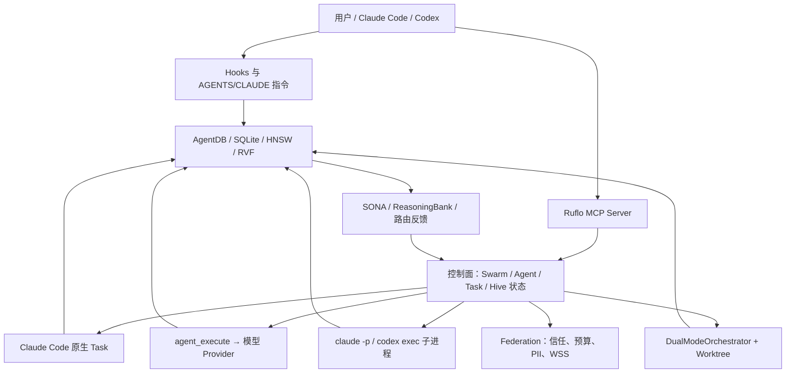
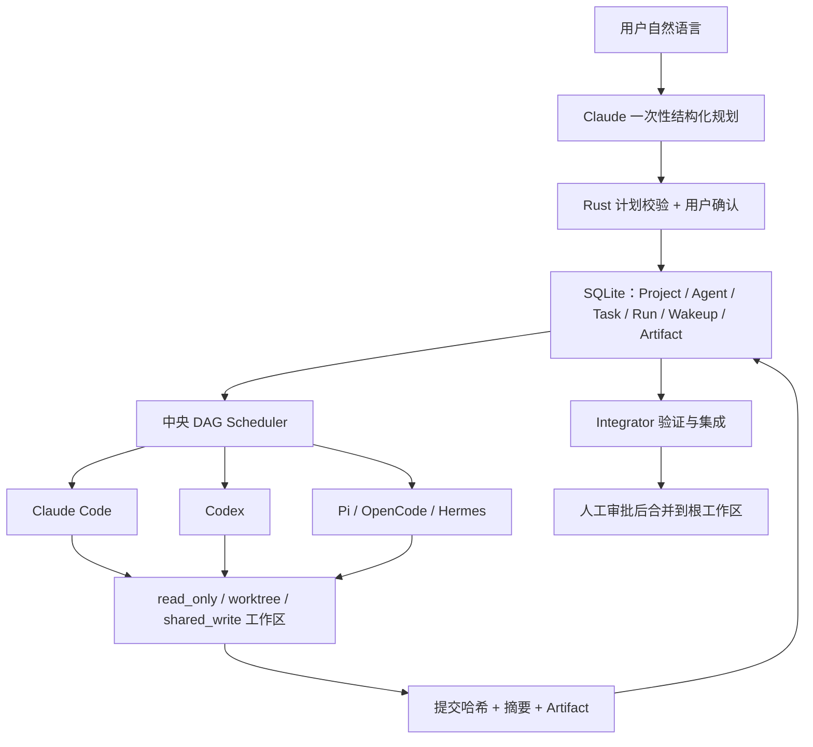

# Ruflo 多 Agent 协作实现研究

> 研究时间：2026-08-07  
> 源码基线：`ruvnet/ruflo` 的 `main` 分支提交 [`913f9eaedee92627950544424e50339feaf98271`](https://github.com/ruvnet/ruflo/tree/913f9eaedee92627950544424e50339feaf98271)，提交日期 2026-08-01，根包版本 3.34.0。  
> 证据范围：Ruflo 官方仓库、仓库内 README/ADR/源码，以及 Cognitum.One 官方页面。未采用第三方教程或媒体文章。

## 一、结论

Ruflo 不是一个“自己拥有一组常驻 LLM 进程的 Agent 平台”，而是包在 Claude Code、Codex、无头 CLI 和模型 API 外面的 **Agent 元编排器（meta-harness）**。它把多 Agent 协作拆成四个平面：

1. **控制面**：MCP 工具注册 Swarm、Agent、Task、Hive、共识与状态；Claude/Codex 通过 MCP 调用这些能力。
2. **执行面**：真正的模型工作由 Claude Code 原生 Task、`agent_execute` 的真实模型 API 调用、`claude -p`/`codex exec` 子进程，或 dual-mode orchestrator 执行。
3. **协作数据面**：进程内消息总线、项目内 JSON 状态、AgentDB/SQLite/HNSW/RVF 共享记忆，以及跨机器 federation 的 WebSocket 传输。
4. **学习与治理面**：hooks 采集任务轨迹，AgentDB/SONA/ReasoningBank 保存经验，模型路由器基于结果更新；同时提供预算、信任、审计、工作树隔离与故障恢复。

官方 README 自己将 Ruflo 定义为 Claude Code/Codex 外层的 harness，并给出 `User → CLI/MCP → Router → Swarm → Agents → Memory → LLM Providers` 的闭环，而不是把 Ruflo 描述成模型本身。[README：定义与总架构](https://github.com/ruvnet/ruflo/blob/913f9eaedee92627950544424e50339feaf98271/README.md#L29-L43)

最重要的实现事实是：**当前代码里“登记/协调”和“执行”是分开的**。

- `swarm_init` 创建并持久化一条 Swarm 记录，保存 topology、maxAgents、strategy 等字段；它本身没有实例化 `UnifiedSwarmCoordinator`，也没有启动 Agent。[`swarm_init` 处理器](https://github.com/ruvnet/ruflo/blob/913f9eaedee92627950544424e50339feaf98271/v3/%40claude-flow/cli/src/mcp-tools/swarm-tools.ts#L247-L341)
- `agent_spawn` 创建 Agent 元数据、选择模型、写入 Agent/Swarm 状态，返回值明确写着 `status: registered`，并告知调用者还需要走 `agent_execute`、Claude Code Task 或 `claude -p` 三条执行路径。[`agent_spawn` 处理器](https://github.com/ruvnet/ruflo/blob/913f9eaedee92627950544424e50339feaf98271/v3/%40claude-flow/cli/src/mcp-tools/agent-tools.ts#L276-L438)
- `agent_execute` 才会读取已注册 Agent，设为 busy，通过 provider router 调用真实模型 API，完成后更新 `taskCount`、`lastResult` 和模型路由反馈。[`executeAgentTask`](https://github.com/ruvnet/ruflo/blob/913f9eaedee92627950544424e50339feaf98271/v3/%40claude-flow/cli/src/mcp-tools/agent-execute-core.ts#L477-L701)
- 真正的多进程并行位于 Codex dual-mode adapter：它用 `child_process.spawn` 启动 `claude -p` 或 `codex exec`，把共享记忆路径、Agent 身份和工作树注入子进程。[`DualModeOrchestrator`](https://github.com/ruvnet/ruflo/blob/913f9eaedee92627950544424e50339feaf98271/v3/%40claude-flow/codex/src/dual-mode/orchestrator.ts#L75-L228)

因此，Ruflo 更准确的描述是：**它是“协调状态机 + 执行适配器 + 共享记忆 + 学习反馈 + 安全治理”的组合，而不是单一 Swarm 类。**

## 二、总体架构

### 2.1 两套容易混淆的协调实现

仓库中同时存在两类协调代码：

1. **`@claude-flow/swarm` 核心库**：内存中的 `UnifiedSwarmCoordinator`、`TopologyManager`、`MessageBus`、`AgentPool`、Raft/PBFT/Gossip 等，提供完整领域模型和事件驱动协调能力。[Swarm 包入口](https://github.com/ruvnet/ruflo/tree/913f9eaedee92627950544424e50339feaf98271/v3/%40claude-flow/swarm/src)
2. **CLI/MCP 的项目状态实现**：`swarm-tools.ts`、`agent-tools.ts`、`task-tools.ts`、`hive-mind-tools.ts` 直接读写 `.claude-flow/**` JSON，并由 Claude/Codex/外部调用者驱动执行。[CLI MCP 工具目录](https://github.com/ruvnet/ruflo/tree/913f9eaedee92627950544424e50339feaf98271/v3/%40claude-flow/cli/src/mcp-tools)

当前生产入口 `ruflo mcp start` 暴露的是后一套 MCP 工具。核心 Swarm 库是可复用的运行时组件，但不能假定每次 `swarm_init` 都已经启动了该运行时。这个分层解释了为什么 README 中的能力很丰富，而某些 MCP 路径仍然只是持久化“协调意图”。

## 三、Agent 生命周期

### 3.1 MCP 路径的真实生命周期

生命周期主线是：

`registered → idle → busy → idle → terminated`

Agent 记录包含类型、状态、健康度、任务数、模型层级、具体模型 ID、provider、最近结果，以及可选的每 Agent COW 记忆分支；主存储是 `.claude-flow/agents/store.json`。Hive worker 另存于 `.claude-flow/agents.json`，读取时进行合并。[`AgentRecord` 与存储路径](https://github.com/ruvnet/ruflo/blob/913f9eaedee92627950544424e50339feaf98271/v3/%40claude-flow/cli/src/mcp-tools/agent-tools.ts#L15-L120)

具体过程：

1. `agent_spawn` 校验输入，根据 Agent 类型、任务和路由器选择模型，写入 Agent store，并把 Agent ID 幂等加入最近或指定 Swarm 的 `agents` 数组。[注册与 Swarm 关联](https://github.com/ruvnet/ruflo/blob/913f9eaedee92627950544424e50339feaf98271/v3/%40claude-flow/cli/src/mcp-tools/agent-tools.ts#L303-L376)
2. 若传入 `memoryBase`，为 Agent 创建独立的 Agentic COW/RVF 分支；这是可选、best-effort 的隔离机制，失败不会阻止 Agent 注册。[COW 分支创建](https://github.com/ruvnet/ruflo/blob/913f9eaedee92627950544424e50339feaf98271/v3/%40claude-flow/cli/src/mcp-tools/agent-tools.ts#L384-L406)
3. `agent_execute` 将 Agent 设为 busy、任务数加一，然后调用 provider。成功或失败后回到 idle，并记录结果与路由反馈。[执行状态转换](https://github.com/ruvnet/ruflo/blob/913f9eaedee92627950544424e50339feaf98271/v3/%40claude-flow/cli/src/mcp-tools/agent-execute-core.ts#L477-L579)
4. `agent_terminate` 删除/终止 Agent；若存在 COW 记忆分支，可选择 promote 合并到共享基线，否则丢弃分支。[终止工具与记忆处理](https://github.com/ruvnet/ruflo/blob/913f9eaedee92627950544424e50339feaf98271/v3/%40claude-flow/cli/src/mcp-tools/agent-tools.ts#L490-L540)

这里的 Agent 是“可被持续追踪的执行身份”，不是自动常驻进程。只有在调用具体执行适配器后才真正消耗模型推理。

### 3.2 核心 Swarm 库的生命周期

`UnifiedSwarmCoordinator.initialize()` 并行初始化 topology、message bus 和 consensus，创建 Agent pool，并启动 heartbeat、health、metrics 定时器。[初始化](https://github.com/ruvnet/ruflo/blob/913f9eaedee92627950544424e50339feaf98271/v3/%40claude-flow/swarm/src/unified-coordinator.ts#L195-L237)

Agent 注册时会同时：

- 写入 coordinator state；
- 加入 topology；
- 订阅 message bus；
- 加入 consensus engine。

见 [`registerAgent`](https://github.com/ruvnet/ruflo/blob/913f9eaedee92627950544424e50339feaf98271/v3/%40claude-flow/swarm/src/unified-coordinator.ts#L299-L348)。

另一个更偏 DDD 的 `AgentRegistry` 将 definition 与 runtime state 分开，显式实现 register、spawn、assign、complete、terminate、heartbeat；连续三次心跳缺失会把 Agent 置为 error。[`AgentRegistry` 生命周期](https://github.com/ruvnet/ruflo/blob/913f9eaedee92627950544424e50339feaf98271/v3/%40claude-flow/swarm/src/coordination/agent-registry.ts#L76-L235)、[健康检查](https://github.com/ruvnet/ruflo/blob/913f9eaedee92627950544424e50339feaf98271/v3/%40claude-flow/swarm/src/coordination/agent-registry.ts#L268-L327)

## 四、拓扑与编排

### 4.1 核心拓扑

`TopologyManager` 支持四种运行时拓扑：

| 拓扑 | 实现方式 |
|---|---|
| `mesh` | 节点成为 peer，初始连接最多 10 个现有节点；重平衡目标最多 5 条连接 |
| `hierarchical` | 第一个节点成为 queen，worker 连接 queen |
| `centralized` | 第一个节点成为 coordinator，其他节点连接 coordinator |
| `hybrid` | coordinator/queen 层 + worker 局部 mesh |

证据见 [`TopologyType`](https://github.com/ruvnet/ruflo/blob/913f9eaedee92627950544424e50339feaf98271/v3/%40claude-flow/swarm/src/types.ts#L33-L44)、[初始连接规则](https://github.com/ruvnet/ruflo/blob/913f9eaedee92627950544424e50339feaf98271/v3/%40claude-flow/swarm/src/topology-manager.ts#L311-L366) 和 [四类 rebalance](https://github.com/ruvnet/ruflo/blob/913f9eaedee92627950544424e50339feaf98271/v3/%40claude-flow/swarm/src/topology-manager.ts#L438-L557)。

leader 规则不是复杂选举器：hierarchical 直接选 queen，centralized 直接选 coordinator，mesh/hybrid 按角色优先级选择活跃节点。[`electLeader`](https://github.com/ruvnet/ruflo/blob/913f9eaedee92627950544424e50339feaf98271/v3/%40claude-flow/swarm/src/topology-manager.ts#L190-L240)

CLI 的 `swarm_init` 接受更多产品级标签，如 hierarchical-mesh、ring、star、adaptive、pheromone-adaptive，但当前处理器主要把 topology 作为持久化策略字段；其中 pheromone-adaptive 会建立基于任务成功率、延迟和共识一致性的 EMA 调度门。[`swarm_init` topology schema](https://github.com/ruvnet/ruflo/blob/913f9eaedee92627950544424e50339feaf98271/v3/%40claude-flow/cli/src/mcp-tools/swarm-tools.ts#L249-L340)

### 4.2 Queen 编排

`QueenCoordinator` 是高级策略层：分析任务、按任务类型拆分子任务、匹配历史 pattern、给 Agent 打分、生成并行委派计划、监控域/Agent 健康度，并对高风险决策触发共识。[`QueenCoordinator` 能力与依赖](https://github.com/ruvnet/ruflo/blob/913f9eaedee92627950544424e50339feaf98271/v3/%40claude-flow/swarm/src/queen-coordinator.ts#L494-L566)

它的委派不是单一 LLM prompt，而是显式结构：`TaskAnalysis → DelegationPlan → primary assignment + parallel assignments + execution strategy`。[任务分析](https://github.com/ruvnet/ruflo/blob/913f9eaedee92627950544424e50339feaf98271/v3/%40claude-flow/swarm/src/queen-coordinator.ts#L588-L699)、[委派](https://github.com/ruvnet/ruflo/blob/913f9eaedee92627950544424e50339feaf98271/v3/%40claude-flow/swarm/src/queen-coordinator.ts#L1100-L1159)

### 4.3 当前自动编排边界

必须区分“库中存在策略类”和“默认 MCP 调用已自动执行”。当前代码明确承认：

- `coordination_orchestrate` 只保存 orchestration 记录，返回 `executor: none`，真实执行要改用 `agent_spawn + Task` 或 hive-mind。[源码中的诚实 stub](https://github.com/ruvnet/ruflo/blob/913f9eaedee92627950544424e50339feaf98271/v3/%40claude-flow/cli/src/mcp-tools/coordination-tools.ts#L720-L765)
- `hooks_teammate-idle` 目前只确认 idle 事件并返回 waiting；自动分配仍依赖尚未接通的 task-queue consumer。[`hooks_teammate-idle`](https://github.com/ruvnet/ruflo/blob/913f9eaedee92627950544424e50339feaf98271/v3/%40claude-flow/cli/src/mcp-tools/hooks-tools.ts#L5016-L5044)

因此，Ruflo 当前最可靠的多 Agent 执行路径仍是由上层 Agent/用户显式组合 MCP 控制操作与真实执行器，而不是仅调用一次“orchestrate”就全自动完成。

## 五、任务调度

核心库提供两级调度机制。

### 5.1 基于能力和负载的即时分配

`UnifiedSwarmCoordinator.submitTask()` 创建任务后查找 idle Agent，按以下因素评分：

- task type 与 Agent type 是否匹配；
- 当前 workload；
- health；
- 历史 successRate。

最高分 Agent 被设为 busy，任务设为 assigned，并通过 message bus 发送 `task_assign`。[任务创建和分配](https://github.com/ruvnet/ruflo/blob/913f9eaedee92627950544424e50339feaf98271/v3/%40claude-flow/swarm/src/unified-coordinator.ts#L390-L431)、[评分函数](https://github.com/ruvnet/ruflo/blob/913f9eaedee92627950544424e50339feaf98271/v3/%40claude-flow/swarm/src/unified-coordinator.ts#L742-L815)

域级调度把 Agent 分成 queen/security/core/integration/support pool；没有可用 Agent 时进入域队列。`executeParallel()` 先提交全部任务，再用 `Promise.allSettled` 并行等待各域结果。[域队列与分配](https://github.com/ruvnet/ruflo/blob/913f9eaedee92627950544424e50339feaf98271/v3/%40claude-flow/swarm/src/unified-coordinator.ts#L1101-L1170)、[并行执行](https://github.com/ruvnet/ruflo/blob/913f9eaedee92627950544424e50339feaf98271/v3/%40claude-flow/swarm/src/unified-coordinator.ts#L1188-L1241)

### 5.2 DAG 与优先级调度

`TaskOrchestrator` 维护 dependency graph 和 reverse dependent graph，拒绝成环依赖；任务只有在依赖完成后才能排队。可运行任务按 critical/high/medium/low，再按创建时间排序；指定 Agent 时再按 capability 过滤。[任务创建与状态机](https://github.com/ruvnet/ruflo/blob/913f9eaedee92627950544424e50339feaf98271/v3/%40claude-flow/swarm/src/coordination/task-orchestrator.ts#L101-L237)、[依赖与优先队列](https://github.com/ruvnet/ruflo/blob/913f9eaedee92627950544424e50339feaf98271/v3/%40claude-flow/swarm/src/coordination/task-orchestrator.ts#L279-L407)

CLI MCP 的 `task_*` 工具则提供较轻量、跨会话的 JSON 任务表，存储在 `.claude-flow/tasks/store.json`；它支持创建、分配、完成、取消和 retry，但执行仍由调用方触发。[实际 Task store](https://github.com/ruvnet/ruflo/blob/913f9eaedee92627950544424e50339feaf98271/v3/%40claude-flow/cli/src/mcp-tools/task-tools.ts#L1-L68)

## 六、通信与共享记忆

### 6.1 进程内消息总线

`MessageBus` 为每个 Agent 维护优先级队列，优先级顺序为 urgent/high/normal/low，支持 direct、broadcast、TTL、filter、ack、批量投递和重试。[队列与订阅](https://github.com/ruvnet/ruflo/blob/913f9eaedee92627950544424e50339feaf98271/v3/%40claude-flow/swarm/src/message-bus.ts#L223-L383)、[投递与 ack](https://github.com/ruvnet/ruflo/blob/913f9eaedee92627950544424e50339feaf98271/v3/%40claude-flow/swarm/src/message-bus.ts#L405-L509)

它是进程内 `EventEmitter + Map` 实现。配置中虽然有 `enablePersistence`，但当前类没有对应持久化读写；shutdown 会清空队列。因此它不应被视为跨进程可靠消息队列。[配置与 shutdown](https://github.com/ruvnet/ruflo/blob/913f9eaedee92627950544424e50339feaf98271/v3/%40claude-flow/swarm/src/message-bus.ts#L238-L292)

### 6.2 AgentDB/SQLite/HNSW/RVF 记忆

Ruflo 的长期协作主要依赖记忆层，而不是消息总线：

- `HybridBackend` 同时写 SQLite 与 AgentDB；精确/结构化查询走 SQLite，语义向量查询走 AgentDB/HNSW。[`HybridBackend`](https://github.com/ruvnet/ruflo/blob/913f9eaedee92627950544424e50339feaf98271/v3/%40claude-flow/memory/src/hybrid-backend.ts#L149-L231)
- Memory service 在关闭时保存 HNSW sidecar，重开时恢复；损坏时标记 corrupt 并退化为 fresh state。[Memory README：HNSW 持久化](https://github.com/ruvnet/ruflo/blob/913f9eaedee92627950544424e50339feaf98271/v3/%40claude-flow/memory/README.md#L199-L235)
- `AutoMemoryBridge` 在 SessionStart 从 Claude auto-memory 导入 AgentDB，在 SessionEnd/Stop 将洞见同步回 Markdown，形成“人可读文件 ↔ 向量记忆”的双向桥。[`AutoMemoryBridge`](https://github.com/ruvnet/ruflo/blob/913f9eaedee92627950544424e50339feaf98271/v3/%40claude-flow/memory/src/auto-memory-bridge.ts#L184-L413)
- Agent memory 具有 project/local/user 三种 scope，并支持把高置信知识转移到另一个 Agent scope。[`agent-memory-scope.ts`](https://github.com/ruvnet/ruflo/blob/913f9eaedee92627950544424e50339feaf98271/v3/%40claude-flow/memory/src/agent-memory-scope.ts#L100-L185)、[跨 Agent transfer](https://github.com/ruvnet/ruflo/blob/913f9eaedee92627950544424e50339feaf98271/v3/%40claude-flow/memory/src/agent-memory-scope.ts#L185-L268)
- `PersistentSonaCoordinator` 把 pattern、trajectory 与 EWC state 保存到 RVF，并按周期自动持久化。[`PersistentSonaCoordinator`](https://github.com/ruvnet/ruflo/blob/913f9eaedee92627950544424e50339feaf98271/v3/%40claude-flow/memory/src/persistent-sona.ts#L106-L169)、[持久化与 shutdown](https://github.com/ruvnet/ruflo/blob/913f9eaedee92627950544424e50339feaf98271/v3/%40claude-flow/memory/src/persistent-sona.ts#L318-L345)

### 6.3 多进程共享方式

Dual-mode worker 不共享对话上下文，而是通过统一 namespace 的 memory CLI 读写摘要。orchestrator 会把“先搜索共享记忆、完成任务、再写回结果”的协议注入每个 worker prompt。[worker 协作 prompt](https://github.com/ruvnet/ruflo/blob/913f9eaedee92627950544424e50339feaf98271/v3/%40claude-flow/codex/src/dual-mode/orchestrator.ts#L269-L287)

这是一种“共享黑板（blackboard）”协作：Agent 之间不复制完整上下文，而是交换可检索的任务事实、结果和 pattern。

## 七、共识

### 7.1 核心共识引擎

`ConsensusEngine` 对外统一 Raft、Byzantine/PBFT、Gossip；`paxos` 目前直接回退到 Raft，并非独立 Paxos 实现。[算法选择器](https://github.com/ruvnet/ruflo/blob/913f9eaedee92627950544424e50339feaf98271/v3/%40claude-flow/swarm/src/consensus/index.ts#L52-L120)

- Raft 实现 follower/candidate/leader、随机选举超时、RequestVote、AppendEntries、日志复制和多数提交。[`RaftConsensus`](https://github.com/ruvnet/ruflo/blob/913f9eaedee92627950544424e50339feaf98271/v3/%40claude-flow/swarm/src/consensus/raft.ts#L50-L150)
- Byzantine 实现 pre-prepare/prepare/commit 三阶段，并以 `2f+1` commit 判断提交。[`ByzantineConsensus`](https://github.com/ruvnet/ruflo/blob/913f9eaedee92627950544424e50339feaf98271/v3/%40claude-flow/swarm/src/consensus/byzantine.ts#L53-L120)、[commit 阈值](https://github.com/ruvnet/ruflo/blob/913f9eaedee92627950544424e50339feaf98271/v3/%40claude-flow/swarm/src/consensus/byzantine.ts#L371-L399)
- Gossip 以 fanout、周期传播、消息去重和 convergence threshold 实现最终一致性。[`GossipConsensus`](https://github.com/ruvnet/ruflo/blob/913f9eaedee92627950544424e50339feaf98271/v3/%40claude-flow/swarm/src/consensus/gossip.ts#L90-L165)

三者都可以注入 `ConsensusTransport`；transport 提供 send、broadcast、onMessage、peer 列表，并支持 Ed25519 签名与 replay 防护。[`ConsensusTransport`](https://github.com/ruvnet/ruflo/blob/913f9eaedee92627950544424e50339feaf98271/v3/%40claude-flow/swarm/src/consensus/transport.ts#L35-L79)、[签名与验证](https://github.com/ruvnet/ruflo/blob/913f9eaedee92627950544424e50339feaf98271/v3/%40claude-flow/swarm/src/consensus/transport.ts#L86-L145)

但 `UnifiedSwarmCoordinator` 创建 `ConsensusEngine` 时只传算法与通用 config，没有注入 federation transport；默认仍是单进程协调。仓库 ADR-095 也明确记录：transport 抽象已经落地，但跨进程 transport 需要 wiring layer 提供。[ADR-095 G2 状态更新](https://github.com/ruvnet/ruflo/blob/913f9eaedee92627950544424e50339feaf98271/v3/docs/adr/ADR-095-architectural-gaps-from-april-audit.md#L182-L194)

### 7.2 Hive MCP 共识

`hive-mind_consensus` 是另一条更轻量的应用级路径：proposal/vote/history 写入 JSON，支持 bft/raft/quorum 标签、防重复投票、检测矛盾票、计算阈值，并把已决结果 best-effort 写到 AgentDB。[Hive 共识处理器](https://github.com/ruvnet/ruflo/blob/913f9eaedee92627950544424e50339feaf98271/v3/%40claude-flow/cli/src/mcp-tools/hive-mind-tools.ts#L525-L750)

它不是一个持续运行的分布式 Raft 集群，而是 MCP 调用驱动、文件持久化的共识状态机。实际部署时必须明确自己采用的是“网络协议共识”还是“应用层投票记录”。

## 八、持久化与故障恢复

Ruflo 使用多层恢复，而不是一个统一数据库：

| 故障类型 | 恢复机制 |
|---|---|
| Swarm 宿主异常退出 | Swarm state 记录可选 PID；每次 load 时检查 PID，旧记录无 PID 时按 24 小时 TTL 回收 orphan |
| 并发写 Swarm state | `wx` 锁文件 + 10 秒 stale lock 回收 + 临时文件原子 rename |
| Agent 心跳丢失 | 核心 coordinator 三倍 heartbeat timeout 后降 health，达到阈值时重置 Agent 并重新分配任务 |
| 任务执行失败 | 核心任务按 `maxRetries` 重新排队；CLI `task_retry` 克隆原任务生成新任务，保留历史 |
| Provider 瞬时错误 | 对 429、5xx、timeout 按成本最优候选做有限 fallback，并记录 fallbackHistory |
| 向量索引损坏 | HNSW sidecar 恢复失败时标记 corrupt，退回 fresh state；关键词检索可退化到 FTS5 |
| 多 Agent 写代码冲突 | 每个 writer 独立 git worktree/branch，集成阶段按 run registry 合并 |

Swarm 原子状态与 orphan 回收见 [`swarm-tools.ts`](https://github.com/ruvnet/ruflo/blob/913f9eaedee92627950544424e50339feaf98271/v3/%40claude-flow/cli/src/mcp-tools/swarm-tools.ts#L32-L190)。核心心跳恢复见 [`checkHeartbeats` / `recoverAgent`](https://github.com/ruvnet/ruflo/blob/913f9eaedee92627950544424e50339feaf98271/v3/%40claude-flow/swarm/src/unified-coordinator.ts#L956-L994)。provider fallback 见 [`executeAgentTask`](https://github.com/ruvnet/ruflo/blob/913f9eaedee92627950544424e50339feaf98271/v3/%40claude-flow/cli/src/mcp-tools/agent-execute-core.ts#L533-L577)。工作树隔离见 [`CodexWorktreeCoordinator`](https://github.com/ruvnet/ruflo/blob/913f9eaedee92627950544424e50339feaf98271/v3/%40claude-flow/codex/src/worktrees/coordinator.ts#L34-L139)。

## 九、Claude Code、Codex、CLI 与 MCP 集成

### 9.1 Claude Code

完整 `init` 会生成 `.claude/`、`.claude-flow/` 和 `CLAUDE.md`，注册 MCP server 并安装 hooks；仅安装 Claude plugin 只得到 slash command/skill/Agent 定义，不会注册 MCP，也没有完整的 memory/swarm loop。[README：两种安装面的区别](https://github.com/ruvnet/ruflo/blob/913f9eaedee92627950544424e50339feaf98271/README.md#L47-L66)

生成的 Claude hooks 包括：

- PreToolUse：Bash 与 Edit/Write 前校验；
- PostToolUse：记录编辑和命令结果；
- UserPromptSubmit：任务/模型路由；
- SessionStart：恢复 session，并导入 auto-memory；
- SessionEnd/Stop：持久化 session、同步记忆；
- SubagentStart/SubagentStop：记录原生子 Agent 生命周期。

见 [`settings-generator.ts`](https://github.com/ruvnet/ruflo/blob/913f9eaedee92627950544424e50339feaf98271/v3/%40claude-flow/cli/src/init/settings-generator.ts#L290-L466)。

Hooks 能注入路由与记忆提示、记录轨迹，但不能替代 Claude Code 对 MCP/Task 工具的实际调用；所以项目同时用 `CLAUDE.md` 行为规则要求上层模型在复杂任务中显式组合 MCP 与 Task。[仓库 CLAUDE.md 的编排规则](https://github.com/ruvnet/ruflo/blob/913f9eaedee92627950544424e50339feaf98271/CLAUDE.md#L28-L62)

### 9.2 Codex

`init --codex` 生成 `AGENTS.md`、`.agents/config.toml`、skills 和 `.codex/config.toml`，并通过 `codex mcp add ruflo -- npx -y ruflo@latest mcp start` 注册 MCP。[Codex initializer](https://github.com/ruvnet/ruflo/blob/913f9eaedee92627950544424e50339feaf98271/v3/%40claude-flow/codex/src/initializer.ts#L49-L213)、[MCP 配置生成](https://github.com/ruvnet/ruflo/blob/913f9eaedee92627950544424e50339feaf98271/v3/%40claude-flow/codex/src/mcp-config.ts#L7-L108)

Codex adapter README 对职责边界写得很清楚：`Codex does the work. Claude-flow coordinates and learns`；并明确“代码由 Codex 执行，MCP 工具主要用于学习与协调”。[Codex README：职责边界](https://github.com/ruvnet/ruflo/blob/913f9eaedee92627950544424e50339feaf98271/v3/%40claude-flow/codex/README.md#L17-L38)、[执行流程](https://github.com/ruvnet/ruflo/blob/913f9eaedee92627950544424e50339feaf98271/v3/%40claude-flow/codex/README.md#L175-L208)

### 9.3 MCP 与 CLI

Claude/Codex 都通过 stdio MCP 启动同一套 CLI MCP server；CLI 命令也可通过内置 MCP client 调用同一 handler。这使状态与行为尽量复用，但也意味着 MCP handler 是否真正接到执行器，决定了能力是真执行还是只记状态。

MCP 的主要价值不是“多开模型”本身，而是给不同宿主提供统一控制协议：Agent 注册/执行、Swarm 状态、Task、Memory、Hooks、Hive、Federation、Security 等。

## 十、跨机器 Federation

Federation 是 Ruflo 中真正处理跨进程/跨机器协作的层。官方 user guide 描述五级信任梯、per-peer 预算和 circuit breaker、PII pipeline、审计，以及 WSS/可选 WireGuard mesh。[Federation user guide](https://github.com/ruvnet/ruflo/blob/913f9eaedee92627950544424e50339feaf98271/docs/federation/README.md#L1-L16)

核心安全与传输机制包括：

- Ed25519 身份与签名；
- UNTRUSTED → VERIFIED → ATTESTED → TRUSTED → PRIVILEGED 的能力门；
- 每个 envelope 经过 PII policy；
- token/USD/maxHops 预算传播；
- peer ACTIVE/SUSPENDED/EVICTED circuit breaker；
- WebSocket/WSS fallback，支持证书 pinning；原生 QUIC 仍是后续目标；
- 可选 WireGuard mesh，使 federation trust 降级能联动 L3 隔离。

实现状态见 [ADR-104：WSS transport](https://github.com/ruvnet/ruflo/blob/913f9eaedee92627950544424e50339feaf98271/v3/docs/adr/ADR-104-federation-wire-transport.md#L35-L88)、[ADR-107：TLS 与 pinning](https://github.com/ruvnet/ruflo/blob/913f9eaedee92627950544424e50339feaf98271/v3/docs/adr/ADR-107-federation-tls.md#L148-L157)、[ADR-097：预算与 breaker](https://github.com/ruvnet/ruflo/blob/913f9eaedee92627950544424e50339feaf98271/v3/docs/adr/ADR-097-federation-budget-circuit-breaker.md#L131-L156)。

这层最值得注意的设计是：**先把信任、预算、审计、PII 和 transport 做成独立策略服务，再允许远端 Agent 委派**，而不是把跨机器协作等同于开放一个未受控 RPC。

## 十一、Cognitum.One 与 Ruflo 的关系

官方资料能够确认三层关系，但不能据此推导出更多未公开事实：

1. Ruflo README 明确写着底层由 Cognitum.One agentic architecture 支持，并使用 Rust AI engine、embeddings、memory 和 plugin system；README 也把 Cognitum.One 列为 Powered by。[Ruflo README](https://github.com/ruvnet/ruflo/blob/913f9eaedee92627950544424e50339feaf98271/README.md#L39-L43)、[支持信息](https://github.com/ruvnet/ruflo/blob/913f9eaedee92627950544424e50339feaf98271/README.md#L404-L413)
2. Cognitum 官方 [`ruFlo` 产品页](https://cognitum.one/ruvstack/ruflo) 将 ruFlo 定位为 Cognitum/RuvStack 的多 Agent 编排层：Swarm 负责协调多个 Agent；首页把 ruFlo 放在 RuvStack 的 Intelligence Layer / Reason 步骤，并将平台协议表述为 MCP 与 A2A。[Cognitum.One 首页](https://cognitum.one/)
3. 开源仓库还包含 `@claude-flow/plugin-iot-cognitum`：把每台 Cognitum Seed 设备建模为 Ruflo Agent，并通过 `@cognitum-one/sdk` 接入设备向量、trust、witness、fleet 等能力。[IoT Cognitum plugin README](https://github.com/ruvnet/ruflo/blob/913f9eaedee92627950544424e50339feaf98271/v3/%40claude-flow/plugin-iot-cognitum/README.md#L1-L11)、[包依赖](https://github.com/ruvnet/ruflo/blob/913f9eaedee92627950544424e50339feaf98271/v3/%40claude-flow/plugin-iot-cognitum/package.json#L1-L25)

Cognitum 的 ruFlo 页面另列出 4 个已认证工具的 Toolpack 源契约，但当前只标注为 target-only；页面没有公开 endpoint、可调用的 MCP/A2A 接口、商业可用性或部署授权。因此合理结论是：

- **Cognitum 是上层产品/架构品牌，Ruflo 是其中的多 Agent 编排层，也是公开源码实现。**
- **GitHub Ruflo 与 Cognitum 产品叙述有关联，但不能把 Cognitum 页面中的目标能力自动视为当前开源仓库已可调用的服务。**
- **产品页上的 MCP/A2A/Toolpack 描述与开源代码应分别验证。**

## 十二、实现成熟度与风险边界

### 已经真实落地、可直接借鉴

- MCP 控制协议与宿主解耦；
- Agent/Swarm/Task 跨会话状态；
- `agent_execute` 的真实 provider 调用和有限 fallback；
- Claude/Codex 双宿主适配；
- 子进程并行与工作树隔离；
- AgentDB/SQLite/HNSW/RVF 共享记忆；
- hooks 驱动的轨迹记录和路由反馈；
- federation 的身份、信任、预算、PII、breaker 和 WSS transport。

### 不能按产品文案直接假定

- `agent_spawn` 不等于已经启动独立进程；它首先是注册操作。
- `swarm_init` 不等于已启动核心 `UnifiedSwarmCoordinator`。
- `coordination_orchestrate` 当前没有 executor。
- `hooks_teammate-idle` 当前没有真正消费任务队列。
- 核心 `MessageBus` 是进程内的，且 persistence 配置未落地。
- Paxos 只是 Raft fallback。
- Hive MCP 的共识是文件驱动的应用层投票，不是默认跨机器 Raft/PBFT。
- 核心 consensus 支持 transport 注入，不代表默认 coordinator 已接入 federation transport。

## 十三、可借鉴的设计

### 13.1 首先借鉴：控制面与执行面分离

不要让“Agent 身份、权限、记忆、任务状态”绑死某一种模型执行方式。像 Ruflo 一样，让同一 Agent record 可以被原生子 Agent、模型 API、CLI 子进程或远端节点执行。这样模型供应商、宿主和并发方式可以替换。

但 API 命名应比 Ruflo 更严格：若只是登记，建议叫 `registerAgent`；只有确实创建进程/会话时才叫 `spawnAgent`。

### 13.2 建立唯一的协作状态模型

Ruflo 的主要技术债是存在多套并行状态：核心 Swarm 内存 Map、`.claude-flow/agents/store.json`、`.claude-flow/agents.json`、swarm-state、task store、hive state。借鉴其 schema、锁和原子写，但应在自己的项目中建立唯一 canonical store，并让 MCP、UI、scheduler、worker 都通过同一个 repository/service 访问。

### 13.3 把任务调度做成显式 DAG

值得直接采用：

- task dependency/reverse dependency；
- cycle detection；
- priority + FIFO；
- capability filtering；
- retry policy；
- task receipt/result/artifact；
- blocked/queued/assigned/running/completed/failed/cancelled 的严格状态机。

不要只靠 prompt 约定“先 A 后 B”，否则失败恢复和可观测性都很差。

### 13.4 共享黑板优于复制完整上下文

多 Agent 只共享经过结构化的事实、产物、决策与高置信 pattern；每个 Agent 保留自己的局部上下文。可采用：

- project/local/user 三层 scope；
- namespace 隔离；
- 高置信知识显式 transfer；
- COW 记忆分支，成功后 promote，失败则丢弃；
- 语义检索 + 精确查询双通道。

### 13.5 写代码的 Agent 必须隔离工作区

Ruflo 的 worktree coordinator 在并发 writer 前检查仓库是否干净，为每个 writer 建独立 branch/worktree，并保存 run registry；这是比“让多个 Agent 同时修改一个目录”稳健得多的做法。[worktree prepare/integrate/cleanup](https://github.com/ruvnet/ruflo/blob/913f9eaedee92627950544424e50339feaf98271/v3/%40claude-flow/codex/src/worktrees/coordinator.ts#L34-L139)

### 13.6 学习闭环必须绑定真实结果

Ruflo 会把 provider 成功/失败写回模型路由 Beta prior，并可记录 trajectory outcome；虽然“API 成功”还不是代码质量金标准，但已经比静态路由更好。[模型 outcome 反馈](https://github.com/ruvnet/ruflo/blob/913f9eaedee92627950544424e50339feaf98271/v3/%40claude-flow/cli/src/mcp-tools/agent-execute-core.ts#L581-L665)

更进一步的实现应把测试结果、代码审查结论、用户接受/回滚等作为 reward，而不是只看模型请求是否成功。

### 13.7 跨机器协作先做信任和预算

远端 Agent 不是普通 worker。应先实现：

- 节点身份与签名；
- replay 防护；
- 每 peer capability/trust；
- PII/secret 出站策略；
- token、费用、hop 上限；
- circuit breaker；
- 审计 trail；
- 可撤销的 operator override。

这比先做远端 spawn、之后再补安全更稳妥。

## 十四、建议的最小落地顺序

若要在现有项目中吸收 Ruflo 的设计，建议按以下顺序，而不是一次引入全部 Swarm 概念：

1. 统一 `AgentRun`、`Task`、`Artifact`、`Message`、`MemoryEntry` 状态模型。
2. 建一个单一持久化 repository，支持原子写、幂等、lease/heartbeat、orphan 回收。
3. 把当前执行器适配为统一 `Executor` 接口：原生子 Agent、CLI 子进程、模型 API。
4. 增加 DAG scheduler、capability matching、priority、retry 和 timeout。
5. 对并发 writer 引入 worktree 隔离和集成队列。
6. 增加共享 memory namespace 和 run receipt；先精确查询，再加向量检索。
7. 在真实测试/审查结果上闭合路由反馈。
8. 最后再加 mesh/queen、共识、federation；没有多节点强一致或跨信任域需求时，不要先上 Raft/PBFT。

## 十五、当前项目的多 Agent 协作实现

当前项目不是“Agent 自由聊天式”的 swarm，而是一个 **SQLite 持久化的中央 DAG 调度器 + 多 CLI 执行适配器 + Git worktree 交付流水线**。它已经把计划、调度、执行、产物交接、人工审批和恢复串成真实闭环。

### 15.1 计划与控制面

- 前端通过 Tauri 命令读取项目快照、提交自然语言意图、展示并确认计划；`MultiAgentControl.tsx` 以约 1 秒轮询刷新快照，并在确认后调用 `ma_apply_plan`、`ma_start_project`。
- Rust coordinator 把当前项目、Agent、Task、Run、Approval 和最近历史压进一次 `claude -p` 调用，使用 JSON Schema 约束输出；它不允许工具调用和会话持久化，因此本质是 **一次性规划器**，不是持续自治的总控 Agent。
- 服务端会再次校验 runtime mention、Agent 实例、依赖和跨 runtime 的审查/集成要求，避免仅依赖模型输出正确性。

主要代码：`src-tauri/src/multi_agent/coordinator.rs`、`src-tauri/src/lib.rs`、`src/components/MultiAgentControl.tsx`。

### 15.2 唯一状态源与任务模型

`domain.rs` 定义 Project、AgentProfile、Task、Run、Wakeup、Event、Session、CoordinatorPlan、Message、Artifact、Approval 等领域对象。`store.rs` 以 SQLite 为 canonical store，负责：

- 原子 claim、严格的 Run/Task 状态迁移；
- 依赖边与 runnable task 查询；
- 幂等 wakeup 入队和领取；
- run 完成、失败、重试、审批、集成交付；
- 启动时把异常中断的 active run 恢复为 interrupted，并按工作区类型决定任务可重试还是 blocked。

这点比 Ruflo 默认 MCP 路径分散在多个 JSON store、内存 Map 和 Hive state 更一致。

### 15.3 调度与实际执行

`MultiAgentSupervisor` 在后台运行 scheduler：从 SQLite 找可运行任务，按 Agent 并发额度原子 claim，然后为每个 Run 启动执行线程。执行器并非只登记 Agent，而是真的启动并管理 Claude Code、Codex、Pi、OpenCode、Hermes 五类 CLI。

- Claude/Codex 主要走可持续的原生交互会话、PTY 和 hooks；
- 其他 runtime 走各自结构化或 headless 命令适配；
- 每次执行统一产出 `RuntimeResult`，再由 store 完成 Run/Task 状态迁移并唤醒后继任务。

目前 scheduler 有一个明显的吞吐限制：每轮启动一批任务后，会等待本批所有 handle 结束才重新计算 DAG。快速任务的后继会被同批中无关的慢任务拖住；它还没有 Agent heartbeat/lease renewal 和自动 orphan reclaim 的完整闭环。

主要代码：`src-tauri/src/multi_agent/executor.rs` 中的 `MultiAgentSupervisor::schedule_until_idle`、`execute_run` 与 runtime adapter；`store.rs` 中的 `claim_task_for_agent`、`ensure_runnable_wakeups`、`finalize_run`。

### 15.4 代码协作与产物交接

当前项目真正的 Agent 间协作不是直接消息，而是 **DAG 依赖 + 结构化产物 + Git 提交链**：

- `read_only` 任务只读检查，结束时校验工作区保持干净；
- `worktree` 任务拥有独立 Git worktree，完成后自动 checkpoint commit；
- 下游任务收到依赖产物、摘要、哈希和必要的提交链，写任务可 cherry-pick 依赖提交；
- Integrator 负责最终验证和可审计提交；人工审批后才把交付合并到根工作区。

这使并行写入隔离、依赖交接和最终合并都可追踪。`ma_messages` 当前主要是 UI/审计记录；Agent 没有可直接调用的 inbox、`send_message`、`task.claim` 或 `artifact.publish` 工具，所以它仍是中央黑板式交接，不是点对点 Agent Team。

### 15.5 人工接管与恢复

- takeover 会把 Agent 控制模式切到 manual，阻止后续自动 claim，并把人工指令放入队列；当前正在执行的 Run 不会被即时打断，指令在下一次运行时一次性注入。
- 应用启动时会调用 `recover_interrupted_runs_at_startup`。只读任务可回到 ready；写任务为避免不明工作区继续写而转为 blocked，需要用户显式 retry。
- `lease_expires_at` 已写入数据，但当前没有续租、过期扫描、退避和 dead-letter，字段还没有形成完整故障恢复机制。

## 十六、两者对比

| 维度 | Ruflo | 当前项目 |
|---|---|---|
| 产品定位 | 通用 meta-harness，覆盖宿主、Provider、记忆、学习、Federation | 桌面端本地代码任务编排与安全交付 |
| 真实执行 | `agent_execute`、Claude Task、CLI 子进程、dual-mode；部分 MCP 操作只记状态 | 五类 CLI adapter 已接通真实进程、会话、工作区与结果回写 |
| canonical state | 多套 JSON、SQLite/AgentDB、内存运行时并存 | 单一 SQLite store，状态迁移更集中 |
| 调度 | topology、能力/负载、DAG、优先级、heartbeat；不同入口接通程度不一 | DAG + 依赖 + 原子 claim；缺能力路由、优先级和事件驱动续调度 |
| Agent 通信 | 进程内 MessageBus、Claude Agent Teams、共享 memory namespace | 依赖 Artifact/提交链交接，无 Agent 可调用的直接消息面 |
| 长期记忆 | SQLite + AgentDB/HNSW/RVF + scope/COW + SONA/ReasoningBank | 项目历史、Artifact、Session locator；无语义记忆与学习闭环 |
| 写入隔离 | dual-mode worktree coordinator | worktree、checkpoint、依赖提交链、Integrator、人工合并门已完整落地 |
| 恢复 | heartbeat、retry、provider fallback、orphan 回收，状态分散 | 启动恢复和显式 retry 稳健；lease/heartbeat/backoff 尚缺 |
| 跨机器 | Federation 有身份、信任、预算、PII、WSS | 当前只做本机，不需要先引入分布式共识 |

核心判断：**当前项目的执行与 Git 交付链比 Ruflo 默认 MCP 协调路径更具体、更闭环；Ruflo 的优势在统一宿主协议、Agent 可调用协作面、记忆/学习、能力路由和跨节点治理。** 最合理的方向不是替换现有 scheduler，而是在现有 SQLite 权威状态机和执行器之上增加 Ruflo 风格的协调协议。

## 十七、对当前项目的落地建议

### P0：先补可靠协作闭环

1. **增加本地协作 MCP/CLI bridge**：向正在运行的 Agent 暴露受权限约束的 `task.read/claim/complete`、`thread.read`、`message.send`、`artifact.publish/inspect`、`approval.request`、`heartbeat`。每个 Run 使用短期 token，只允许访问绑定的 project/task/agent/cwd；SQLite 仍是唯一事实源。
2. **把 scheduler 改成事件驱动**：任何 Run 完成、Agent idle 或依赖解除时立即重新调度，不等待整批线程结束；补 lease renewal、heartbeat、超时扫描、错误分类、指数退避、最大尝试次数和 dead-letter。
3. **统一执行事件协议**：定义 `RuntimeEvent`（message/tool/approval/diff/usage/status/artifact），优先接入 Codex app-server、ACP 或各 runtime 的结构化接口；PTY 仅保留为可视化和兼容回退。

### P1：增强路由、记忆与治理

4. **能力优先调度**：把 runtime 探测到的 tool、sandbox、session、structured-output、MCP 等能力进入 AgentProfile、计划校验和 scheduler；按任务需求、健康度、历史验证结果与成本选 Agent。
5. **建立受控共享记忆**：先做 project/task/agent/pattern/decision namespace 和精确检索，只将测试、审查或用户接受后的结果晋升为可复用知识；数据量和召回需求明确后再加向量索引。
6. **显式策略信封**：为每个 Run 固化可用工具、路径、网络、secret、费用、最大委派深度和审批点，所有越权与降级都写审计 receipt。
7. **将一次性 coordinator 升级为持久工具循环**：允许它查看 Task、Log、Artifact、Diff 并提出增量计划，但所有写操作仍通过 typed command 和 SQLite 状态机，不能绕过验证器。

### P2：需求出现后再做

8. 增加 named inbox、直接消息和 `AgentIdle`/`TaskCompleted` hook，让 Agent 能在权限范围内主动协作。
9. 多审查者场景只需简单 quorum/typed verdict；单机桌面应用没有必要先实现 Raft/PBFT、mesh 或 queen 选举。
10. 只有出现跨机器执行需求时再做 federation，并先补身份、预算、secret/PII 出站策略和 circuit breaker。
11. 前端从每秒全量 snapshot 轮询改为带 `after_seq` 的增量事件订阅，降低数据库与序列化开销。

### 建议的第一阶段改造边界

第一阶段只做三件事：**协作 bridge、事件驱动调度、统一 RuntimeEvent**。它们能让现有“中央 DAG 交接”升级为真正可观察、可唤醒、可恢复的 Agent 协作，同时保留当前项目已经做得更好的 worktree、提交链、Integrator 和人工审批安全边界。
